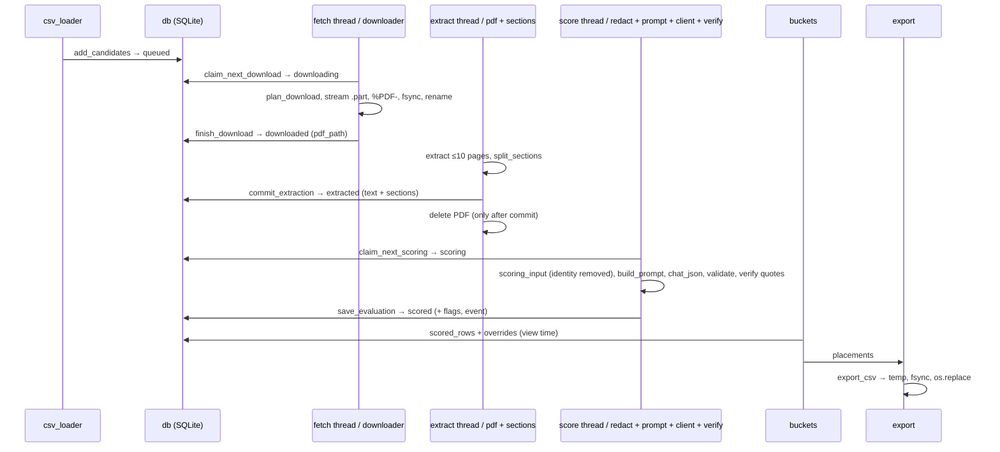

# Phase 1 Summary — the Atlas engine

## 1. Overview
Atlas's engine now screens résumés end to end with no UI. A recruiter's CSV is validated and shown as a pre-flight report. Each student's résumé link is downloaded safely, whether it's Google Drive, a private link, a 25 MB file or a sign-in page. The PDF is turned into text and named sections (up to 10 pages, with OCR for scanned pages if installed). A local Ollama model scores it against the recruiter's criteria, with the student's identity removed, résumé text fenced as untrusted data, and every evidence quote checked against the real text. Candidates are then bucketed into Shortlisted / Cutoff / Rejected at view time and exported as an Excel-safe CSV. Everything is driven by three threads that communicate only through SQLite, so the process can be killed at any instant and resumes with nothing lost or duplicated. A lost internet connection or a stopped Ollama pauses the run without failing anyone, and it resumes by itself. `python -m engine.cli` exposes all of it. The suite has **257 tests** (1 opt-in live test skipped), including a real-worker kill test that runs on Windows.

## 2. One candidate, from CSV row to exported line
Take Priya, row 7 of `students.csv`: `Priya Sharma, RA2111003010007, 8.4, priya@…, +91 98765 43210, CSE, "Python, Docker", https://drive.google.com/file/d/1AbC…/view`.

1. **`ingest/csv_loader.load_csv`**: headers matched ("Mail ID" → `email`), phone normalised to `9876543210`, RA upper-cased, CGPA 8.4. The row appears in the pre-flight report. Nothing is written yet.
2. **`cli run` → `db.add_candidates`**: after "Continue? y" and the model pre-check, Priya is a row with `state = queued`.
3. **`worker.start`**: hard filters (she passes), crash recovery, run → `running`.
4. **Fetch thread → `db.claim_next_download`** (gate ≤ 2 in flight): `queued → downloading`.
5. **`ingest/downloader.Downloader.fetch`**:
   - `links.plan_download` rewrites the link to `drive.usercontent.google.com/download?id=1AbC…`;
   - the body streams to `downloads/7.part` (≤ 20 MB) and `%PDF-` is checked;
   - `fsync` and rename to `7.pdf`.

   Then `db.finish_download`: `downloading → downloaded`, `pdf_path` set.
6. **Extract thread → `extract/pdf.PdfExtractor.extract`** (≤ 10 pages, OCR for text-less pages) → `extract/sections.split_sections`. Then **`db.commit_extraction`**: text + sections + `downloaded → extracted` in one transaction. **Only then** is `7.pdf` deleted.
7. **Score thread → `db.claim_next_scoring`**: `extracted → scoring`.
8. **`llm/redact.scoring_input`**: drops the `header` and `personal` sections, and replaces "Priya", "Sharma", her email, phone, RA number and section code with placeholders. Only CGPA, department and her claimed skills (to verify) remain.
9. **`llm/scorer.Scorer.score`**:
   - `llm/prompt.build_prompt` puts Projects first within the budget, fenced in `<resume>`;
   - `llm/client.OllamaClient.chat_json` makes a streamed, schema-constrained call;
   - `llm/schema.parse_evaluation` validates the answer;
   - `llm/verify.review` drops invented quotes and flags injection text;
   - retries happen as needed.
10. **`db.save_evaluation`**: evaluation + flags + `scoring → scored` in one transaction, plus a "Scored 78" event (the CLI prints `[7/40] #7 RA2111003010007: Scored 78`).
11. **`buckets.compute_buckets`** at view time: 78 ≥ 60 → Shortlisted (reason "score"), rank 5.
12. **`export.export_csv`** via `db.export_rows`: the CSV line `"5","RA2111003010007","Priya Sharma",…,"78",…,"Shortlisted","Score","…","Claims Docker; not in the résumé",…` is written to a temp file, fsynced and renamed.

## 3. Steps
| Step | What was built | Tests added (total) | Summary |
|---|---|---|---|
| 1.0 | Windows baseline: close the DB handle on a failed open; retry transient SQLite I/O errors on open; kill test runs on Windows; requirements, `.gitignore`, `.gitattributes` | +2 (45) | [step-1.0-baseline.md](phase1/step-1.0-baseline.md) |
| 1.3 | `ingest/csv_loader.py`, `ingest/links.py`: aliases, encodings, phones, CGPA, duplicates, shared links, pre-flight report | +29 (74) | [step-1.3-csv-loader.md](phase1/step-1.3-csv-loader.md) |
| 1.4 | `errors.py`, `ingest/downloader.py`, Drive stub: rewrite, HTML traps, 20 MB stream cap, `%PDF-`, 429, throttle, disk full | +41 (115) | [step-1.4-downloader.md](phase1/step-1.4-downloader.md) |
| 1.5 | `extract/pdf.py`, `ocr.py`, `sections.py`: ≤ 10 pages, per-page OCR, section splitting, 10-page fixture | +29 (144) | [step-1.5-extraction.md](phase1/step-1.5-extraction.md) |
| 1.6 | `llm/`: schema, client, redaction, prompt, verification, scorer, pre-check; DB schema v2 (`flags`) | +56 (200) | [step-1.6-llm-scoring.md](phase1/step-1.6-llm-scoring.md) |
| 1.7 | `worker.py`, `health.py`, `logs.py`, DB claims, Ollama stub, **worker kill test** | +33 (233) | [step-1.7-worker.md](phase1/step-1.7-worker.md) |
| 1.8 | `export.py`, `Database.export_rows` | +12 (245) | [step-1.8-export.md](phase1/step-1.8-export.md) |
| 1.9 | `cli.py` | +10 (255) | [step-1.9-cli.md](phase1/step-1.9-cli.md) |
| 1.10 | Stub servers finished, `test_e2e.py`, `test_live.py` | +2 (257) | [step-1.10-e2e.md](phase1/step-1.10-e2e.md) |

(1.1 `db.py` and 1.2 `buckets.py` existed before this phase.)

## 4. Definition of done: evidence
All commands run on Windows 11, Python 3.14.7, from the repo root.

- [x] **Full suite green.** `.venv/Scripts/python -m unittest discover -s engine/tests -t .` → `Ran 257 tests in 47.5s — OK (skipped=1)`. The skip is `test_live`, which needs `ATLAS_LIVE=1` and a real Ollama.
- [x] **Both kill tests pass.** `-m unittest engine.tests.test_kill engine.tests.test_worker_kill -v` → both `ok`, `Ran 2 tests in 19.9s — OK`. Both run on Windows (`Popen.kill()` = TerminateProcess); `test_worker_kill` was also run 3× in a row, all green.
- [x] **Network-loss and Ollama-loss tests: 0 failed candidates and auto-resume.**
  - `test_network_loss_pauses_with_zero_failures_then_auto_resumes`: `ok`. It asserts `failed` is absent from the state counts while paused, that the run stays paused until the injected clock passes 5 s, and that it then completes with 12/12 scored.
  - `test_ollama_loss_returns_scoring_to_extracted_and_auto_resumes`: `ok`, with the in-flight candidate back in `extracted`.
  - End to end, `test_full_run_with_an_ollama_outage` asserts zero failures with a model reason during the outage, and the CLI prints "Paused: Ollama isn't running…" then "Resumed.".
- [x] **The 10-page résumé is scored using content from page 7.**
  - `test_ten_page_resume_projects_on_page_seven_reach_the_projects_section`: `ok`.
  - `TenPageTests.test_page_seven_project_is_sent_and_its_quote_verified`: `ok`. The page-7 line is in the prompt's Projects block, and the model's quote of it is verified as real.
  - In `test_e2e`, student 21's only evidence is exactly the page-7 line.
- [x] **No identity in any prompt.** `IdentityTests` (5 tests, all `ok`). `test_prompt_built_from_a_full_candidate_row_contains_no_identity` builds a prompt from a full row whose résumé contains the name, email, phone (in several formats), RA number, section and city. It asserts none survive, while the surrounding content does. `test_identity_fields_cannot_be_passed` shows that `CandidateContext` and `build_prompt` have no identity parameter.
- [x] **No résumé text or PII in `engine.log`.** `test_e2e` asserts the log contains RA numbers but none of the 26 CSV names, first names, emails or phones, and none of four résumé sentences. `LogTests` checks the scrubbing filter on messages and tracebacks.
- [x] **No module outside `worker.py` and `cli.py` imports `engine.db`.** The prompt's `grep -rnE "from (engine|\.|\.\.)\.?db import|import engine\.db" engine --include=*.py | grep -vE "tests/|worker\.py|cli\.py"` prints nothing. An AST scan of every import statement agrees: `engine.db imported outside worker/cli/tests: []`.
- [x] **Nothing from `legacy/` is imported.** The AST scan prints `legacy/qwentus imports: []`. The only `grep` hit for "QWENTUS" is a docstring. Third-party imports: `requests`, `pymupdf`, `pydantic`, and (lazily, OCR only) `easyocr` + its `numpy`, all pre-approved.
- [x] **Markers and Progress are current.** ARCHITECTURE: every Phase 1 section is **Built**; only server, estimate, UI, packaging and "clear filters" remain Planned. CLAUDE.md: all engine modules `[done]`, `server.py [next]`. PLAN.md: exit criteria marked met, and the Progress section has one line per step.
- [x] **One commit per step, all green.** `git log --oneline`: the import commit, then `phase1(1.0)`, `(1.3)` … `(1.10)`.
- [x] **Summaries.** Nine step summaries in `docs/summaries/phase1/`, this file, and `docs/summaries/CHANGELOG.md` with one line per commit.

## 5. Deviations from ARCHITECTURE.md (all reflected in it now)
**Crash safety and the database**
1. Kill tests **run on Windows** instead of being skipped; the prompt said to skip `test_worker_kill` there. Doing so found that reopening the DB right after a kill fails transiently (`disk I/O error`), so `Database()` now retries the open on `SQLITE_IOERR` for about 2 s and always closes a refused handle.
2. **DB additions:** `claim_next_download` (gate + claim atomically), `claim_next_scoring`, `export_rows`; `mark_failed` also clears `pdf_path`; schema v2 adds `evaluations.flags` by migration.

**CSV loading and downloading**

3. **CSV loader extras:** UTF-16, a title row above the header, first + last name, "starts with" header matching. Excel-rounded phones are **kept as typed with a warning** instead of "undone", because the lost digits can't be recovered.
4. **New `ingest/links.py`** for pure link logic shared by the loader and the downloader.
5. **More recruiter reasons** (§8): "The file host refused the download.", "The website in this link couldn't be reached.", "This résumé is a scanned image, and text recognition (OCR) isn't installed on this computer.", "The model stopped before finishing this résumé."; and pauses (§6) "Atlas hit repeated errors. See logs." and "The model "X" is no longer installed…".
6. **Downloader:** 403 with Drive's quota page is *retryable*, not "private"; 429 is retried up to 2 times inside `fetch`, honouring `Retry-After`.

**Extraction**

7. **PDFs are opened from bytes.** PyMuPDF leaks the handle when opening a corrupt file by path, which blocks deletion on Windows.
8. **OCR runs per page**, and `page_count` stores the real page count.
9. **Sections:** a new `personal` section (DOB, gender, declaration) and the `header` are **never sent to the model**. A résumé with no headings goes to `other`. There are weak heading words, a rule that skills labels inside projects stay with the project, and two headings on one line go to the higher-priority section.

**Scoring**

10. **New `llm/redact.py`.** The identity guarantee is enforced by types (`CandidateContext`) plus text redaction. The student's CSV claims are treated as untrusted (fence-proofed and injection-scanned).
11. **Scorer:** `num_ctx` capped at 8192; at most 8 calls; the last *valid* answer is kept if later retries fail.

**Worker and health**

12. **Worker:**
    - the probe runs *on failure* rather than before every call;
    - the 5-in-a-row bug guard counts per stage;
    - `resume()` also restarts a completed run (Retry failed);
    - a guard plus `_reconcile` ensure no candidate is ever stuck mid-stage;
    - a missing CGPA or department is not filtered out.
13. **Health probe** uses host names (`drive.google.com`, `www.google.com`), so broken DNS reads as offline. §1 now lists this data-less TCP probe as outbound traffic.
14. **Logging:** a PII-scrubbing filter as a safety net.

**Export and CLI**

15. **Export:** a Flags column; formula escaping also after leading spaces; `ExportError` for a file locked by Excel.
16. **CLI:** usage errors exit 1 (2 means paused); the pre-check is cached per model + digest; the run stores the resolved model name.
17. **Diagram corrections** (§3): removed the `csv_loader → db` and `export → db` arrows (stage modules never import db); added `cli.py`.

**Repository**

18. **`legacy/QWENTUS` is not tracked in git.** Registering it as a submodule was blocked by the tool's safety check; it's untouched on disk.

## 6. Known weaknesses and risks (most severe first)
1. **Never run against a real model or real Drive.** All scoring and downloading was tested against stubs. Prompt quality, real score spread, speed per résumé, and how often retries fire on a real 8B model are unknown. Drive's real HTML (sign-in, confirm, quota pages) may differ from the stubs. *This is the biggest risk to the recruiter-facing result.*
2. **Identity redaction is heuristic.** It relies on the CSV name sharing words with the résumé name. Two-letter name parts aren't redacted, and a résumé with no headings is sent whole (minus regex-matched emails and phones). The header and personal sections are dropped, which covers the common case, but a nickname in the body would leak.
3. **Only tested on Windows with Python 3.14.** The POSIX path (SIGKILL, directory fsync, macOS file semantics) and Python 3.11–3.13 weren't exercised in this session.
4. **Section splitting is English-only and layout-sensitive.** Two-column PDFs interleave lines. Nothing is lost, but sections can be mislabelled, which affects budget priority.
5. **Token budgeting uses a fixed 3 characters per token.** Non-Latin-heavy résumés could exceed `num_ctx`, and Ollama then truncates the prompt from the start, weakening the system instructions.
6. **A captive portal** (hotel Wi-Fi) passes the TCP probe, and downloads fail as permanent "isn't a PDF". This is recoverable with `retry --include-permanent`, but alarming.
7. **OCR is untested with real EasyOCR** (not installed here; PyTorch is heavy). The code path is covered with fakes only.
8. **Injection detection is pattern-based.** Novel phrasings won't be flagged (they still can't break the fence or the schema).
9. **Auto-resume doesn't survive an app restart.** A run paused for "No internet connection" needs Phase 2's server to start a worker for it at launch.
10. **`stop()` waits up to 30 s** for the current item, which is longer than Electron's planned 10 s grace. Recovery covers a kill, as proven, but the reason then becomes "closed unexpectedly".

## 7. What Phase 2 needs from the engine
The API in ARCHITECTURE §17 maps onto engine calls that already exist, except those marked **missing**.

| Endpoint | Engine calls |
|---|---|
| startup | `Database(path)`; `Worker(...)`, one per engine process; `recover_after_crash` + orphan deletion (currently inside `Worker.start`; **expose as `Worker.recover()`** so the server can run it at boot before any run starts); start a worker for runs paused with `AUTO_RESUME_REASONS` |
| `GET /health`, `/system` | `OllamaClient.health()`, `list_models()`; hardware profile **missing** (Phase 3 estimate) |
| `POST /models/{name}/pull` | **missing** (Ollama `/api/pull` streaming) |
| `POST /models/{name}/precheck` | `llm.precheck.precheck(client, name)` + cache in `settings["model_prechecks"]` (as `cli._checked_model` does) |
| `POST /runs`, `PATCH /runs/{id}` | `create_run`, `configure_run` (raises `RunLockedError` after start) |
| `POST /runs/{id}/csv`, `/csv/confirm` | `load_csv` → `render_report` / `PreflightReport` (serialise `rows`, `errors`, `warnings`, `summary`); `add_candidates(report.rows)` |
| `POST …/start · /pause · /resume` | `Worker.start`, `pause(run, Pause.BY_USER)`, `resume` |
| `POST …/cancel` | `set_run_status(run, "cancelled")` exists; the worker needs a **`cancel(run_id)`** that stops claims and hands back or deletes in-flight PDFs (**missing**) |
| `POST …/retry-failed` | `retry_failed(run, include_permanent=…)` + `Worker.start` |
| `GET …/progress` | `state_counts`, `get_run` (status, `pause_reason`), `evaluations.duration_seconds` for the Phase 3 ETA |
| `GET …/results?shortlist=&maybe=&min=` | `compute_buckets(scored_rows, …, overrides=latest_overrides)` |
| `GET …/candidates/{cid}` | `get_candidate`, `get_evaluation` (scores, reasons, evidence, mismatches, flags), `events(run, …)` filtered by candidate; `get_resume_text` for a text view |
| `POST …/override` | `add_override` |
| `GET …/export?view=` | `export_rows` + `compute_buckets` → `export_csv` (catch `ExportError`) |
| `GET …/events` (SSE) | `events(run_id, after_id=Last-Event-ID)`; the worker writes "Scored N"; `mark_failed` writes "Failed (kind): reason"; run status changes are logged |
| `GET/PUT /settings` | `get_setting` / `set_setting` |
| `POST /shutdown` | `Worker.stop()` → "Atlas was closed" |
| clear filters (§5 state diagram) | **missing** DB method (`filtered → queued`) |

Error contract: every recruiter-facing sentence is in `engine/errors.py` (`Reason`, `Pause`, `Flag`) and `ExportError` / `PrecheckResult.message`. The server should return those strings, never exception names.
