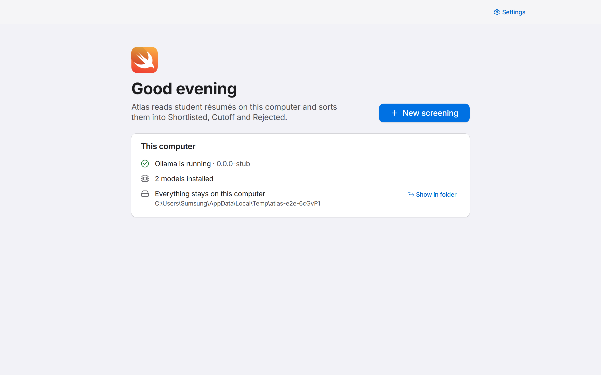
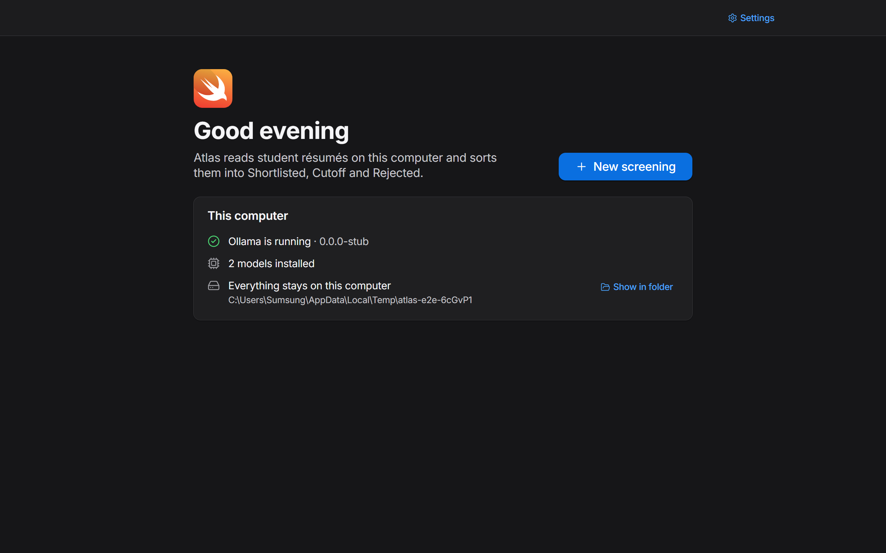
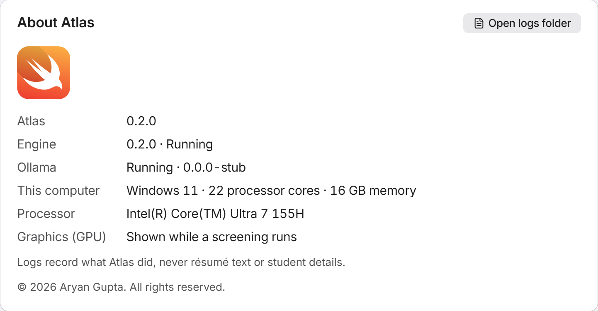
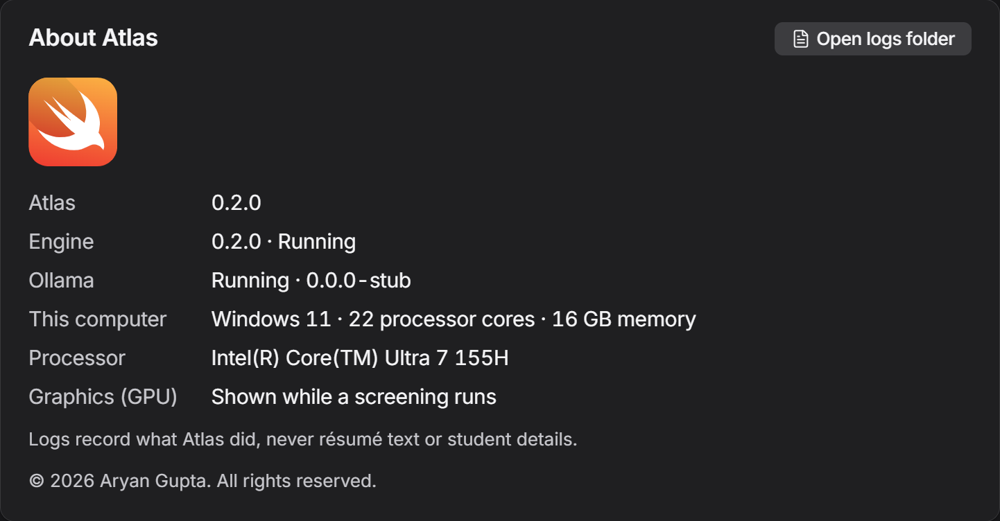

# Branding: Swift app icon and hello splash

Written 3 October 2026 on branch `feat/branding`. Atlas uses the two brand assets the iOS Development Center supplied:
- the Swift logo, as its app logo and icon;
- Apple's "hello" lettering, as a start-up screen on off-white.

**Why it's built this way.** The supplied files are treated as untrusted input:
- they stay exactly as received;
- the app uses checked, cleaned copies;
- everything else (icons, favicon, splash) is made from those copies by a script anyone can re-run and get the same bytes.

## Step 0: a clean branch

- **No graph-refresh branch needed.** `ci/hardening` has nothing `main` lacks: its graph refresh (`3ae2b25`) reached `main` with PR #1 (`36b82ff`). So no `chore/graph-refresh` branch was made.
- **Branch.** `feat/branding` starts from `main` at `36b82ff`.
- **The originals** are committed exactly as received (`90c9928`), with `Public_assets/README.md`. The README says where they came from, that they are Apple trademarks outside `LICENSE`, and that the app never loads them directly.

| Original | Bytes | SHA-256 |
|---|---|---|
| `Public_assets/swift-svgrepo-com.svg` | 2,295 | `ad4786e756a3635ce18e845dd3b9f010724f444566336e24dd89642ebfbb4611` |
| `Public_assets/Hello (apple).svg` | 7,260 | `ccca3b1fb0da33b072413979bcbfa05824230f04eb11dbac981d54215f3d9700` |

## Step 1: what the SVGs contain, and the clean copies

| | `swift-svgrepo-com.svg` | `Hello (apple).svg` |
|---|---|---|
| viewBox | `0 0 256 256`: **square** | `0 0 500 500` |
| Size | 800 × 800 px | `100%` × `100%`: no size of its own as an `` |
| Art | **Filled**: an orange gradient rounded square that fills the canvas, and a white swift | **Stroked**: one black, round-capped path, readable on off-white |
| Scripts, `on*` handlers, `foreignObject` | none | none |
| External hrefs, embedded fonts or images | none | none |
| Extra | An XML prolog, an "SVG Repo" comment, an unused `xmlns:xlink` | Four SMIL `<animate>`s on a 6 s loop that draw "hello" in, hold it, erase it and loop forever. At rest (`stroke-dasharray 0 100`) it's **invisible** |

Nothing unsafe had to be removed, so none of the stop conditions applied:
- the Swift SVG is square;
- the "hello" art is black.

The clean copies are in `app/renderer/assets/brand/` (`f7563ef`):

- **`logo.svg`** (2,114 bytes) is the same art without the prolog, the comment or the xlink namespace, at 256 × 256. It is **pixel-identical** to the original at 512 px: 0 of 262,144 pixels differ.
- **`hello.svg`** (1,329 bytes) is the original's *held* frame as static art:
  - the held path, with its dash pattern;
  - the all-black gradient as a solid `#000000` stroke;
  - the viewBox cropped to the lettering plus room for the round caps (`89 189 326 120`), with that size as its own.

  It is pixel-identical to the original paused on that frame (0 pixels differ).

  **Why static?** An `` can't honour "reduce motion", and the original's loop would erase "hello" while the splash is still up. The splash animates the image itself instead (step 3).

**Checks.** `brand.test.ts` (16 tests) fails if a copy:
- gains a script, an `on*` handler, `foreignObject`, an external URL, `href` or `url()`, metadata, a comment, a prolog, or an embedded image, font or `@import`;
- loses its viewBox or a matching size;
- or if "hello" gains animation.

It also fails if any renderer source inlines markup (`dangerouslySetInnerHTML`, `innerHTML`, `?raw` imports). Both files are loaded only as ``. The checker is itself tested against each bad case.

## Step 2: the app icon

**How the icons are made.** `packaging/icons/render-icons.mjs` draws `logo.svg` on a CPU-backed canvas and writes the PNGs, the `.ico` and `SHA256SUMS`. A CPU canvas gives the same bytes on every run; a GPU one may not.

**One change from the plan.** It renders with the Chromium inside Electron, driven by Playwright, both already in `app/`. The plan said Playwright's own Chromium, but that isn't installed here (no `ms-playwright` folder), and installing it means downloading a separate browser. So there is no new dependency and no download.

**Re-running gives the same bytes.** `node packaging/icons/render-icons.mjs --check` re-renders without writing and fails if any byte would change. It passed three times in a row: "11 files re-rendered byte for byte". `app/tests/icons.test.ts` checks the committed files against `SHA256SUMS`.

| File | Size | Bytes | Used for |
|---|---|---|---|
| `icon.ico` | 16, 24, 32, 48, 64, 128, 256 px (PNG entries) | 92,056 | Windows: the exe (taskbar, Start menu, Explorer, shortcuts), the installer and the uninstaller (`win.icon`, `nsis.installerIcon`, `nsis.uninstallerIcon`), and the window icon at run time |
| `icon-mac.png` | 1024 px, art 824 × 824 centred, soft shadow | 521,066 | macOS: electron-builder makes the `.icns` in `Atlas.app` from it, and the DMG's volume icon (`mac.icon`); the Dock icon in development |
| `icon-256.png` | 256 px | 57,527 | Windows notifications ("Screening finished") |
| `icon.png` | 1024 px, full-bleed | 689,930 | Anything else that needs a large PNG (replaces the placeholder) |
| `icon-16.png` … `icon-512.png` | 16, 24, 32, 48, 64, 128, 256, 512 px, full-bleed | 814 … 212,947 | The `.ico` is built from 16–256 |

**Each size is drawn from the vector, not shrunk from 1024 px.** That keeps the swift crisp at 16 px.

**The macOS icon follows Apple's grid**, checked pixel by pixel in the test:
- opaque art exactly from (100, 100) to (923, 923);
- transparent corners and margins;
- a light shadow below, at under 50% alpha, gone well before the edge.

**At run time** (`app/main/brand.ts`, `iconPath()`), the icon is found in `resources/icons/` when packaged, or `packaging/icons/` in development:
- **Windows:** the `BrowserWindow` icon, and the notification icon, for both the run watcher's and the renderer's notifications.
- **macOS:** `app.dock.setIcon()` in development only. Packaged, the bundle's `.icns` does it.

**In the app:**
- the logo at the top of Welcome (56 px);
- in Settings → About (64 px);
- as the favicon (`index.html`);
- in `README.md` (128 px).

The old placeholder icon and its README note are gone. `packaging/icons/README.md` now says which file is used where, and how to change the logo. `START_CMDS.md` §9 says how to re-render.

**Tests:**
- `icons.test.ts` (4): the hashes, the sizes, the macOS grid, and the `.ico`'s entries.
- `brand.test.ts` in `main/` (3): where the icons are found.
- `packaged.spec.ts` now also checks the built app. The icon the OS itself shows for `Atlas.exe` (Windows) or `Atlas.app` (macOS), and for the Windows installer, must be mostly the logo's orange-red: at least 30% of its opaque pixels.

| Icon | Orange-red share |
|---|---|
| The logo, at every size | 0.79 |
| Electron's default, Notepad, Edge, Firefox, Paint | 0 |
| Explorer's yellow folder (the nearest colour) | 0.14 |

On macOS the test also checks:
- that `Info.plist`'s `CFBundleIconFile` names a `.icns` in `Contents/Resources/`;
- that the DMG, mounted read-only, has a `.VolumeIcon.icns`.

## Step 3: the start-up screen

**Layout.** "hello" sits on off-white (`--atl-splash-bg`, #F5F5F7), edge to edge, in both light and dark mode:
- centred;
- about 40% of the window's width, at most 520 px;
- never touching an edge.

The colour is a theme-independent token in `tokens.css`, never themed.

| When | What happens |
|---|---|
| Atlas opens | The window appears only once its first frame is painted, and that frame is already off-white: `index.html` marks `<html data-splash>`, so the page has the colour before any script runs. "hello" fades in while growing from 98% to 100%, over about 600 ms. It uses the existing `gentle` spring, slowed down: the same curve, no bounce. |
| The engine is ready, and at least 1.2 s have passed | A 300 ms cross-fade onto Welcome, or its Resume card. The app was already mounted underneath, so it arrives loaded. |
| The engine fails | The same rule (at least 1.2 s), then a hand-over to the existing "Atlas couldn't start" screen. Its alert is only added as the splash leaves, so a screen reader announces it: an alert added inside an inert region isn't. |
| 6 s and still starting | "Still starting…" appears under the art. |
| 15 s | It hands over whatever the engine is doing (the usual "Starting Atlas…" screen with its spinner). It never hangs. |
| Reduced motion | A plain fade: no scale, no transform at all. |
| Accessibility | `role="status"` named "Atlas is starting", and the image's alt is "hello". Nothing in it takes focus, and Esc does nothing. The app underneath is `inert` until it leaves. The window can still be dragged by the splash. |
| Once per launch | Not again after an engine restart, nor on a page reload (`sessionStorage`). |

**Who decides.** Only the renderer decides when the splash leaves (`app/renderer/state/splash.ts`); it then tells main through a new IPC call, `atlas:splash-done`. That is UI chrome only, so rule 16 is unaffected.

**Main's side** (`app/main/index.ts`):
- **Window background.** A window without a material (the e2e build, Linux) is created with the splash's #F5F5F7 as its own `backgroundColor`, in either theme. It keeps that colour until `splash-done`, even if the theme changes meanwhile.
- **Caption buttons.** The Windows caption buttons are drawn dark for the off-white until `splash-done`.
- **Maximized windows.** A maximized window now waits for the first frame too. `maximize()` shows a window at once, so it moved into `ready-to-show`.

**One deliberate difference: windows with a material.** In the packaged app the window has a material (Mica on Windows 11, vibrancy on macOS), and it keeps its clear `#00000000` background:
- **The material has to show through after the splash.** Switching a window from opaque back to clear at run time isn't documented to work on every OS, and macOS vibrancy can't be checked on this laptop. If the switch failed, a dark-mode app would be stuck with an off-white base.
- **Nothing else can show first.** The page paints opaque off-white from its first frame, and the window is shown only after that frame.

**Not done: the optional stroke draw-in.** It would need "hello" as inline SVG, and the brand rule is `` only (step 1).

**Tests:**
- **Vitest:**
  - `state/splash.test.tsx` (8): the timings, the 1.2 s minimum, waiting for the engine, "Still starting…" at 6 s, the 15 s cap, the failure hand-over, staying gone, once per launch.
  - `screens/splash.test.tsx` (8): the token in both themes, what the page and the overlay paint, both arrivals, the status and its focusables, "Still starting…", the app staying inert, the failure hand-over with Esc, the cap handing over to "Starting Atlas…".
  - `screens/splash-reduced.test.tsx` (1): no transform with reduced motion.
  - `main/brand.test.ts` (+1): the window's colour equals the token.
- **Engine:** `test_gated_engine.py` (3).
- **`e2e/splash.spec.ts` (7):**
  - Off-white edge to edge: the overlay, the page, and the window's `getBackgroundColor()`. "hello" has loaded (`naturalWidth > 0`), is centred, about 40% wide and clear of the edges. No focus; Esc does nothing.
  - Dark mode: still off-white, and the window goes dark (#1c1c1e) after the splash.
  - The real 1.2 s minimum, then Welcome; a reload doesn't show it again.
  - A slow engine keeps it up, with "Still starting…", until the engine is ready.
  - Engine failure hands over to "Atlas couldn't start".
  - Reduced motion: every frame of the fade has no transform. The same sampler sees `scale(0.98…)` with full motion, so the check can catch one.
  - The logo screenshots.

  The slow engine is `engine/tests/gated_engine.py`. It holds the real server at "starting" until the test creates a gate file, so no test depends on how fast Python starts.
- **Every other spec** waits past the splash with one helper, `waitForWelcome()`: the splash removed, then the engine ready. `errors.spec` uses the `splashGone()` part.
- **No test-only timings.** The real 1.2 s minimum is used everywhere.

| Light | Dark |
|---|---|
|  |  |
|  |  |
|  |  |

## Step 4: licence and notices

- **`THIRD_PARTY_NOTICES.md` → Brand assets.** What each asset is, where it ships, and the key fact: the assets were supplied by the iOS Development Center, and the Swift logo and the "hello" lettering are **Apple trademarks**, not covered by Atlas's `LICENSE`.
- **`LICENSE`.** A new clause 6, one sentence, excludes these third-party marks.
- **`packaging/check_licenses.py`.** It checked shipped *packages*. It now also checks the shipped *brand art*: every file in `app/renderer/assets/brand/` must be named in the Brand assets section, and that section must say whose trademarks they are. It prints "2 brand assets (hello.svg, logo.svg)" and passes. It has 2 new tests in `test_tools.py`.
- **`docs/SIGNING.md` → Before any distribution: replace the logo.** It gives the reason (Apple's trademark guidelines don't allow the Swift logo as a product icon) and the swap, step by step:
  1. replace `logo.svg`;
  2. `node packaging/icons/render-icons.mjs`;
  3. replace `hello.svg`;
  4. update the notices;
  5. `npm run dist`.

  The README's limitations and licence sections point to it.
- **`brand.test.ts`.** It used to require the logo's exact `viewBox="0 0 256 256"`. It now requires a square viewBox of any size, which is what the test's name says. Otherwise the documented swap would fail on a perfectly good square logo.
