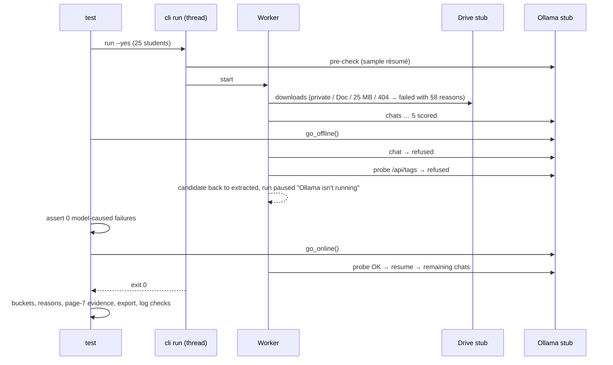

# Step 1.10 — Stub servers and end-to-end tests

## What was built
Two local stand-ins, a fake Google Drive and a fake Ollama, let the whole engine run on real sockets with no internet and no model. On top of them, one end-to-end test feeds a realistic 25-student CSV through the actual command line and turns off "Ollama" halfway. It then checks everything a recruiter would care about: who was shortlisted, the exact words of every failure, that a 10-page résumé was judged on its page-7 project, that the export is safe to open in Excel, that nobody was failed because of the outage, and that no personal data leaked into the log file. A final opt-in test runs three sample résumés against a *real* local model, for the owner to run on their own machine.

## Files
| File | Purpose | Key functions / classes |
|---|---|---|
| `engine/tests/stubs/base.py` | Start/stop/offline/online for a local HTTP server; swallows expected client hang-ups | `StubServer` |
| `engine/tests/stubs/drive_stub.py` | Fake Drive: PDFs, confirm page, sign-in page at 200, Google Doc route, 404, 429 + `Retry-After`, 503, slow drip, oversized, truncated, offline | `DriveStub`, `Pdf`, `Confirm`, `SignIn`, `Status`, `RateLimited`, `Drip`, `Oversized`, `Truncated` |
| `engine/tests/stubs/ollama_stub.py` | Fake Ollama: `/api/tags`, `/api/show`, streaming `/api/chat` with valid evaluations quoting the prompt's résumé; scriptable garbage/truncate/extra keys/fake quote/error/drop; offline | `OllamaStub`, `evaluation_for` |
| `engine/tests/test_e2e.py` | The end-to-end run with an Ollama outage | `EndToEndTest` |
| `engine/tests/test_live.py`, `engine/tests/samples/*.txt` | Real-model check (skipped unless `ATLAS_LIVE=1`); 3 fictional résumés | `LiveOllamaTest` |

## How it works
1. `build_csv` registers 25 behaviours on the Drive stub and writes a UTF-8-BOM CSV with one duplicate row:
   - 13 ordinary résumés with known grades;
   - private, Google Doc, 25 MB, 404;
   - 429-then-OK and the virus-scan confirm page;
   - a plain portfolio URL;
   - the 10- and 12-page fixtures;
   - an injection attempt, a formula name and a Tamil name.
2. `cli.main(["run", …, "--yes"])` runs in a background thread with the downloader's `url_rewrite` pointed at the Drive stub and a health probe pointed at both stubs.
3. After five candidates are scored, `ollama.go_offline()` makes the next chat fail with "connection refused". The worker probes `/api/tags`, which also fails, hands the candidate back to `extracted` and pauses: "Ollama isn't running". The test checks that zero candidates failed because of it, then calls `go_online()`. The worker's 5-second poll (0.2 s in tests) resumes the run, which completes. The CLI exits 0.
4. The test then asserts every student's final state and reason word for word, scores and flags, the page-7 quote, buckets (via `compute_buckets` and the `results` command), the exported CSV, an empty downloads folder, and a clean `engine.log`.



## Key decisions and why
- **Stubs are real HTTP servers, not mocks.** Timeouts, truncated bodies, refused connections and streaming only behave truthfully on sockets. The stubs run in-process on port 0, so tests can run in parallel and never touch the network.
- **"Offline" closes the listening socket,** so clients get a genuine *connection refused*, like a stopped service, rather than a canned error. On Windows a refused localhost connect takes about 2 s (the OS retries the SYN), which the tests allow for.
- **Stub scores come from the résumé** ("Capstone grade N out of 100"), so every expected bucket is known in advance. In the kill test this also proves that no candidate's text was ever swapped with another's.
- **The Ollama stub quotes the prompt it receives.** Evidence verification is exercised for real: the quote has to survive redaction, section budgeting and fencing to be found again.
- **The e2e test drives the CLI in-process** through `main()`'s test seams (URL rewrite, health probe, fast intervals) rather than as a subprocess. That lets it watch the database and flip the stub mid-run. The subprocess path is covered by the worker kill test.
- **The log check is about more than names.** It also checks that no email, phone or résumé sentence ("Built a Flask app", "Sentinel-2") appears in `engine.log`, while RA numbers do.
- **The live test asserts only what any usable model must do** (valid, verified output), and prints scores and timings for a human to judge. Scores differ between models, so asserting them would make the test flaky, not stronger.

## Failure handling
Covered end to end in this step:

| Situation | What happens | Candidate failed / run paused / nothing | Message shown |
|---|---|---|---|
| Private Drive file (sign-in at 200) | download stops | failed, permanent | Link is private. Ask the student to set sharing to "Anyone with the link". |
| Google Doc link | rejected before any request | failed, permanent | This is a Google Doc, not a PDF. Ask the student to upload a PDF. |
| 25 MB file, no length header | cut at 20 MB | failed, permanent | The file is larger than 20 MB. |
| 404 | — | failed, permanent | The file no longer exists at this link. |
| 429 then OK | waits `Retry-After`, succeeds | nothing | — |
| Virus-scan confirm page | followed once, succeeds | nothing | — |
| Ollama stopped mid-run | candidate back to `extracted`, auto-resume | **run paused, 0 failed** | Ollama isn't running |
| Instructions to the AI in a résumé | scored normally (grade unchanged) | nothing | flag: Possible instructions to the AI found in résumé |
| 12-page résumé | first 10 pages read | nothing | flag: Résumé longer than 10 pages; pages 11+ not read |

## Tests
Added **2** (1 e2e, 1 live, skipped by default); total **257** (256 run, 1 skipped). The stubs themselves are exercised by the downloader (7 socket tests), CLI (10), worker-kill (1) and e2e tests.
- `test_full_run_with_an_ollama_outage` proves:
  - the pre-flight drops the duplicate;
  - the outage pauses with the exact message and resumes, with zero model-caused failures and nothing left in `scoring`;
  - all 25 students end where they should, with exact reasons, scores and flags;
  - the 10-page student's only evidence is the page-7 line;
  - buckets are 11 / 6 / 4, and the `results` command agrees;
  - the export escapes `=HYPERLINK(...)`, round-trips the Tamil name, and carries reasons and flags;
  - the downloads folder is empty;
  - `engine.log` has RA numbers but no names, emails, phones or résumé text.
- `test_three_sample_resumes` (live): the pre-check plus three fictional résumés through the full real pipeline.

## How to try it yourself
```bash
.venv/Scripts/python -m unittest engine.tests.test_e2e -v        # about 7 s
# test_full_run_with_an_ollama_outage ... ok

# With Ollama running locally (on your machine):
set ATLAS_LIVE=1
set ATLAS_MODEL=qwen3:8b
.venv/Scripts/python -m unittest engine.tests.test_live -v
#   pre-check qwen3:8b: ok=True (…) This model is ready for screening.
#   data_science     score  …  attempts 1  … s  evidence …
#   strong_backend   score  …
#   weak_generic     score  …
```

## Known limitations
- The stubs imitate Drive's pages as they look today (English). Real Drive can change its HTML; only real links will tell. See "What I need to do" in the Phase 1 summary.
- The live test hasn't been run: this machine has no Ollama. Real-model behaviour (score quality, speed, how often retries happen) is unmeasured.
- The e2e test covers an Ollama outage; the internet outage is covered at worker level with fakes (`test_worker.py`) and at downloader level with the stub going offline.

## Concepts to learn
- **Test doubles at the network boundary**: a fake server exercises your real HTTP code; a mock only exercises your assumptions about it.
- **Deterministic fixtures**: encoding the expected answer in the input ("grade N") makes end-to-end assertions exact.
- **Fault injection**: turning a dependency off mid-run is the only honest way to test "survives an outage".
- **Opt-in live tests**: keep the default suite fast and offline, and still have a one-command check against the real thing.
