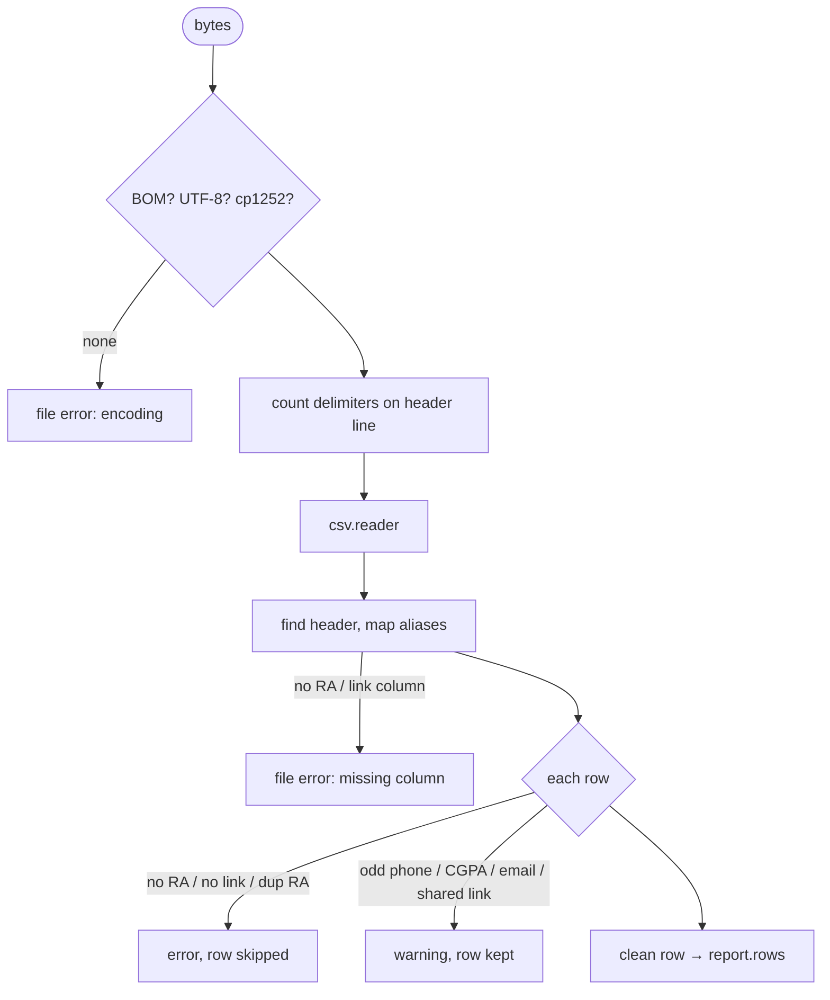

# Step 1.3 — CSV loading and the pre-flight report

## What was built
`load_csv(path)` reads the recruiter's spreadsheet export and turns it into clean candidate rows plus a **pre-flight report**. The recruiter sees the report before any run starts. The loader copes with the messy files real people produce: different header names ("Reg. No", "RA Number", "Résumé Link (Drive)"), several encodings (Excel's UTF-8 with BOM, UTF-16, old Windows cp1252), comma/semicolon/tab separators, phone numbers mangled by Excel, and CGPA written in three different ways. Rows that can't be used (missing RA number or link, duplicate RA number) are excluded and listed. Rows with smaller issues are kept and listed as warnings. The loader is *pure*: it never writes to the database. Only when the recruiter confirms does the caller insert `report.rows` with `add_candidates`.

## Files
| File | Purpose | Key functions / classes |
|---|---|---|
| `engine/ingest/csv_loader.py` | Parse, normalise and validate the CSV; render the report | `load_csv`, `PreflightReport`, `Issue`, `render_report`, `normalise_phone`, `normalise_cgpa` |
| `engine/ingest/links.py` | Pure link helpers shared with the downloader (1.4) | `with_scheme`, `drive_file_id`, `link_identity` |
| `engine/tests/test_csv_loader.py` | 29 tests | see Tests |

## How it works
1. **Read bytes, pick the encoding** (`_decode`): UTF-8 BOM → UTF-16 BOM → strict UTF-8 → cp1252. The first that decodes wins. NUL bytes are dropped.
2. **Pick the delimiter** (`_sniff_delimiter`): count `,` `;` tab `|` *outside quotes* on the first non-blank line; ties go to comma.
3. **Parse** with the stdlib `csv.reader`. It handles quoted commas and newlines inside cells.
4. **Find the header** (`_find_header`): the first non-blank row, unless a later row (within 10) names both required columns. That skips a title row like "Placement Drive 2026".
5. **Map columns** (`_map_columns`): each header is normalised (lower-case, accents removed, only letters and digits kept), so "Reg. No" becomes `regno`. It is then matched against alias lists, exact matches first and then "starts with" for specific aliases. Unused columns produce a warning, two columns for one field produce a warning (the first is used), and a missing RA-number or link column is a **file-level error**.
6. **Read rows** (`_read_rows`): blank lines are skipped, but they still count for row numbers, so "row 17" is row 17 in Excel. For each row:
   - Missing RA number, missing link, or a duplicate RA number is an **error** and excludes the row.
   - Phone, CGPA, email, link shape and a shared link are **warnings**; the row is kept.
7. **Summarise** (`_summarise`) and **render** (`render_report`) the text block from ARCHITECTURE §10.



## Key decisions and why
- **Never guess a phone number.** `9.19876E+11` is what Excel shows after it has already thrown away six digits. Turning it into `919876000000` would invent a wrong number. We only undo scientific notation when every digit survived (`9.19876543210E+11`); otherwise the value is kept as typed with the warning "shortened by Excel". ARCHITECTURE §10 was updated to say this.
- **Own delimiter detection, not `csv.Sniffer`.** Sniffer often gives up on short header lines. Counting separators outside quotes on the header is simple, deterministic and testable.
- **Row numbers are spreadsheet row numbers** (header = 1, blank lines count), so the recruiter can find "row 17" in Excel.
- **Duplicates are detected after upper-casing** (`ra1` = `RA1`). A row with a missing link does *not* claim its RA number, so a later valid row with the same RA is kept. We keep the first *usable* row.
- **Shared links compare by Drive file id** (`links.link_identity`), so `/file/d/X/view` and `open?id=X` are recognised as the same file.
- **Extras beyond the spec** (all small, all tested): UTF-16 files (Excel's "Unicode Text" export), a title row above the header, `First Name` + `Last Name` joined into Name, links pasted without `https://`, email shape check, and values past the last named column. The CGPA `x/4` scale is *not* converted: it's rare, and guessing a conversion is worse than asking.
- **`links.py` is new.** Link understanding is needed by both the loader (shared links) and the downloader (1.4). A pure module avoids the loader importing `requests` through the downloader.
- **The loader keeps its own copy of the field list** (`FIELDS`), because stage modules may not import `db.py`. A test asserts it equals `db.CANDIDATE_INPUT_FIELDS`, so they can't drift apart.

## Failure handling
| Situation | What happens | Candidate failed / run paused / nothing | Message shown |
|---|---|---|---|
| File missing or unreadable | file error, no rows | nothing (run can't start) | "The file couldn't be opened. Check that it still exists." |
| Undecodable bytes | file error | nothing | "…use Save As → "CSV UTF-8" and try again." |
| Empty file / header only | file error | nothing | "The file is empty." / "The file has a header but no student rows." |
| No RA-number or link column | file error | nothing | "No column for RA number. Add a column named "RA number"." |
| Row without RA number / link | row excluded | nothing | "RA number is missing. Row skipped." / "Résumé link is missing. Row skipped." |
| Duplicate RA number | later row excluded | nothing | "RA number RA1 is also in row 2. Kept the first; this row is skipped." |
| Odd phone, CGPA, email; shared link; non-URL link | row kept, warning | nothing (a non-URL link fails later, at download) | e.g. "Same résumé link as RA1 (row 2)." |

## Tests
Added **29**; total **74**.
- **HeaderTests (7)**: aliases ignore case, punctuation and accents; prefix matching; first + last name; unknown vs trailing-empty columns; missing required columns are file errors; duplicate columns; title row above the header.
- **FileLevelTests (3)**: empty or whitespace-only file, header only, missing file.
- **EncodingAndDelimiterTests (8)**: UTF-8 BOM with Tamil, UTF-8 with Hindi, cp1252 fallback, UTF-16 tab-separated, semicolon with `8,2`, quoted commas and newlines, blank lines keep spreadsheet row numbers, values past the header.
- **NormalisationTests (3)**: 14 phone cases (including both lossless and lossy scientific notation), 15 CGPA cases, row-level trimming and warnings.
- **RowErrorTests (4)**: duplicates keep the first (case-insensitive), missing RA or link skips the row, shared link across URL shapes, a link without `https://` is accepted.
- **ReportTests (2)**: the §10 text layout; long lists are shortened with "+N more".
- **ContractTests (2)**: row keys equal `db.CANDIDATE_INPUT_FIELDS` and insert cleanly via `add_candidates`; 5,000 rows parse in under 2 s (about 0.1 s here).

## How to try it yourself
```bash
.venv/Scripts/python -c "from engine.ingest.csv_loader import load_csv, render_report; print(render_report(load_csv('students.csv')))"
```
Expected output shape:
```text
5 rows read
3 ready
  1 duplicate RA numbers             → row 3 (kept first)
  1 missing résumé links             → row 4 (skipped)
  1 links shared by two students     → RA4 (warning only)
  1 phone numbers shortened by Excel → RA4 (warning only)
  note: Column "Remarks" isn't used.
```

## Known limitations
- `.xlsx` files aren't read; the recruiter must export CSV. (Phase 2 can add this; it would need a new dependency.)
- A department written two ways ("CSE" vs "Computer Science") isn't unified. The department filter (1.7) compares letters and digits only.
- If Excel already rounded a phone number, the digits are gone; we can only flag it.
- `x/4` CGPA scales are flagged as unreadable rather than converted.
- Header aliases are a fixed list; a truly unusual header ("Student ID") needs adding to `_ALIASES`.

## Concepts to learn
- **Text encodings and BOMs**: the same bytes mean different letters in UTF-8 and cp1252. A byte-order mark is how Excel says "this is UTF-8/UTF-16".
- **Pure functions at the boundary**: parsing that doesn't write anything can be shown to the user first and retried freely.
- **Normalisation before comparison**: comparing `normalise(a) == normalise(b)` rather than raw strings is what makes "Reg. No" match "REG NO".
- **Floating-point precision loss**: scientific notation keeps a few significant digits; the rest are gone for good.
- **Errors vs warnings**: an error blocks one row, a warning only informs. Separating them lets the recruiter decide instead of the code silently dropping data.
