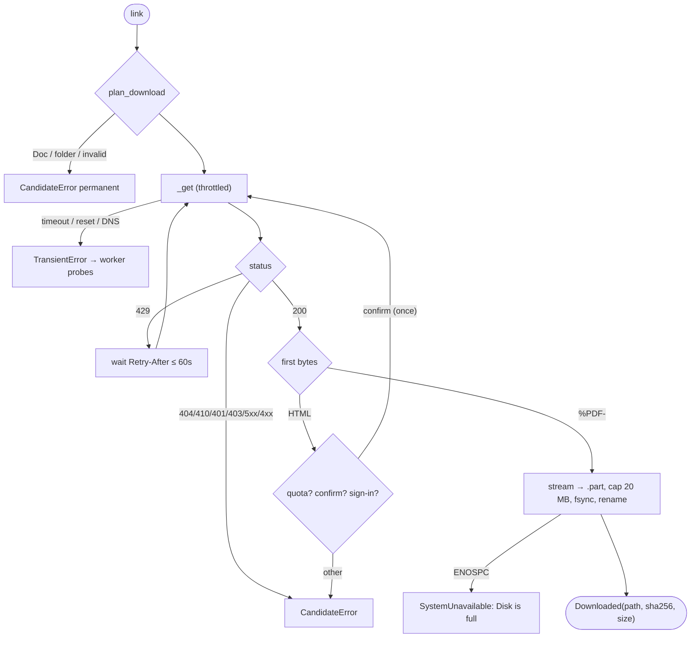

# Step 1.4 — Downloading résumés

## What was built
The downloader takes one résumé link from the CSV and either puts a complete, verified PDF on disk or says precisely why it couldn't. Google Drive makes this hard. A private file doesn't return "403 Forbidden"; it returns "200 OK" with a sign-in web page. Large files return a virus-scan warning page instead of the file. The downloader therefore never trusts the status code alone. It inspects what actually came back, and the first five bytes must be `%PDF-`. Every failure is sorted into one of three typed errors (new `engine/errors.py`): the candidate's problem, the machine's problem, or "can't tell yet". Each carries a sentence written for a recruiter.

## Files
| File | Purpose | Key functions / classes |
|---|---|---|
| `engine/errors.py` | The three error types, and every recruiter-facing sentence | `CandidateError`, `SystemUnavailable`, `TransientError`, `Reason`, `Pause`, `AUTO_RESUME_REASONS` |
| `engine/ingest/links.py` | Pure link planning: Drive rewrite, reject Docs/folders/invalid links | `plan_download`, `DownloadPlan`, `drive_file_id` |
| `engine/ingest/downloader.py` | HTTP, HTML traps, streaming to disk, size cap, throttle | `Downloader.fetch`, `Downloaded`, `is_disk_full`, `_confirm_url` |
| `engine/tests/stubs/drive_stub.py` | A fake Google Drive on 127.0.0.1 (extended in 1.10) | `DriveStub`, behaviours `Pdf`, `Confirm`, `SignIn`, `Status`, `RateLimited`, `Drip`, `Oversized`, `Truncated` |
| `engine/tests/test_downloader.py` | 41 tests | see Tests |

## How it works
1. `plan_download(link)`: add `https://` if missing; reject non-http(s) links, Google Docs/Sheets/Slides/Forms and Drive folders straight away, with no request made. Drive file links (`/file/d/ID`, `open?id=`, `uc?id=`…) become `https://drive.usercontent.google.com/download?id=ID&export=download`.
2. `_get(url)`: apply the `url_rewrite` hook, wait for the throttle (`_throttle`, at least 1 s between request starts), then `session.get(stream=True, timeout=(10, 30))`. Network exceptions become `TransientError`.
3. **Status:** 429 → wait `Retry-After` (≤ 60 s) and try again, up to 2 times. 404/410 → not found. 401/403 → private, unless the page is Drive's quota page, which is retryable. 5xx → retryable. Any other status ≥ 300 → refused.
4. **Sniff** the first bytes. `%PDF-` → save. HTML → check in order: quota page → Drive confirm page (follow **once**) → sign-in page → otherwise "isn't a PDF". Anything else → "isn't a PDF".
5. `_save`: refuse early if `Content-Length` is over 20 MB. Otherwise stream into `<stem>.part`, hashing as it goes, and **abort the moment the running total passes 20 MB**. Then `fsync`, atomic `os.replace` to `<stem>.pdf`, and (POSIX) `fsync` the directory. A `finally` deletes the `.part` file on every failure.



## Key decisions and why
- **Three error types, not one.** The worker's single most important decision is "fail this candidate" vs "pause the run". Encoding that in the exception type means no stage has to know about runs or the database.
- **All recruiter wording lives in `errors.py`.** The reasons are shown verbatim, and the e2e test (1.10) checks them word for word. One place to edit, one place to review.
- **Four reasons added to ARCHITECTURE §8.** "The file host refused the download." (other 4xx, redirect loops) and "The website in this link couldn't be reached." (DNS failure or refused connection on one host while the internet works) come from this step. "OCR isn't installed" and "The model stopped…" come in 1.5–1.6. §8's "The download timed out." didn't fit a dead personal website.
- **429 is retried inside `fetch`** (up to 2 times, honouring `Retry-After`) instead of failing at once. Drive rate-limits in bursts, so a short wait usually fixes it, and the prompt's end-to-end test expects "429-then-OK" to succeed. 5xx is *not* retried inside `fetch`: it fails as retryable and "Retry failed" handles it, which keeps `fetch` time bounded.
- **403 isn't always "private".** Drive's "too many users have downloaded this file" quota page can come back as 403. Calling that "private" would send the recruiter chasing a student for nothing, so the body is checked first.
- **Confirm pages are followed only for Drive links and only once**, as the prompt requires. A second confirm page means "isn't a PDF", never a loop.
- **The magic-byte check is strict** (`%PDF-` in the first five bytes), as specified. Acrobat tolerates up to 1 KB of junk before `%PDF`; we don't. See limitations.
- **The Drive stub was built now, not in 1.10.** Some failure modes only exist on real sockets: truncated bodies, slow drips, refused connections. It is extended in 1.10.

## Failure handling
| Situation | What happens | Candidate failed / run paused / nothing | Message shown |
|---|---|---|---|
| Google Doc / Sheet / Slides link | rejected before any request | failed, permanent | This is a Google Doc, not a PDF. Ask the student to upload a PDF. |
| Drive folder link | rejected | failed, permanent | This is a folder link. Ask the student for a link to the PDF itself. |
| Not a web address | rejected | failed, permanent | The résumé link isn't a valid web address. |
| Sign-in page at 200 / 401 / 403 | — | failed, permanent | Link is private. Ask the student to set sharing to "Anyone with the link". |
| 404 / 410 | — | failed, permanent | The file no longer exists at this link. |
| HTML page or other non-PDF | — | failed, permanent | The file isn't a PDF. |
| Over 20 MB (declared or streamed) | stops reading at once, `.part` deleted | failed, permanent | The file is larger than 20 MB. |
| 429 (3rd time) / Drive quota page | waited, retried twice | failed, retryable | Google Drive is limiting downloads. Retry later. |
| 5xx | — | failed, retryable | The file host returned an error. |
| Timeout, reset, truncated body | `.part` deleted, `TransientError` | worker probes: paused (no internet) **or** failed, retryable | The download timed out. |
| DNS failure / refused | `TransientError` | worker probes: paused **or** failed, retryable | The website in this link couldn't be reached. |
| Disk full | `.part` deleted | **run paused** | Disk is full |

## Tests
Added **41**; total **115**.
- **PlanTests (5)**: 10 Drive link shapes → one direct URL; Docs, Sheets, Slides and Forms rejected; 3 folder shapes rejected; 8 invalid links rejected; other links pass through.
- **HappyPathTests (4)**: streamed atomically with the correct sha256 and no `.part`; leftover `.part` from a crash is replaced; `url_rewrite` applies to *every* request; a PDF with a wrong `text/html` type is still accepted.
- **HtmlTrapTests (9)**: confirm form followed once; legacy confirm link; confirm twice → no loop; confirm only for Drive; sign-in at 200; redirect to `accounts.google.com`; "You need access" page; quota page at 200 and 403 is retryable; HTML, PNG, docx and empty body → "isn't a PDF".
- **StatusTests (5)**: 8 status codes mapped; 429 honours `Retry-After`; capped at 60 s; HTTP-date form; three 429s → retryable.
- **SizeTests (2)**: declared > 20 MB refused after reading one chunk; an undeclared stream is cut right after passing the cap.
- **NetworkErrorTests (5)**: connect/read timeout; DNS and refused → "couldn't be reached"; reset → "timed out"; mid-stream reset or truncation deletes `.part`; malformed URL → permanent.
- **DiskAndThrottleTests (4)**: `ENOSPC` → `SystemUnavailable("Disk is full")` with no files left; Windows error 112 detected; a permission error is *not* disk-full; request starts spaced by 1 s.
- **StubServerTests (7, real sockets)**: PDF, confirm and sign-in over HTTP; 404, 503 and 429-then-OK; **a 25 MB stream with no Content-Length cut at the real 20 MB cap**; truncated body; slow drip hits the read timeout; server offline → refused, back online → works; Google Doc rejected with zero requests.

## How to try it yourself
```bash
.venv/Scripts/python -m unittest engine.tests.test_downloader -v
# … Ran 41 tests … OK

# A real public PDF (needs internet):
.venv/Scripts/python -c "from engine.ingest.downloader import Downloader; print(Downloader().fetch('https://www.w3.org/WAI/ER/tests/xhtml/testfiles/resources/pdf/dummy.pdf', 'tmp_dl', 'x'))"
```

## Known limitations
- `%PDF-` must be the first five bytes. A PDF with a BOM or junk before the header is rejected as "isn't a PDF".
- Drive's HTML is matched on known phrases in English. If Google changes the wording or serves another language, a private file could show as "isn't a PDF" (still permanent, just a less helpful reason).
- A captive portal (hotel Wi-Fi login page) looks like "HTML, not a PDF" and fails candidates permanently. The internet probe can't see it either, because TCP works.
- OneDrive/Dropbox share links aren't rewritten to direct downloads; they usually return HTML → "isn't a PDF".
- The confirm-page follow-up and 429 retries share one 1 s throttle, so a worst-case `fetch` takes about 2 × 60 s + 3 × 40 s.

## Concepts to learn
- **Streaming downloads**: read the body in chunks as it arrives instead of all at once, so a 2 GB file can't fill memory and a size cap can stop it early.
- **Atomic rename**: write to a temp name, `fsync`, then `os.replace`. Readers see either no file or the whole file, never half.
- **Magic bytes**: file formats start with a fixed signature (`%PDF-`, `\x89PNG`, `PK`), which is more trustworthy than a `Content-Type` header.
- **Retry-After / rate limiting**: servers tell well-behaved clients how long to wait; honouring it avoids being blocked.
- **Error taxonomy**: classifying failures by *who can fix them* (the student, the recruiter, nobody yet) is what lets a system pause instead of wrongly failing people.
