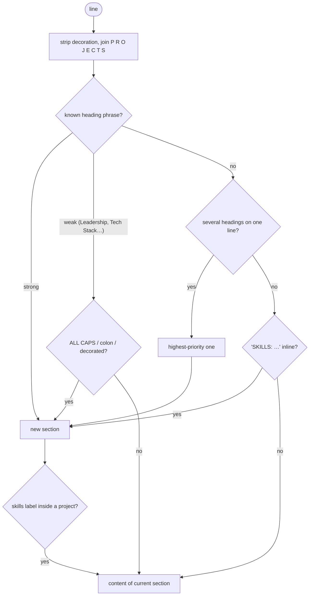

# Step 1.5 — Text and section extraction

## What was built
This step turns a downloaded PDF into text, then cuts that text into named sections: Projects, Experience, Skills and so on. QWENTUS sent the model only the first 2,500 characters of a résumé, about half a page, so anything on page 3 or later was invisible. Now every page up to 10 is read, and the résumé is split into sections, so the prompt builder in step 1.6 can take the Projects section from page 7 if that's where it is. Scanned pages without a text layer are read with OCR when EasyOCR is installed. When it isn't, the recruiter gets a clear reason instead of a crash. Two sections are deliberately kept away from the model: the header (name and contact details) and Personal Details (date of birth, gender, and so on).

## Files
| File | Purpose | Key functions / classes |
|---|---|---|
| `engine/extract/pdf.py` | PDF → text, ≤ 10 pages, per-page OCR fallback, typed failures | `PdfExtractor.extract`, `Extraction`, `clean_text` |
| `engine/extract/ocr.py` | Optional EasyOCR wrapper; never downloads models | `EasyOcrEngine.read_page`, `OcrUnavailable` |
| `engine/extract/sections.py` | Text → `{section: text}` | `split_sections`, `match_heading`, `SECTION_NAMES`, `PROMPT_PRIORITY` |
| `engine/tests/fixtures.py` | PDFs generated in tests, including the 10-page résumé with Projects on page 7 | `make_pdf`, `make_ten_page_resume`, `PAGE7_PROJECT_LINE` |
| `engine/tests/test_extract.py` | 29 tests | see Tests |
| `engine/__init__.py` | `NullHandler` on the `atlas` logger (library convention) | — |

## How it works
1. `PdfExtractor.extract(path)`: a missing file raises `FileNotFoundError` (not the candidate's fault; the worker re-downloads). Otherwise the bytes are read and opened with PyMuPDF. Failing to open, or needing a password, → "The PDF is damaged or password-protected."
2. For each of the first 10 pages: `page.get_text("text")`, then `clean_text` (NFKC, drop icon glyphs and invisible characters, tidy whitespace). A page with fewer than 50 characters is offered to OCR, and the OCR text is used only if it's longer.
3. If the whole résumé has fewer than 20 characters, it fails: "OCR isn't installed" when a page needed OCR that wasn't available, otherwise "No readable text was found". `Extraction.page_count` is the real page count and `truncated_pages` how many were skipped.
4. `split_sections(text)` walks the lines. `match_heading(line, current)` decides whether a line starts a section:
   - strip the decoration in front (`■`, `➤`, `##`, icons) and behind (`:`, `———`);
   - join letter-spaced caps (`P R O J E C T S`);
   - look the phrase up in the heading table (strong or weak);
   - otherwise try splitting a two-headings line on `|`, `&`, `and`, tabs or wide gaps, and pick the more important section;
   - otherwise try an inline heading (`SKILLS: Python`).
5. Lines before the first heading are `header`. Repeated sections are merged. No headings at all → one `other` section.



## Key decisions and why
- **Open PDFs from bytes, not by path.** Found by a test on Windows: when PyMuPDF fails to open a corrupt file *by path*, it keeps the file handle. The worker deletes every PDF straight after extraction, and on Windows it can't delete a file that's still open. Reading the bytes first (≤ 20 MB) means no handle outlives the call. This happens to be what QWENTUS did; the reason just wasn't written down.
- **OCR per page, not per document.** QWENTUS only OCR'd a document with *no* text at all, so a text résumé with one scanned certificate page lost that page.
- **`page_count` stores the real page count** (e.g. 12), not the 10 read. The "pages 11+ not read" flag is derived from it later (1.6/1.7), with no schema change.
- **`header` never goes to the model.** It's where the name, email, phone and address live (rule 9). If a résumé has no headings at all, we can't separate contact details from content, so everything becomes `other`. It is still sent, after identity redaction in 1.6.
- **Added a `personal` section** (Personal Details, Declaration) that never goes to the model. Indian résumés often list date of birth, gender, religion and father's name there. Rule 9 names only name/email/phone/RA/section/photos, but sending the rest is the same bias risk. This deviates from ARCHITECTURE §12's list; §12 was updated.
- **Weak headings.** "Leadership", "Research", "Languages" and "Tech Stack" are both heading words and ordinary lines in a skills list. Treating them as headings only when they look like one (ALL CAPS, colon, decoration) avoids chopping a skills list in half.
- **Labels inside projects stay with the project.** "Tech Stack: PyTorch" under a project would otherwise start a Skills section and pull the rest of the projects with it. That's exactly the content the model most needs to see labelled correctly.
- **Two headings on one line** go to the more important section instead of being duplicated or split. The text can't be untangled reliably (it's usually two columns interleaved), so we make sure it lands where the prompt builder looks first.
- **Text is normalised with NFKC** so "Certifications" (with the `fi` ligature) matches the heading table, and the model's quotes match the stored text. The zero-width joiners used in Indic scripts are kept.
- **MuPDF's own stderr messages are switched off.** Failures are already typed; the console noise helped nobody.

## Failure handling
| Situation | What happens | Candidate failed / run paused / nothing | Message shown |
|---|---|---|---|
| PDF corrupt, empty or unopenable | `CandidateError` | failed, permanent | The PDF is damaged or password-protected. |
| PDF needs a password | `CandidateError` | failed, permanent | The PDF is damaged or password-protected. |
| Scanned, no OCR installed / no model files | `CandidateError` | failed, permanent | This résumé is a scanned image, and text recognition (OCR) isn't installed on this computer. |
| OCR ran, found nothing | `CandidateError` | failed, permanent | No readable text was found in the résumé. |
| More than 10 pages | first 10 read, `truncated_pages` set | nothing (flag added at scoring) | "Résumé longer than 10 pages; pages 11+ not read" (flag, 1.6) |
| PDF file missing on disk | `FileNotFoundError` | nothing: the worker re-downloads (1.7) | — |
| One scanned page among text pages, no OCR | that page is empty, the rest used | nothing | — |

## Tests
Added **29**; total **144**.
- **PdfTests (8)**: one page; **the 10-page résumé: page 7's project line is in `page_texts[6]` and in `sections["projects"]`**, and the text is >10× what QWENTUS read; 12 pages → 10 read, `truncated_pages = 2`, page 11 absent; encrypted; corrupt and empty; a truncated download is either damaged or partly readable, never a crash; a missing file is not a candidate failure; files can be deleted after every outcome (the Windows handle leak).
- **OcrFallbackTests (5)**: only text-less pages go to OCR; scanned without OCR → "OCR isn't installed"; OCR finds nothing → "no readable text"; a short text page keeps its text if OCR finds less; one scanned page among text pages is fine without OCR.
- **EasyOcrEngineTests (3)**: easyocr not installed → `OcrUnavailable`, not a crash; the reader is built with `gpu=False`, `download_enabled=False` and the given model folder; missing model files → `OcrUnavailable`.
- **CleanTextTests (2)**: ligatures, icon glyphs, soft hyphens and zero-width spaces; Indic joiners survive.
- **SectionTests (11 layouts)**: single-column; inline `SKILLS:`; title-case with colons and letter-spaced caps; icons, bullets and rules; two headings on one line (`|`, wide gap, tab, `&`); no headings; weak words; labels inside projects; repeated sections merged; personal details and hobbies separated; sentences aren't headings.

## How to try it yourself
```bash
.venv/Scripts/python -c "from engine.extract import PdfExtractor, split_sections; e = PdfExtractor().extract('resume.pdf'); print(e.page_count, e.truncated_pages); print({k: len(v) for k, v in split_sections(e.text).items()})"
# 10 0
# {'header': 98, 'summary': 87, 'education': 3122, 'experience': 7773, …, 'projects': 3259, …}

.venv/Scripts/python -m unittest engine.tests.test_extract -v
```

## Known limitations
- **Two-column layouts** can interleave lines from both columns (PyMuPDF reads in content order). Sections are then mixed, but every line still reaches the prompt.
- An **unknown heading** (e.g. "Open Source") isn't detected; its lines stay in the section above.
- If a résumé's **only** objective paragraph sits under the name with no heading, it's in `header` and not sent to the model.
- OCR quality and speed haven't been measured (easyocr isn't installed here); PyTorch makes it heavy. ARCHITECTURE §21 already suggests evaluating RapidOCR in Phase 3.
- The heading tables are English-only.

## Concepts to learn
- **Text layer vs image**: a "digital" PDF stores characters; a scanned one stores a picture of them, which only OCR can read.
- **Unicode normalisation (NFKC)**: several code-point sequences can look identical ("fi" vs "fi"); normalising makes them compare equal.
- **Heuristic parsing with precision/recall trade-offs**: every heading rule trades missed headings against false ones; "weak" words show how to tune one side without breaking the other.
- **Leaked file handles**: on Windows an open handle blocks delete and rename; library error paths are a common source of leaks.
- **Data minimisation**: not sending data (header, personal details) is the strongest privacy and bias control.
