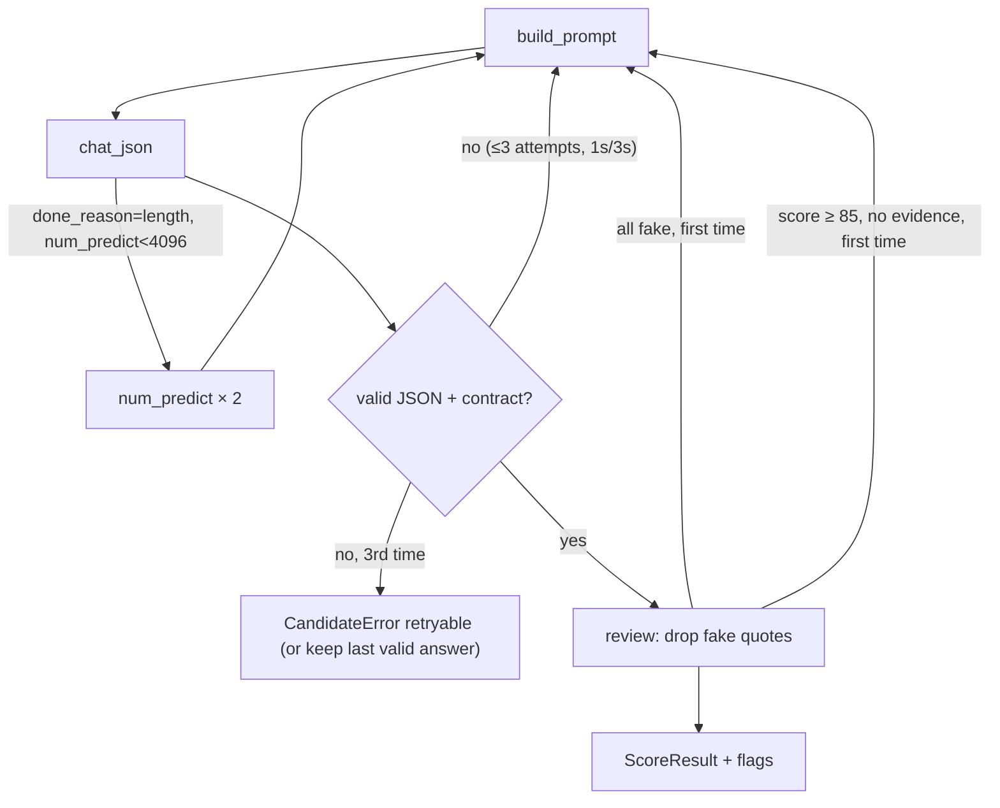

# Step 1.6 — LLM scoring

## What was built
This step asks the local Ollama model to score one résumé against the recruiter's criteria, and doesn't take its answer on trust. The prompt is built so that the student's identity *can't* reach the model: the prompt builder only accepts a context object with no identity fields, and the résumé text is redacted first. Cutoff scores never enter the prompt, because code decides buckets, not the model. The model must answer in a strict JSON contract. Every "evidence quote" it gives is checked against the actual résumé and dropped if invented. A cut-off, garbled or suspicious answer is retried within fixed limits. Text in a résumé that tries to instruct the AI is flagged for the recruiter. A model pre-check proves a model works on this machine before a run can start. The database moved to schema v2 to store these flags.

## Files
| File | Purpose | Key functions / classes |
|---|---|---|
| `engine/llm/schema.py` | The output contract (Pydantic, `extra="forbid"`) and its JSON schema | `Evaluation`, `parse_evaluation`, `evaluation_json_schema` |
| `engine/llm/client.py` | Streaming Ollama client; no files on disk | `OllamaClient.chat_json`, `list_models`, `find_model`, `model_context_length`, `health`, `ChatResult`, `ChatDeadline` |
| `engine/llm/redact.py` | Identity removal; the identity-free context type | `CandidateContext`, `scoring_input`, `ScoringInput`, `redact` |
| `engine/llm/prompt.py` | Fenced prompt, section budget, per-item trimming | `build_prompt`, `Prompt`, `resume_budget_chars`, `SYSTEM_PROMPT` |
| `engine/llm/verify.py` | Quote verification, injection detection | `review`, `quote_found`, `detect_injection` |
| `engine/llm/scorer.py` | The retry and guardrail loop | `Scorer.score`, `ScoreResult` |
| `engine/llm/precheck.py`, `sample_resume.txt` | Can this model screen? (fictional sample) | `precheck`, `PrecheckResult` |
| `engine/errors.py` | Added `Flag` (recruiter notes) | `Flag` |
| `engine/db.py` | Schema v2: `evaluations.flags`; `save_evaluation(flags=…)` | `_migrate`, `save_evaluation`, `get_evaluation` |
| `engine/tests/test_llm.py`, `test_db.py` | 53 + 3 tests | see Tests |

## How it works
1. **Prepare** (`redact.scoring_input(candidate_row, text, sections)`): drop the `header` and `personal` sections; redact the known name, email, phone, RA number and section code, plus anything shaped like an email or phone number; return a `CandidateContext` (CGPA, department, claimed skills, claimed hackathons), the redacted sections, and the redacted `full_text` the model will be able to quote.
2. **Score** (`Scorer.score`): ask Ollama for the model's context length once (capped at 8192); compute the résumé budget; `build_prompt(...)`; `client.chat_json(prompt, SCHEMA, …)`.
3. **Check each answer:**
   - cut off (`done_reason == "length"`) → double `num_predict` (1024 → 2048 → 4096) and retry;
   - unreadable or outside the contract → retry, 3 attempts in total with 1 s and 3 s waits;
   - `review()` drops quotes that aren't in the résumé; if *all* were fake → retry once;
   - score ≥ 85 with no surviving evidence → retry once, then keep it with the flag "High score without supporting evidence".
4. **Result** (`ScoreResult`): the cleaned evaluation, flags (plus "Possible instructions to the AI found in résumé" if detected), the raw answer (stored only in SQLite), the prompt hash, attempts and duration.
5. **Nothing usable** after all attempts → `CandidateError(retryable, "The model's answer couldn't be read.")`. Ollama unreachable → the `SystemUnavailable` / `TransientError` passes straight through to the worker, which pauses.



## Key decisions and why
- **Identity is blocked by types, not just by care.** The prompt builder's signature takes `CandidateContext`, which has no name/email/phone/RA/section field, and passing one is a `TypeError`. The résumé text is the other leak path, so `redact.py` exists (a new module; ARCHITECTURE §13 updated). A test builds a prompt from a full row whose résumé mentions the name, email, phone, RA number and section in several places, including a GitHub URL, and proves none survive.
- **The header section is dropped, not just redacted.** Redaction depends on the CSV name matching the résumé ("Priya S" vs "Priya Sharma"); the header is where the leftovers would be. Personal Details (DOB, gender, religion) is dropped for bias reasons.
- **The student's CSV claims are untrusted too.** They're typed by the student, so `</resume>` is neutralised in them and they're scanned for injection text. The prompt calls them claims to verify, and mismatches go to `claim_mismatches`.
- **`num_ctx` capped at 8192.** Many models advertise 32k–128k contexts; Ollama allocates KV-cache memory for the full `num_ctx`, which would swap or crash a 16 GB laptop. 8k fits the prioritised sections of a 10-page résumé.
- **Keep the last valid answer.** If the fake-quote retry produces garbage three times, the first (valid) answer is kept instead of failing the candidate. The fake quotes are already dropped from it.
- **Quote matching is lenient on form, strict on words.** Case, punctuation, whitespace, curly quotes and "…" elisions are ignored, but matching is by whole words ("Java" doesn't match "JavaScript") and the pieces must be in order.
- **Injection patterns are tuned against false positives.** Students who build chatbots write "system prompts", "prompt engineering", "As an AI enthusiast". The tests include those lines to make sure they aren't flagged.
- **A bug caught before it shipped:** with `BeforeValidator` before `Field(ge, le)`, Pydantic writes non-standard `ge`/`le` into the JSON schema. Validation still worked, but the schema sent to Ollama had no range. The annotation order was fixed and a test guards it.
- **Schema v2 by migration, never by editing v1.** The v1 DDL is untouched; v2 is an `ALTER TABLE` inside a transaction with `user_version`, and it checks for the column first, so an interrupted upgrade is safe to repeat.
- **QWENTUS's per-request log files are gone.** Nothing in `llm/` writes a file. The raw answer lives in `evaluations.raw_response` and is deleted with the run.

## Failure handling
| Situation | What happens | Candidate failed / run paused / nothing | Message shown |
|---|---|---|---|
| Answer cut off | retry with double `num_predict` (≤ 4096) | nothing | — |
| Unreadable / invalid JSON / extra keys / out-of-range | up to 3 attempts | failed, retryable (if never valid) | The model's answer couldn't be read. |
| All evidence quotes invented | retry once, then keep without evidence | nothing | — |
| Score ≥ 85 without evidence twice | kept, flagged | nothing | flag: High score without supporting evidence |
| Instruction-like text in résumé or claims | scored normally, flagged | nothing | flag: Possible instructions to the AI found in résumé |
| Ollama not answering `/api/tags` | `SystemUnavailable` | run paused (worker) | Ollama isn't running |
| Chat breaks midway / Ollama 500 | `TransientError(probe="ollama")` | worker probes: paused, or failed retryable | The model stopped before finishing this résumé. |
| Model deleted mid-run (404) | `SystemUnavailable` | run paused, no auto-resume | The model "X" is no longer installed in Ollama. Install it again, then press Resume. |
| Pre-check: invalid or slower than 120 s | `ok=False` | run can't start | This model can't be used for screening. Choose another. |

## Tests
Added **56** (53 in `test_llm.py`, 3 in `test_db.py`); total **200**.
- **SchemaTests (7)**: valid; extra keys rejected at three levels; scores must be 0–100 whole numbers (not `true`, not 85.5); missing or empty fields; code fences and prose tolerated; errors never contain reply text; JSON schema self-contained with real bounds.
- **ClientTests (8)**: request shape (`think: false`, `format` = schema, `temperature 0`, `num_ctx`, `num_predict`, system and user messages); **no files written**; models and `:latest` matching; Ollama down → "Ollama isn't running"; five mid-chat failures → `TransientError`; 404 → model-missing pause; read timeout with a deadline; context length parsing, fallback and errors.
- **IdentityTests (5)**: **a full candidate row + résumé with identity everywhere → no name, email, phone, RA number, section or city in the prompt**; the scorer sends none either; `CandidateContext` and `build_prompt` can't accept identity; header and personal never sent; years and counts aren't mistaken for phones.
- **PromptTests (7)**: block order and system rules; the résumé (and claims) can't close the fence; no way in for cutoffs; nothing trimmed when it fits; 20 long projects trimmed per item with **all 20 titles kept**; priority gets the leftover; budget maths and hash stability.
- **VerifyTests (5)**: lenient-form matches; invented, partial-word and out-of-order quotes fail; review drops fakes and duplicates; 11 injection phrasings detected; 9 ordinary résumé lines not flagged.
- **ScorerTests (14)**: happy path; invalid JSON with 1 s/3 s back-off; 3× unreadable → retryable failure; contract violations; cut-off → 1024/2048/4096; fake quotes once and twice; partly fake; high score flagged; high score with evidence; injection in the résumé and in claims; earlier valid answer kept; system errors propagate; context capped and asked once; deadline.
- **TenPageTests (1)**: **the 10-page PDF → the page-7 project line is in the prompt's Projects block, the model's quote of it is verified as real, and Projects is the first section sent.**
- **PrecheckTests (5)**: ready; not installed; Ollama down; unusable answers; too slow.
- **MigrationTests (3, test_db)**: a real v1 database with data upgrades with everything intact and `flags = []`; an interrupted upgrade is safe to repeat; flags round-trip.

## How to try it yourself
```bash
.venv/Scripts/python -m unittest engine.tests.test_llm -v            # 53 tests, no Ollama needed

# See exactly what the model would receive for the bundled sample:
.venv/Scripts/python -c "from engine.llm.precheck import SAMPLE_RESUME; from engine.extract import split_sections; from engine.llm.redact import scoring_input; from engine.llm.prompt import build_prompt; t=SAMPLE_RESUME.read_text(encoding='utf-8'); d=scoring_input({'name':'Meera Nair','email':'meera.nair@example.com'}, t, split_sections(t)); print(build_prompt(d.context, d.sections, 'Backend interns', budget_chars=20000).user)"

# With Ollama running and a model pulled:
.venv/Scripts/python -c "from engine.llm.client import OllamaClient; from engine.llm.precheck import precheck; print(precheck(OllamaClient(), 'qwen3:8b'))"
```

## Known limitations
- **Not yet run against a real model.** Everything is tested with a scripted fake; the prompt's effect on real scores is unmeasured until `ATLAS_LIVE=1` (step 1.10) and the Phase 3 eval set.
- Name redaction needs the CSV name to share words with the résumé name. Two-letter name parts ("Li") and nicknames aren't redacted outside the dropped header.
- Injection detection is pattern-based (English). Hidden white-on-white text is extracted and scored like any other text; it's only flagged if it matches a pattern.
- Chars-per-token is a fixed estimate (3.0). A résumé heavy in non-Latin script uses more tokens than budgeted; Ollama would then truncate from the start of the prompt.
- The pre-check verifies format and speed, not scoring *quality*.

## Concepts to learn
- **Structured outputs / constrained decoding**: passing a JSON schema as `format` makes Ollama only generate tokens that fit the schema. Validation is still needed.
- **Prompt injection**: untrusted text inside a prompt can try to act as instructions. Fencing, telling the model it's data, and verifying outputs are layered defences.
- **Grounding / evidence verification**: asking for verbatim quotes and checking them turns "the model says so" into "the résumé says so".
- **Data minimisation by construction**: making a mistake impossible through types (no field for the name) beats remembering not to make it.
- **Schema migrations**: `PRAGMA user_version` plus ordered `if version < N` steps let old databases upgrade in place, atomically.
