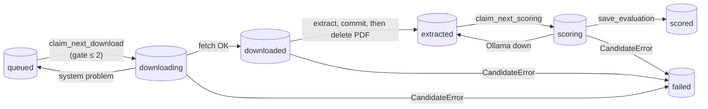
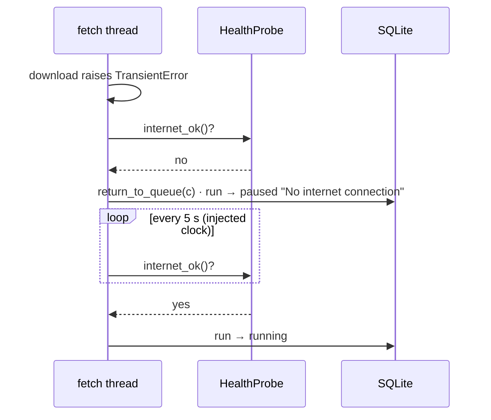

# Step 1.7 — The resumable job loop

## What was built
The worker is the engine's conductor. It moves each candidate through download → extract → score using three threads, and it keeps the promise: **no data is lost, and a run killed at any moment resumes exactly where it stopped.** The threads never hand candidates to each other in memory; the database *is* the queue, so a crash can only leave work in known states that recovery puts back. The worker also decides whose problem a failure is. A private link fails that candidate; a dropped internet connection or a stopped Ollama pauses the whole run without failing anyone, and the run resumes by itself when things come back. A bug that hits one candidate fails only that candidate, but the same bug five times in a row pauses the run instead of failing everyone. The Phase 1 exit criterion is proven here: the real worker, hard-killed 20 times, finishes with nothing lost or mixed up.

## Files
| File | Purpose | Key functions / classes |
|---|---|---|
| `engine/worker.py` | The three-stage pipeline, failure mapping, pause/resume, recovery | `Worker.start`, `pause`, `resume`, `stop`, `wait_idle`, `_fetch`, `_extract`, `_score`, `_transient`, `_unexpected`, `_reconcile`, `_maybe_auto_resume`, `_maybe_complete`, `_apply_filters` |
| `engine/health.py` | "Is it the machine?" probes | `HealthProbe.internet_ok`, `ollama_ok` |
| `engine/logs.py` | `engine.log`, 5 × 5 MB, with emails/phones scrubbed | `configure_logging`, `ScrubPII`, `remove_logging` |
| `engine/db.py` | Atomic claims; `mark_failed` clears `pdf_path` | `claim_next_download`, `claim_next_scoring`, `mark_failed` |
| `engine/tests/stubs/base.py`, `ollama_stub.py` | Shared stub-server plumbing; a fake Ollama (extended in 1.10) | `StubServer`, `OllamaStub`, `evaluation_for` |
| `engine/tests/test_worker.py` | 19 worker tests with fakes | see Tests |
| `engine/tests/test_worker_kill.py` | The exit criterion: 20 hard kills of the real worker | `WorkerKillTest` |
| `engine/tests/test_health_logs.py` | 8 tests | see Tests |

## How it works
1. **`start(run_id)`**: apply the hard filters (`mark_filtered` for CGPA below the minimum or a department not selected), run `recover_after_crash` and delete the orphan files it reports, set the run to `running`, and start three threads.
2. **Fetch thread**, each loop:
   - If the run is paused for an auto-resumable reason, poll the probe once per 5 s (`_maybe_auto_resume`).
   - Otherwise `claim_next_download(run, max_in_flight=2)` (gate + claim in one transaction) → `downloader.fetch` → `finish_download`.
   - With nothing to claim, `_reconcile()`, then `_maybe_complete()`.
3. **Extract thread**: take the oldest `downloaded` candidate → `extractor.extract(pdf)` → `split_sections` → `commit_extraction` → **then** delete the PDF.
4. **Score thread**: `claim_next_scoring` → `scoring_input` (identity removed) → `Scorer.score` → `save_evaluation` with flags (plus "pages 11+ not read" when `page_count > 10`) and a "Scored N" event.
5. **Errors** (§8):
   - `CandidateError` → `mark_failed`.
   - `SystemUnavailable` → hand the candidate back and pause.
   - `TransientError` → probe: healthy → fail as retryable; unhealthy → hand back and pause.
   - Anything else → `_unexpected` (fail as retryable, or pause after 5 in a row).
6. **`stop()`** (app quit): pause with "Atlas was closed", let each thread finish its current item, join. **`wait_idle()`** returns when the run isn't running and no thread is mid-item.





## Key decisions and why
- **The prefetch gate lives in the database** (`claim_next_download`: count and claim in one `BEGIN IMMEDIATE`). It can't be overstepped however the threads interleave, and a test proves that 6 threads × 10 attempts claim exactly 2. `scoring` doesn't count, so the model always has the next résumé ready.
- **Probe on failure, not before every call.** ARCHITECTURE §7 said "health gate before every network or LLM call". The call itself is the best probe, and probing first adds a TCP handshake per candidate without preventing anything. The outcome is the same: no candidate is ever failed for a system problem. §7 was updated.
- **Probe hosts are names, not IPs** (`drive.google.com`, `www.google.com`). With broken DNS every download fails; probing an IP would say "internet fine" and fail everyone. By name, the run pauses.
- **Busy flag before the claim, and `_reconcile`.** While reviewing the first draft I found that any unexpected error *after* a claim (say, in `save_evaluation`) would leave the candidate in `scoring` forever, holding a slot, so the run could never complete until restarted. Now every claim runs under a guard that fails or hands back the candidate. As a second net, when no stage is busy, anything still in `downloading`/`scoring` is handed back. Setting "busy" *before* claiming, under the same lock, makes this race-free.
- **Error streaks are per stage.** My first version counted "the same bug 5 times in a row" globally. The test showed why that's wrong: successful downloads kept resetting the counter while the scorer failed every candidate. The count is now per stage.
- **`resume()` also restarts a completed run.** That's how "Retry failed" works (`completed → running` is already allowed by the state machine). Found by the retry test.
- **`mark_failed` clears `pdf_path`.** The worker marks the candidate failed and then deletes its PDF. If it dies in between, the file is now an unreferenced orphan that recovery deletes; before, it stayed referenced by a failed candidate until someone pressed Retry.
- **A PDF that can't be deleted right now** (Windows file lock) is logged and left. It's unreferenced, so the next start's recovery deletes it (tested).
- **3 threads, as specified.** Auto-resume polling and the completion check ride on the fetch thread, which is idle whenever the run is paused.
- **Missing CGPA or department is not filtered out.** A student with no CGPA in the CSV isn't below the minimum; they're unknown. Filtering them would silently drop people. They are scored, and the filter reason says exactly why the others were removed.
- **The kill tests run on Windows**, where the recruiters are. The prompt said to skip them there; step 1.0 explains why that would have left no crash proof on the main platform.

## Failure handling
| Situation | What happens | Candidate failed / run paused / nothing | Message shown |
|---|---|---|---|
| Link private / 404 / not a PDF / too big | `mark_failed` | failed, permanent | the §8 reason from the downloader |
| Download times out, internet fine | probe OK → `mark_failed` | failed, retryable | The download timed out. |
| Internet down | download handed back, run paused, auto-resumes | **run paused, 0 failed** | No internet connection |
| Ollama stops mid-run | scoring candidate back to `extracted`, run paused, auto-resumes | **run paused, 0 failed** | Ollama isn't running |
| Disk full (download, or SQLite write) | handed back, run paused, waits for the user | run paused | Disk is full |
| Model deleted from Ollama | handed back, run paused | run paused | The model "X" is no longer installed in Ollama. Install it again, then press Resume. |
| PDF damaged | `mark_failed`, PDF deleted | failed, permanent | The PDF is damaged or password-protected. |
| PDF vanished before extraction | back to `queued`, downloaded again | nothing | — |
| A bug on one candidate | traceback logged, `mark_failed` | failed, retryable | Something went wrong while processing this résumé. |
| The same bug 5× in a row in one stage | 5th handed back, run paused | run paused | Atlas hit repeated errors. See logs. |
| App closed | current items finish, run paused | run paused | Atlas was closed |
| Process killed | next `start` recovers | run paused until resumed | Atlas closed unexpectedly. Press Resume to continue. |

## Tests
Added **33** (19 worker, 1 worker-kill, 8 health/logs, 5 db); total **233**.
- **HappyPathTests (5)**: 20 candidates all scored in CSV order, **never more than 2 PDFs on disk and never more than 2 in flight** (sampled every millisecond), durations and events recorded; the gate stops downloads while extraction is blocked; the PDF exists during `commit_extraction` and is gone after; an undeletable PDF is cleaned up at the next start; >10 pages → flag.
- **SystemProblemTests (5)**: **network loss → paused "No internet connection", 0 failed, stays paused until the injected clock passes 5 s, then auto-resumes and completes**; **Ollama loss → paused, the in-flight candidate back in `extracted`, 0 failed, auto-resumes**; disk full → paused, never auto-resumes, completes after `resume()`; a transient error with a healthy probe fails only that candidate; "Paused by you" never resumes on its own.
- **CandidateFailureTests (2)**: permanent and retryable failures at all three stages with exact reasons, the damaged PDF deleted; then `retry_failed` + `start` → the retryable ones complete, and the scoring failure is **not re-downloaded**. A vanished PDF is downloaded again.
- **UnexpectedErrorTests (4)**: one bug fails one candidate with a logged traceback; **3 failures, a success, then 5 in a row → 7 failed, the 5th handed back, run paused**; a failure after the claim never leaves a candidate stuck; `_reconcile` only acts when no stage is busy.
- **StopAndRecoveryTests (2)**: `stop()` → "Atlas was closed", nothing left mid-flight, and a **new** `Worker` finishes all 25 with exactly 25 evaluations; `start` recovers a mid-download, a mid-scoring and an orphan left by a crash.
- **FilterTests (1)**: CGPA and department filters with exact reasons; filtered candidates are **never downloaded**; missing CGPA/department is kept; "c.s.e." matches "CSE".
- **WorkerKillTest (1)**: **30 candidates, 20 hard kills of the real worker (real downloader, PDF extraction, scorer and HTTP) against the stubs, then an uninterrupted run**: every candidate scored or failed with the exact reason, evaluations = scored, every score matches that candidate's own résumé, no PDFs or `.part` files left, integrity ok. About 13 s on Windows.
- **HealthTests (4)**, **LogTests (4)**: either host answering is online; hosts are names; emails and phones are scrubbed from messages *and* tracebacks, RA numbers kept; one handler per file; 5 × 5 MB rotation.
- **db (5)**: gate and CSV order; `scoring` not counted; concurrent claims never exceed the gate; `claim_next_scoring`; failing clears `pdf_path`.

## How to try it yourself
```bash
.venv/Scripts/python -m unittest engine.tests.test_worker -v
.venv/Scripts/python -m unittest engine.tests.test_worker_kill -v
# test_killed_twenty_times_then_finishes_with_nothing_lost ... ok   (≈13 s)
```

## Known limitations
- `stop()` waits for the current items, up to 30 s. A slow model answer can outlast Electron's 10 s shutdown grace; the process is then killed and recovery handles the rest (proven by the kill test).
- A run paused for "No internet connection" when the app quits keeps that reason, but nothing polls after a restart until the run is resumed. Phase 2's server should start a worker for such runs at launch.
- A captive portal (hotel Wi-Fi) passes the TCP probe; downloads then fail as "isn't a PDF" (permanent).
- `pause()` doesn't interrupt a download or model call already running; it only stops new claims.
- Purely numeric RA numbers of 10–13 digits look like phone numbers and are scrubbed in `engine.log` (not in the database).
- One worker handles one run at a time (`WorkerBusyError` otherwise).

## Concepts to learn
- **The database as a queue**: claiming work by an atomic state change (`UPDATE … WHERE state = 'queued'`) makes crash recovery a matter of looking at states.
- **Compare-and-set**: every transition says which state it expects, so two threads can never both claim one candidate.
- **Backpressure**: the prefetch gate keeps downloads just ahead of the slow stage (the model), bounding disk use and wasted work.
- **Classifying failures by probing**: an ambiguous error becomes a clear one by asking a second, independent question ("can I reach anything at all?").
- **Crash-only design**: if killing the process is always safe, graceful shutdown becomes an optimisation rather than a requirement.
