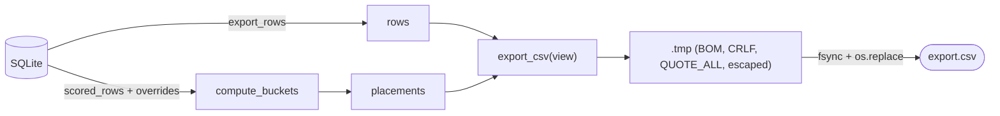

# Step 1.8 — CSV export

## What was built
The recruiter's deliverable is a spreadsheet. `export_csv` writes one view of a run (All, Shortlisted, Cutoff, Rejected or Failed) as a CSV that opens cleanly in Excel. Indian names in Tamil or Devanagari display correctly, thanks to the UTF-8 BOM. A student who types `=HYPERLINK(...)` as their name can't make Excel run a formula, thanks to formula-injection escaping. A crash or a full disk never leaves half a file, because the file is written to a temp name and renamed atomically. The export takes plain data and never touches the database; a small read-only query, `Database.export_rows`, prepares that data for the CLI now and the API server in Phase 2.

## Files
| File | Purpose | Key functions / classes |
|---|---|---|
| `engine/export.py` | Views, columns, escaping, atomic write | `export_csv`, `ExportError`, `COLUMNS`, `VIEWS`, `_escape` |
| `engine/db.py` | Every candidate joined with its evaluation, JSON decoded | `Database.export_rows` |
| `engine/tests/test_export.py` | 12 tests | see Tests |

## How it works
1. The caller gathers `rows = db.export_rows(run_id)` and `placements = compute_buckets(db.scored_rows(run_id), …).placements` (with overrides).
2. `_select` picks and orders rows for the view:
   - bucket views: that bucket, by rank;
   - `failed`: failed candidates;
   - `all`: scored by rank, then failed, filtered, and not-yet-scored.
3. `_cells` builds each row for the §16 columns. Rank, bucket and "how placed" come from the placement; lists are joined with " | "; the failure reason falls back to the filter reason.
4. `_escape` prefixes `'` to any cell starting with `=` `+` `-` `@` tab or CR, including after leading spaces.
5. Write to `.export-XXXX.tmp` in the same folder with `utf-8-sig`, CRLF and `QUOTE_ALL`, then `flush`, `fsync`, `os.replace`. The temp file is removed on every path.



## Key decisions and why
- **Plain data in, file out.** `export.py` imports neither `db.py` nor SQL, as the prompt requires, so it can be tested with dictionaries. The join lives in one read-only `Database.export_rows`, so the CLI and the Phase 2 server share it instead of each writing SQL. I also removed the `export → db` arrow from the ARCHITECTURE §3 diagram, which contradicted "stage modules never import db".
- **A "Flags" column was added.** Schema v2 stores flags such as "Possible instructions to the AI found in résumé", and a recruiter reviewing a shortlist in Excel needs to see them.
- **Escaping also after leading spaces.** Excel can still evaluate `"   =1+1"`; the §16 rule was widened to cover it.
- **Only the All view has a Bucket column**, per §16. The per-bucket views still have "How placed", so filled-to-minimum and moved-by-recruiter candidates stay labelled.
- **Phones are exported as plain digits.** A 10-digit number displays in full in Excel's General format; scientific notation only starts at 12 digits.
- **Readable errors for the common Windows case.** If the CSV is open in Excel, the rename fails; the recruiter sees "export.csv is open in another program. Close it and export again." instead of `PermissionError`.

## Failure handling
| Situation | What happens | Candidate failed / run paused / nothing | Message shown |
|---|---|---|---|
| Crash or exception mid-write | temp removed, target untouched | nothing | the error, to the caller |
| Target file open in Excel | temp removed, target untouched | nothing | export.csv is open in another program. Close it and export again. |
| Disk full | temp removed, target untouched | nothing | The disk is full. Free some space and export again. |
| Unknown view name | `ValueError` before writing | nothing | lists the valid views |

## Tests
Added **12**; total **245**.
- **FormatTests (4)**: BOM, CRLF, `QUOTE_ALL`, the exact §16 column order and values; **seven formula-injection shapes escaped, including `=HYPERLINK("x")`**; ordinary names and hyphenated departments untouched; **Tamil and Hindi names round-trip**.
- **ViewTests (4)**: All has every candidate in the right order with bucket labels and reasons; bucket views have no Bucket column and follow rank; fill and override labels; unknown view.
- **AtomicWriteTests (3)**: **a crash on the third row leaves no file at all**; a failed re-export keeps the previous file byte-for-byte; a file open in Excel gives the readable error.
- **DatabaseRowsTests (1)**: `export_rows` from a real database through buckets to CSV, with escaping.

## How to try it yourself
```bash
.venv/Scripts/python -m unittest engine.tests.test_export -v
# Through the CLI (step 1.9):
.venv/Scripts/python -m engine.cli export --run 1 --data-dir ./data --view shortlisted --out shortlisted.csv
```

## Known limitations
- The escape shows the apostrophe in the cell (`'+91 98765 43210`). That's the documented trade-off of this defence.
- No `.xlsx` output (it would need a dependency).
- Evidence quotes and summaries aren't exported; the results screen (Phase 2) is the place for them.

## Concepts to learn
- **CSV/formula injection**: spreadsheet apps execute cells that start with `=`, so user-supplied text must be neutralised on export.
- **Byte order mark (BOM)**: the three bytes `EF BB BF` tell Excel "this CSV is UTF-8"; without them it guesses cp1252 and garbles non-Latin names.
- **Atomic file replacement**: `write temp → fsync → os.replace` is the standard way to never leave a half-written file.
- **Separation of data preparation and rendering**: the same rows feed the CSV now and the UI later.
