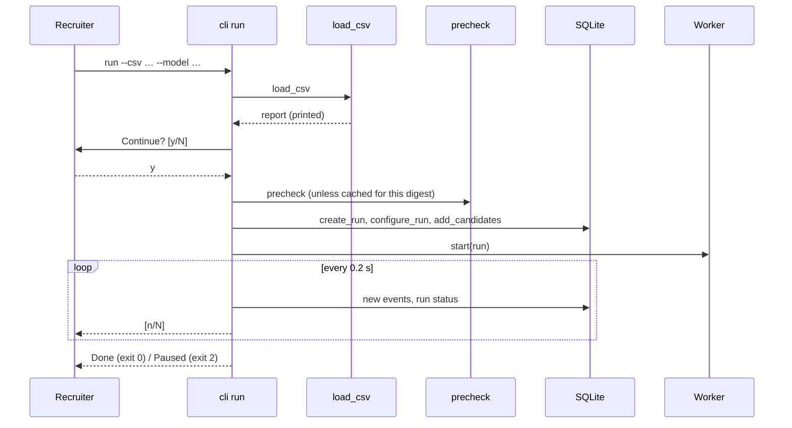

# Step 1.9 — The headless CLI

## What was built
`python -m engine.cli` lets anyone run a full screening without the desktop app. It checks a CSV and screens it, prints progress, pauses and resumes, re-buckets with different cutoffs, exports CSVs and retries failures. It's the proof that Phase 1 works end to end, and it calls exactly the engine functions the Phase 2 API will wrap, so it also serves as a working specification for `server.py`. It asks before saving anything, pre-checks the model once per model version, prints candidates by id and RA number only, and uses exit codes a script can rely on: 0 finished, 2 paused, 1 error.

## Files
| File | Purpose | Key functions / classes |
|---|---|---|
| `engine/cli.py` | Argument parsing, the six commands, the progress loop | `main`, `build_parser`, `_Cli.cmd_*`, `_Cli._drive`, `_Cli._checked_model`, `_wait` |
| `engine/tests/test_cli.py` | 10 tests against the Drive and Ollama stubs | see Tests |

## How it works
1. `main(argv)` parses the command. Usage errors exit **1** (argparse's own 2 would mean "paused").
2. **`run`:**
   - `load_csv` and print the report; stop if the file is unusable.
   - Ask `Continue? [y/N]` (skipped with `--yes`). Nothing is written before this.
   - Open `<data-dir>/atlas.db` and `engine.log`.
   - `_checked_model`: reuse a cached pre-check for this model *and digest*, or run `precheck` and cache it in `settings`.
   - Create and configure the run, add the rows, then `_drive`.
3. **`_drive`** builds the `Worker` (real downloader, PDF extractor with optional OCR, scorer, health probe) and starts or resumes it. Every 0.2 s it prints new candidate events (`[12/40] #12 RA0012: Scored 72`) and watches the run status:
   - `completed` → summary, exit 0;
   - paused for no internet / Ollama → keep waiting, since the worker resumes by itself;
   - any other pause → exit 2 with the `resume` command to type.
4. **Ctrl+C** → `Worker.stop()` → paused "Atlas was closed" → exit 2.
5. `resume`, `retry`, `results` and `export` open the same database and call `Worker.resume`, `retry_failed` + `Worker.start`, `compute_buckets` (with optional preview cutoffs) and `export_csv`.



## Key decisions and why
- **Nothing is saved until the recruiter says yes *and* the model passes.** A declined run or a failed pre-check leaves no half-created run behind (tested: no database file at all).
- **The pre-check is cached per model *and digest*.** Re-pulling a model changes the digest, so the new weights get re-checked; the same model is checked once, not per run.
- **The run stores the installed model name** (`qwen3` → `qwen3:latest`), so the locked config says exactly what ran.
- **Auto-resumable pauses don't end the CLI.** When the internet drops, the CLI keeps waiting and prints "Atlas will continue by itself when it's back", matching the app's behaviour.
- **Exit code 1 for usage errors**, overriding argparse's 2, because the prompt defines 2 as "paused".
- **The Ctrl+C test needed its own seam (`_wait`).** Patching `time.sleep` inside the CLI also patched it for the stub servers' threads (it's the same module object), so the fake Ctrl+C fired in the wrong thread.
- **Progress counts events as they arrive.** Reading the counts at print time showed two candidates as `[2/5]` when both finished between polls.
- **Windows console:** stdout replaces characters the console can't encode instead of crashing. Set `PYTHONIOENCODING=utf-8`, or use Windows Terminal, for `→` and `é`.

## Failure handling
| Situation | What happens | Candidate failed / run paused / nothing | Message shown / exit |
|---|---|---|---|
| CSV unusable | report printed, nothing saved | nothing | "Fix the file and try again. Nothing was saved." · 1 |
| Recruiter answers no | nothing saved | nothing | "Stopped. Nothing was saved." · 1 |
| Model not installed / Ollama down / model unusable | no run created | nothing | pre-check message · 1 |
| Internet or Ollama drops mid-run | keeps waiting | run paused, auto-resumes | "Paused: … Atlas will continue by itself when it's back." |
| Disk full, model deleted, repeated errors | worker stopped | run paused | "Paused: …" plus the resume command · 2 |
| Ctrl+C | `Worker.stop()` | run paused "Atlas was closed" | resume command · 2 |
| Unknown run id / bad options | — | nothing | "Run 99 does not exist." / usage · 1 |
| Export target open in Excel | — | nothing | "… is open in another program. Close it and export again." · 1 |

## Tests
Added **10**; total **255**.
- `test_preflight`: exit 0 with the report; 1 with "No column for RA number".
- `test_run_results_export_and_retry`: a 4-student run (one private link) → exit 0; progress lines with RA numbers and the exact failure reason; **no names, emails or phones in the output**; `results` counts and top list; **preview cutoffs re-bucket without re-scoring**; shortlisted export; `retry` with nothing to do; `--include-permanent` retries the private one (still private).
- `test_declining_saves_nothing` / `test_confirming_runs`: the `[y/N]` prompt.
- `test_model_that_is_not_installed`: exit 1, no run created.
- `test_the_precheck_is_cached_per_model`: the second run sends only the candidates' chats.
- `test_criteria_from_a_file`: `--criteria @file.txt`.
- `test_model_removed_mid_run_pauses_with_exit_2_then_resumes`: the model disappears after two candidates → exit 2 with the pause reason → `resume` finishes all 5.
- `test_ctrl_c_pauses_gracefully_and_resume_finishes`: Ctrl+C → exit 2, paused "Atlas was closed" → `resume` → all 8 scored.
- `test_errors_exit_1`: unknown run, missing options.

## How to try it yourself
With Ollama running and a model pulled:
```bash
set PYTHONIOENCODING=utf-8                     # Windows cmd; PowerShell: $env:PYTHONIOENCODING="utf-8"
.venv/Scripts/python -m engine.cli preflight --csv students.csv
.venv/Scripts/python -m engine.cli run --csv students.csv --model qwen3:8b --criteria @criteria.txt --data-dir ./atlas-data
#   [1/40] #1 RA2111003010001: Scored 72
#   …
#   Done. Scored 38, failed 2, filtered 0.
.venv/Scripts/python -m engine.cli results --run 1 --data-dir ./atlas-data --shortlist 70
.venv/Scripts/python -m engine.cli export --run 1 --data-dir ./atlas-data --view shortlisted --out shortlisted.csv
```

## Known limitations
- No `cancel` or `override` commands; overrides exist in the database API and in Phase 2's UI.
- The CLI processes one run at a time and must stay open. Closing the terminal kills it; `resume` recovers.
- A console without UTF-8 shows `?` for `→`.
- OCR models are expected in `<data-dir>/ocr-models`; nothing downloads them (by design, see step 1.5).

## Concepts to learn
- **Exit codes as an API**: scripts and CI decide what to do next from 0/1/2 without parsing text.
- **Confirm before side effects**: validate and show everything first, write only after a yes.
- **Caching by content hash**: keying the pre-check on the model digest invalidates it exactly when the model changes.
- **Test seams**: a tiny function (`_wait`) that tests can replace beats patching a global module other threads share.
