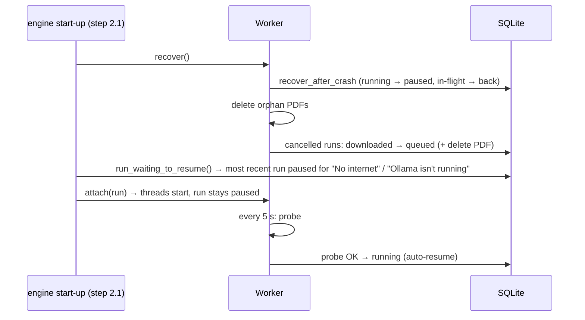

# Step 2.0 — Deferred work recorded, engine gaps filled

## What was built
Before the app can exist, the engine needed a few things the Phase 1 summary listed as missing:
- a way to recover from a crash at start-up, separate from starting a run;
- a way to cancel a run;
- a way to put filtered-out students back;
- automatic resume that survives an app restart;
- Excel input;
- model downloads;
- a time estimate.

This step adds all seven, with tests. It also writes down, in PLAN.md, the work the first real-data run showed must happen before Atlas is used on real students. One item is marked as blocking: redaction of the student's own name as it appears on the résumé.

## Files
| File | Purpose | Key functions / classes |
|---|---|---|
| `PLAN.md` | New **Deferred (must finish before real use)** section; Progress line | — |
| `engine/worker.py` | Boot recovery, cancel, attach (auto-resume after restart), one run at a time, filters once, timing history | `Worker.recover`, `Worker.cancel`, `Worker.attach`, `run_waiting_to_resume`, `_detach`, `_release_in_flight` |
| `engine/db.py` | Put filtered candidates back; this run's scoring times | `Database.clear_filters`, `Database.scoring_durations` |
| `engine/ingest/csv_loader.py` | `.xlsx` input through the same pre-flight; `.xls` refused | `load_table`, `load_csv` (wrapper), `_cell_text`, `_build_report` |
| `engine/llm/client.py` | Stream a model download from Ollama | `OllamaClient.pull`, `PullProgress` |
| `engine/estimate.py` | Pure time estimate: pre-check, history or measured | `estimate`, `Estimate`, `ewma`, `remember`, `TIMING_SETTING` |
| `engine/errors.py` | Recruiter wording for failed downloads of a model | `Pull`, `PullError` |
| `engine/tests/stubs/ollama_stub.py` | Fake `/api/pull` with layered progress, unknown names, and a delay | `OllamaStub.pullable`, `pull_step_delay` |
| `engine/requirements.txt`, `requirements-dev.txt` | `openpyxl` added (pre-approved); dev file for step 2.1's test client | — |

## How it works

**Boot, cancel and attach**


- **`recover()`** is the crash recovery that `start()` used to run every time. It now runs **once per worker**. The server will call it at boot; `start()` still calls it if nobody has, so the CLI and the kill tests behave exactly as before.
- **`cancel(run)`** marks the run `cancelled` first, so no thread claims new work. It then stops the threads. The last thread to exit hands back what's in flight and deletes the PDFs. A model call on a CPU can take minutes, so `cancel` doesn't wait for it; the score that call produces is still saved.
- **`attach(run)`** starts the threads for a paused run *without* resuming it. The fetch thread's existing 5-second probe then resumes it when the connection comes back. This fixes Phase 1 risk #9: "auto-resume doesn't survive an app restart".

**Filters and `clear_filters`**
- `Worker.start()` used to apply hard filters on every start, including resume. That would immediately re-filter students the recruiter had put back. Filters are now applied **once, when the run leaves draft**. On the first start that's identical; after that it was idempotent anyway.
- `clear_filters` moves `filtered → queued` for a draft or paused run, **without touching the run's filter settings**. Those stay locked (CLAUDE.md rule 11).

**One run at a time.** ARCHITECTURE has one worker per engine. Starting run B while run A is *running* raises `WorkerBusyError`. If A is paused, completed or cancelled, its threads are stopped first, and it keeps its status and pause reason. A tiny race is covered: an auto-resume flipping A to running just as B starts is put back to paused, with the same reason.

**Excel.** `load_table` checks the file's first bytes:
- a zip file means `.xlsx`, read with openpyxl;
- an OLE2 file, or any `.xls`, is refused: "Save this file as .xlsx or CSV and try again."

Each `.xlsx` cell becomes the text Excel shows:
- **Whole numbers** are written in full. A phone stored as a number would otherwise come out as `9.19877E+11`; Excel only shows that because the column is narrow.
- **Other numbers** keep up to 15 significant digits, or the decimals their format asks for.
- **Dates** become ISO dates.

The rest of the pre-flight is the same code for CSV and Excel (`_build_report`). The only Excel-specific step: a résumé-link cell whose text is "Resume" is replaced by its hyperlink target. A `mailto:` link on the email column is ignored.

**Model pull.** `OllamaClient.pull(name)` posts to `/api/pull` and yields `PullProgress(status, completed, total)` for each line Ollama streams back.
- Closing the generator closes the connection, which is how the app cancels a pull.
- If Ollama isn't running, it raises `SystemUnavailable("Ollama isn't running")`.
- If the pull itself fails, it raises `PullError` with wording from `errors.py`: "There is no model called "X". Check the name at ollama.com/library." or "The model couldn't be downloaded. Check your internet connection and try again."

**Estimate.** `estimate(remaining, measured=, history=, precheck_seconds=)` is pure: the server gathers the numbers and it only does arithmetic.

| Basis | Label | When | Range |
|---|---|---|---|
| `measured` | Measured | 5+ résumés of this run scored | EWMA of this run's times, ×0.85–1.2 |
| `history` | Based on earlier runs on this computer | earlier runs with this model | median of the last 200 times, ×0.8–1.3 |
| `precheck` | Rough estimate | nothing else known | the pre-check's duration, ×0.7–1.5 |

The worker records every scoring time in `settings["scoring_seconds"][model]`.

## Key decisions and why
- **The missing `prompts/phase1-11.md`.** The Deferred section should list its items 1.11a–g, but the file isn't in the repository or its history.
  - I recorded **1.11a (redaction) as blocking**, exactly as asked.
  - The other items come from smoke test 1 and are deliberately *not* numbered, so nothing pretends to be the owner's plan.
- **Recovery once per worker, not per start.** The server runs it at boot. Running it again while switching runs in the same process would be safe but pointless. And if a future bug left threads alive, re-running it could undo a live claim. The kill tests are unchanged and green.
- **Cancel doesn't wait for the model.** On the smoke-test laptop one call takes 2–4 minutes, and a Cancel button that freezes that long feels broken. Cleaning up in the last thread's exit path, with `recover()` as a backstop, keeps the promise without the wait.
- **`clear_filters` doesn't edit the locked config.** Rule 11 says filters are locked after start, so clearing is modelled as "these students are screened after all", like an override, not as a config change.
- **Whole numbers from Excel are written in full,** not as "displayed". Excel's `9.19877E+11` is a display artefact of column width and destroys the phone number. The stored value has every digit.
- **Estimate multipliers are the ones in the brief.** Smoke test 1 shows the pre-check-based figure is about 2.5× too optimistic on a CPU laptop. I kept the specified maths and the "Rough estimate" label, and recorded this in ARCHITECTURE §15 and PLAN's Deferred list, rather than inventing a fudge factor. The measured basis takes over after 5 résumés.

## Failure handling
| Situation | What happens | Candidate failed / run paused / nothing | Message shown |
|---|---|---|---|
| App restarts while a run is paused for no internet or Ollama | worker attached at boot; resumes when the probe succeeds | nothing | pause reason until then |
| Cancel while a model call is running | cancel returns; the call finishes and its score is saved; the last thread releases the rest | nothing | — |
| App closed right after a cancel | next boot's `recover()` releases the run's PDFs | nothing | — |
| Start a second run while one is running | refused | nothing | "Another screening is running. Pause it before starting this one." |
| Previous run's threads won't stop within 10 s | refused | nothing | "Atlas is still finishing the previous screening. Try again in a minute." |
| `clear_filters` on a running or completed run | refused | nothing | "Filtered candidates can be added back only while screening is paused." |
| `.xls` file | refused at pre-flight | file error | "Save this file as .xlsx or CSV and try again." |
| Damaged `.xlsx` | refused at pre-flight | file error | "The Excel file couldn't be read. Open it in Excel, save it again as .xlsx or CSV, and try again." |
| Pulling a model name that doesn't exist | stream reports an error | — | "There is no model called "X". Check the name at ollama.com/library." |
| Ollama stops during a pull | — | — | "The model couldn't be downloaded. Check your internet connection and try again." |

## Tests
Added **53** (total **310**: 309 run, 1 skipped). The worker kill test and the DB kill test are unchanged and green.

- **`test_worker_lifecycle.py` (19):**
  - recover runs once and `start` doesn't repeat it; `start` still recovers when nobody called `recover`;
  - `recover` releases a cancelled run's PDF, and refuses while threads run;
  - cancel a running run: scores kept, nothing in flight, no PDFs, no work after;
  - cancel a paused run with no threads; cancel a draft;
  - cancel returns in under 3 s while a model call is blocked, and the last thread cleans up;
  - a completed run can't be cancelled, and a cancelled run can't start;
  - attach auto-resumes a run paused for Ollama or no internet after a "restart";
  - manual pause reasons are never attached; the most recently paused run is chosen;
  - a second run is refused while the first runs; a paused run is detached and later resumed; a finished run doesn't block the next;
  - filters apply once and cleared candidates are scored while the config stays locked;
  - timing history is recorded per model.
- **`test_db.py` (+5):** `clear_filters` for paused and draft runs, refused while running or completed, unknown run; `scoring_durations` in order and per run.
- **`test_table_loader.py` (15):**
  - phones stored as numbers stay digits; a "Resume" cell uses its hyperlink; `mailto:` is ignored;
  - number formats; a title row above the header; first sheet only; spreadsheet row numbers;
  - a missing link column; an empty workbook; a damaged workbook;
  - `.xls` by extension and by content; CSV unchanged through `load_table`;
  - 12 cell-text cases.
- **`test_estimate_pull.py` (14):**
  - each estimate basis and its range; four measured résumés aren't enough; nothing left; negative remaining;
  - the dict fields; the EWMA; bounded history;
  - pull streams progress and installs the model; an unknown name; Ollama down; closing early cancels.

## How to try it yourself
```bash
.venv/Scripts/python -m unittest engine.tests.test_worker_lifecycle engine.tests.test_table_loader engine.tests.test_estimate_pull -v
# 48 tests … OK
.venv/Scripts/python -m engine.cli preflight --csv some_fictional.xlsx     # .xlsx now works in the CLI too
```

## Known limitations
- **Only one worker thread set per engine.** Two runs can't screen at the same time. That's by design (one model, one CPU), but the UI must explain it (step 2.5).
- **Cancelling can't interrupt a model call already in progress.** The call finishes, up to minutes on a CPU, before the threads are free for another run.
- **The `precheck` estimate is optimistic on CPU laptops**, about 2.5× in smoke test 1. Phase 3 calibration is the fix.
- **`.xlsx` percentages and dates are rendered by simple rules,** not Excel's full format language. Phones, RA numbers, CGPA and links, the fields that matter, are covered by tests.

## Concepts to learn
- **Idempotent start-up:** a recovery that is safe to run twice, but that you still run once on purpose.
- **Clean-up on the last thread's exit:** how to make "cancel" fast without leaving work half-done.
- **Magic bytes vs file extensions:** trust the first bytes of a file, not its name.
- **Generators as cancellable streams:** `close()` on a Python generator runs its `finally`, which closes the HTTP connection.
- **EWMA:** a moving average that follows recent speed changes (the laptop gets hot, another app starts) without jumping on one slow résumé.
