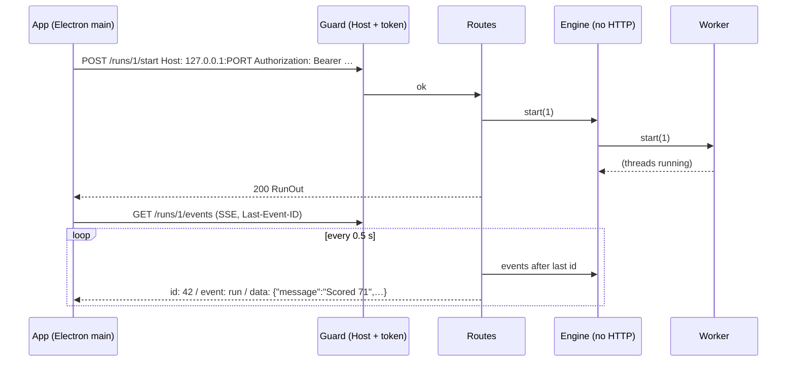

# Step 2.1 — The local API (`engine/server.py`)

## What was built
The engine now runs as a small web server that only this computer can reach. It listens on `127.0.0.1` at a random port and only answers requests carrying a secret token the app generates at launch.

Everything the recruiter will do in the app goes through it:
- **Screening:** create a screening, check a file, choose and test a model, start, pause, resume and cancel.
- **Results:** watch progress live, look at results with cutoffs that move instantly, and move a candidate by hand.
- **Files and settings:** export, change settings and delete data.

It speaks the same rules as the CLI because it calls the same engine code. The screens in steps 2.4–2.8 only display what it returns.

## Files
| File | Purpose | Key functions / classes |
|---|---|---|
| `engine/server.py` | App factory, guard, routes, error mapping, SSE, launch | `Engine`, `EngineOptions`, `create_app`, `Guard`, `parse_multipart_file`, `export_openapi`, `main` |
| `engine/api_models.py` | Every request and response shape (→ OpenAPI → TypeScript) | `RunOut`, `PreflightOut`, `ResultsOut`, `CandidateOut`, `ProgressOut`, … |
| `engine/filters.py` | The CGPA/department rule, shared by the worker and the live preview | `filter_reason`, `preview`, `department_counts`, `department_key` |
| `engine/errors.py` | `Api` messages: what the API says when it can't do something | `Api` |
| `engine/db.py` | Completed runs may change cutoffs; run info; results query; per-candidate overrides/events; VACUUM; clear settings | `configure_run`, `update_run_info`, `results_rows`, `overrides_for`, `candidate_events`, `last_event_id`, `vacuum`, `clear_settings` |
| `engine/ingest/csv_loader.py` | Pre-flight issues grouped with labels for the app | `issue_groups`, `ISSUE_GROUPS` |
| `engine/ingest/links.py` | "What kind of link was pasted", by the downloader's own rules | `link_kind` |
| `engine/llm/client.py` | Ollama's version for Settings → About | `OllamaClient.version` |
| `app/src/shared/api-schema.json` | The exported OpenAPI schema (generated) | — |
| `engine/tests/test_server.py`, `test_api_support.py` | 39 tests | — |

## How it works


- **Two layers.** `Engine` holds every behaviour as plain Python methods: no requests, no JSON. `create_app()` is a thin FastAPI layer over it. Tests exercise the real HTTP layer with TestClient against a real `Engine`, whose worker downloads from the Phase 1 Drive stub and scores with the Ollama stub.
- **The guard** is raw ASGI middleware, so it never buffers a streaming response. It checks, in order:
  - `Host` is exactly `127.0.0.1:<port>`, or 403;
  - `Authorization` equals `Bearer <token>` (`hmac.compare_digest`), or 401, except on `/health`;
  - anything unhandled becomes `{"code": "internal", "message": "Something went wrong inside Atlas. The details are in the log file."}`, with the trace written only to the log.
- **Errors are always `{code, message}`.** Database lock errors keep their own sentence ("A run's model, criteria and cutoffs are locked once it starts."). Everything else uses `errors.Api` wording.
- **Upload** (`POST /runs/{id}/table`):
  1. the multipart body is read with a 20 MB cap;
  2. the file is saved in `<data>/uploads/`;
  3. `load_table` runs, and the report comes back as JSON: summary, file errors, row issues grouped with labels and row/RA lists, columns, and departments with counts for the Cutoffs chips.

  Nothing reaches the database until `/table/confirm`.
- **Results** (`GET /runs/{id}/results?shortlist=&band=&min=…`) run `compute_buckets` on every call with the cutoffs in the query, and never save them. They return:
  - counts, the histogram and the notes;
  - the change against the saved cutoffs ("+12 to Shortlisted, −12 from Cutoff" comes straight from `delta`);
  - failure groups and a page of rows.

  Search, sort and paging happen here too, so the renderer never touches bucketing (rule 16).
- **Live updates** come from two SSE streams, both read from storage by id, so a reconnect with `Last-Event-ID` misses nothing:
  - `/runs/{id}/events` reads the `events` table;
  - `/events` carries app-level events: model-pull progress (throttled to 4 a second), and a status watcher's `run_status` changes, which step 2.2's keep-awake and notifications listen to.
- **Launch** (`python -m engine.server`):
  1. it binds the socket first, so it knows its port;
  2. it runs `Engine.boot()`: recovery, emptying `uploads/` and `exports/`, attaching a run paused for a connection problem;
  3. once uvicorn is listening, it writes `ATLAS_READY port=N\n` as raw bytes. That is the only thing it ever writes to stdout; uvicorn's own logging goes to `engine.log`.

## Key decisions and why
- **The token is passed in the environment (`ATLAS_TOKEN`)** as well as `--token`. A command line is visible to every process on the machine (Task Manager, `ps`); an environment isn't. ARCHITECTURE §2 is updated.
- **`--watch-stdin`** lets the engine notice the app has gone even if Electron crashes without calling `/shutdown`. It then shuts down gracefully instead of running on with a model loaded. Reading stdin in a background thread crashed Python at exit on Windows ("_enter_buffered_busy", exit code 0xC0000005); reading the raw descriptor with `os.read` fixed it, and the launch test covers both exits.
- **The ready line is written as bytes.** Windows text mode turned `\n` into `\r\n`. The line is a protocol, so it must be byte-identical on both OSes.
- **The multipart reader is hand-written.** FastAPI's form parsing needs `python-multipart`, which isn't pre-approved. One file field is about 30 lines to read, and a test checks that binary content (an `.xlsx`) comes back byte for byte.
- **Two export routes.** `GET …/export` is the download the brief asked for. `POST …/export {view, path}` writes straight to the path the native save dialog returns. That reuses Phase 1's atomic writer and its "…is open in another program. Close it and export again." message, instead of re-implementing both in TypeScript.
- **One active run.** Starting a second run while one is *running* returns `409 busy` with "Another screening is running. Pause it before starting this one." This follows from one worker per engine (step 2.0).
- **Shutdown waits 8 s, not 30.** It stays under the app's 10 s grace, so the run's reason is always "Atlas was closed" (a plain Resume), never "closed unexpectedly". This fixes Phase 1 risk #10.
- **`list` endpoints never error when Ollama is down.** `/models` returns `ollama_running: false` and `/system` returns `running: false`, so the Welcome screen can show a calm banner instead of an error.

## Failure handling
| Situation | What happens | Candidate failed / run paused / nothing | Message shown |
|---|---|---|---|
| No or wrong token | 401 | nothing | "This request didn't come from the Atlas app." |
| Wrong `Host` (DNS rebinding) | 403 | nothing | "Atlas only accepts requests from this computer." |
| Unknown run, candidate or route | 404 | nothing | "That item doesn't exist any more. It may have been deleted." |
| Bad field in a request | 422 | nothing | "Something in the request isn't valid. Check "shortlist_cutoff"." |
| Config change after start | 409 | nothing | "A run's model, criteria and cutoffs are locked once it starts." |
| Start a second run | 409 | nothing | "Another screening is running. Pause it before starting this one." |
| Upload over 20 MB | 413 | nothing | "This file is larger than 20 MB. Save just the student sheet as .xlsx or CSV and try again." |
| Upload a PDF | 415 | nothing | "Choose a CSV or Excel (.xlsx) file." |
| Confirm a file with file-level errors | 409 | nothing | "This file can't be used yet. Fix the problems listed, then add it again." |
| Export target open in Excel | 409 | nothing | "all.csv is open in another program. Close it and export again." |
| Ollama down during a pre-check | 503 | nothing | "Ollama isn't running" |
| Any bug in a route | 500; trace only in `engine.log` | nothing | "Something went wrong inside Atlas. The details are in the log file." |
| App crashes without calling shutdown | stdin closes → graceful stop | run paused | "Atlas was closed" |

## Tests
Added **39**: `test_server.py` 30 and `test_api_support.py` 9. Total **349** (348 run, 1 skipped).
- **Auth:** `/health` is open; 6 bad token forms and 4 bad hosts are refused; the right token and host pass.
- **The full flow in one test:**
  - create → upload → grouped pre-flight (missing link, duplicate RA, shared link, departments);
  - a live filter preview; the model pre-check turns `not_checked` into `ready`;
  - configure → an estimate from the pending file → confirm (a second confirm is refused) → start → complete;
  - progress with failures grouped; the SSE backlog, then `Last-Event-ID`;
  - results with a filled-to-minimum row, live cutoffs with the delta and nothing saved;
  - cutoffs saved on the completed run while criteria stay locked;
  - search, bucket, sort and paging;
  - an override with a note, shown in the detail; overriding a failed candidate is refused;
  - export by download and to a path, with a relative path refused; the Welcome list.
- **Uploads and retries:** `.xlsx` upload; replacing the file before confirm; a file with no link column can't be confirmed; retry-failed (retryable only, then with permanent) and clear-filters refused on a completed run.
- **Locks and lifecycle:**
  - every config field is locked after start, but renaming still works;
  - pause/resume, "only a running screening can be paused", one run at a time, and a completed run can't be cancelled;
  - cancel while running (nothing in flight, PDFs gone); cancelling a draft discards its upload;
  - `/shutdown` pauses with "Atlas was closed" and asks to exit;
  - after a restart, a run paused for Ollama resumes by itself.
- **Error bodies:** 14 kinds of 4xx and 5xx are exactly `{code, message}` with no trace, file name or exception name. A forced bug returns a plain 500, and a locked export target gets the right message.
- **Settings and data:** defaults, partial update, validation, and new runs taking the default cutoffs; delete a run, delete all data; a running run can't be deleted.
- **System, models and events:** `/system` and `/models` with Ollama down; model pull progress and the unknown-model message on `/events`; run status changes published.
- **Parsing and schema:**
  - the multipart reader round-trips 5 KB of arbitrary bytes, and rejects three kinds of missing file;
  - the OpenAPI export is deterministic and matches the committed file, and every operation documents its 401.
- **The real process:**
  - exactly one stdout line, `ATLAS_READY port=N\n`; 200 on `/health`, 401 without a token;
  - a live SSE stream delivers its first event; `/shutdown` exits with code 0 and nothing more on stdout;
  - closing stdin also exits with 0.
- **`test_api_support.py`:** the completed-run cutoff exception (and what stays locked), run info, clearing settings and VACUUM, filter reasons and preview, merging department spellings, five link kinds, issue-group order and labels, and Ollama's version.

## How to try it yourself
```bash
set ATLAS_TOKEN=aaaaaaaaaaaaaaaaaaaaaaaaaaaaaaaaaaaa
.venv/Scripts/python -m engine.server --data-dir %TEMP%\atlas-try --port 0
# ATLAS_READY port=53817
curl -s http://127.0.0.1:53817/health
# {"status":"ok","version":"0.2.0"}
curl -s -H "Authorization: Bearer %ATLAS_TOKEN%" http://127.0.0.1:53817/system
curl -s -X POST -H "Authorization: Bearer %ATLAS_TOKEN%" http://127.0.0.1:53817/shutdown
```

## Known limitations
- **One worker, one active run.** That's by design for a single-CPU model; the UI must explain it at Start (step 2.5).
- **A cancel can't interrupt a model call already running.** Its score is saved when it returns.
- **The SSE streams poll storage twice a second** rather than being pushed. That's simple and restartable; the cost is up to 0.5 s of latency, which is invisible next to minutes per résumé.
- **Results rebuild every row per request.** 2,000 rows is well within budget; step 2.9 measures it under 200 ms.
- **Starlette 1.7 asks for `httpx2` in TestClient** and warns. `httpx` is the pre-approved package, so the warning is silenced in tests only.

## Concepts to learn
- **DNS rebinding:** why a server on `127.0.0.1` still checks the `Host` header.
- **Constant-time comparison:** `hmac.compare_digest` doesn't leak how many characters of a token were right.
- **Server-Sent Events:** a one-way stream over plain HTTP, with `Last-Event-ID` for resuming after a disconnect.
- **ASGI middleware:** wrapping the app at the protocol level so streaming responses pass straight through.
- **Contract-first APIs:** the Pydantic models *are* the contract; OpenAPI and the TypeScript types are generated from them, and a test catches drift.
