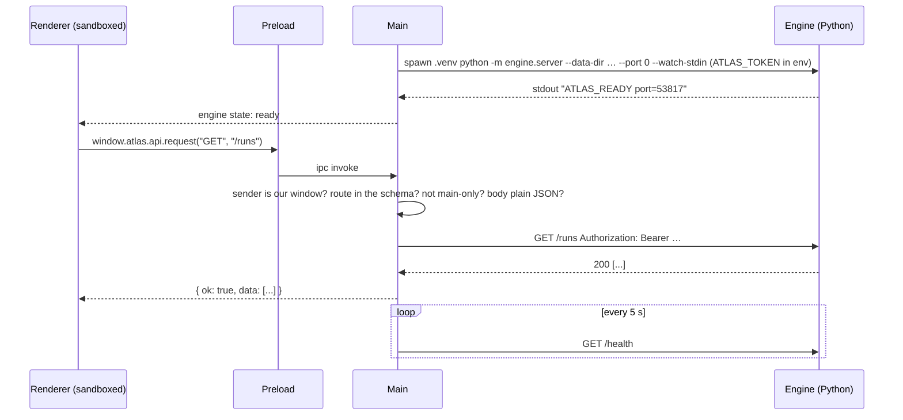

# Step 2.2 — The Electron shell (`app/main`, `app/preload`)

## What was built
Atlas now opens as a desktop window. On launch it starts the Python engine in the background, waits until the engine says it's ready, checks every 5 seconds that it's still alive, and restarts it if it dies. After three crashes in a minute it stops trying and shows a calm error screen with **Restart Atlas**.

The window itself can't touch anything dangerous: no Node, no internet, no new windows, no navigating away. Everything it needs goes through a narrow, typed bridge (`window.atlas`) that the main process checks call by call. The secret the engine requires never leaves the main process.

The screens themselves come in steps 2.3–2.8. This step is the frame they sit in.

## Files
| File | Purpose | Key functions / classes |
|---|---|---|
| `app/package.json`, `electron.vite.config.ts`, `tsconfig*.json`, `vitest.config.ts`, `playwright.config.ts`, `eslint.config.mjs`, `.prettierrc.json` | Tooling; everything a dev dependency (Vite bundles what ships) | — |
| `app/main/index.ts` | Window, menu, single instance, quit flow, wiring | `createWindow`, `confirmAndQuit`, `buildMenu`, `followRunStatuses` |
| `app/main/engine.ts` | The engine as a child process | `EngineProcess`, `engineCommand`, `findRepo` |
| `app/main/ready.ts` | Reassemble stdout into lines, find `ATLAS_READY port=N` | `ReadyLineParser` |
| `app/main/sse.ts` | Parse Server-Sent Events; follow a stream with `Last-Event-ID` | `SseParser`, `followEvents` |
| `app/main/validate.ts` | Check every IPC argument; the route allowlist from the engine schema | `validateApiRequest`, `ROUTES`, `MAIN_ONLY_ROUTES`, … |
| `app/main/ipc.ts` | The bridge's main-process half | `registerIpc` |
| `app/main/runs.ts` | Keep awake while running; notify on completion / pauses that need the recruiter | `RunWatcher`, `notificationFor` |
| `app/main/security.ts` | Permissions, request filter, navigation and window rules | `hardenSession`, `hardenContents` |
| `app/main/window-state.ts` | Remember size and position | `restoreBounds`, `loadBounds`, `saveBounds` |
| `app/preload/index.ts` | `window.atlas` via `contextBridge` | — |
| `app/src/shared/bridge.ts` | The bridge contract (types + channel names) | `AtlasBridge`, `Channels` |
| `app/src/shared/api-types.ts` | Generated from `api-schema.json` | `ApiRoutes`, every response type |
| `app/scripts/gen-api-types.mjs` | OpenAPI → TypeScript, no dependencies | `generate`, `tsType` |
| `app/renderer/index.html`, `main.tsx`, `App.tsx`, `env.d.ts` | CSP'd page; engine-state shell | `App` |
| `app/main/*.test.ts`, `app/tests/contracts.test.ts`, `app/e2e/*.ts` | 33 Vitest + 7 Playwright tests | — |

## How it works


- **Starting the engine.**
  - In development, main runs `<repo>/.venv` Python with `-m engine.server`. It finds the repository by walking up from itself to the folder that has `engine/server.py`, because `app.getAppPath()` differs depending on how Electron is started.
  - Packaged, it runs `resources/engine/atlas-engine`, a Phase 3 placeholder.
  - The token is 32 random bytes, passed in `ATLAS_TOKEN`.
  - stdin stays an open pipe, so if main dies the engine notices (`--watch-stdin`) and stops gracefully.
- **Health and restarts.** Two failed `/health` checks in a row kill a hung engine; a dead engine is restarted. After 3 restarts in 60 s the state becomes `failed`, and the renderer shows the error screen. "Restart Atlas" clears the count and tries again. Nothing is lost, because every bit of state is in SQLite.
- **The bridge.** The renderer can only call `window.atlas`. Main checks each call:
  - it must come from our own window;
  - the method and path must match a route in `api-schema.json`;
  - routes that upload, write files, stream or shut down have their own narrow calls and are refused through `api.request`;
  - bodies must be plain JSON of 256 KB or less;
  - run ids must be integers, file names are cleaned, and so on.

  Replies are always `{ ok, status, data }` or `{ ok: false, error: { code, message } }`, with the engine's recruiter wording.
- **Files never reach the renderer as paths.**
  - The open dialog returns an opaque handle.
  - A dropped file arrives as bytes.
  - Export goes save dialog → `POST /runs/{id}/export {view, path}`, so Phase 1's atomic writer and its "…is open in another program" message are reused.
  - "Show in folder" works only for the data folder, the logs folder, or a file exported this session.
- **Live events.** Main opens the engine's SSE streams and forwards each event over IPC. The parser handles any chunking and CRLF, and the follower reconnects with `Last-Event-ID`. App-level event ids live in the engine's memory, so after an engine restart the resume point resets; run events live in SQLite and keep theirs.
- **Keep awake and notifications.** Main follows `run_status` events:
  - while any run is `running`, it holds `powerSaveBlocker('prevent-app-suspension')`, if Keep awake is on;
  - when a run completes, or pauses for a reason that needs the recruiter (not "Paused by you", not "Atlas was closed", not the two that resume by themselves), it shows a notification, if the window isn't focused and Notify is on.
- **Closing.** Closing the window or quitting while a run is `running` asks: **"Screening is running. Close Atlas?** It will pause and continue where it left off when you reopen it." If the recruiter closes, main calls `/shutdown`, waits up to 10 s, then kills the engine. The engine itself waits at most 8 s, so the run's reason is "Atlas was closed".
- **Window chrome.** Per PLAN's design rules:

  | | macOS | Windows 11 |
  |---|---|---|
  | Title bar | `hiddenInset` | `titleBarStyle: 'hidden'` + `titleBarOverlay`: native controls on the right, colours following the theme |
  | Material | `vibrancy: 'sidebar'` | `backgroundMaterial: 'mica'` |

  The minimum size is 1100×720 and the default 1280×800, and bounds are remembered. Menu: Settings is `⌘,` / `Ctrl+,`, and Reload/DevTools exist only in development. There's one instance.

## Key decisions and why
- **Upload and export go through main, not `api.request`.** The renderer should never know or choose a file path. Handles and bytes keep it that way. This adds two calls to the bridge list in the brief (`uploadTable`, and `saveExport` taking the run and view), and ARCHITECTURE §2 lists the bridge as built.
- **The route allowlist comes from the engine's OpenAPI schema.** One source of truth: a route the engine doesn't have can't be called, and the allowlist can't drift from the API.
- **The token travels in the environment,** as step 2.1 already decided. A Playwright test checks that it never appears in anything the renderer can see: the bridge, its responses, the DOM, storage and cookies. A Vitest test checks that no renderer or preload source mentions it.
- **Tooling within the approved list:**
  - **electron-vite 5 supports Vite ≤ 7**, so Vite is pinned to 7; Vite 8 would break the build.
  - **No `@vitejs/plugin-react`** (not approved): Vite's own esbuild compiles JSX (`esbuild.jsx: 'automatic'`). We lose React Fast Refresh in development; full reloads still work.
  - **ESLint only lints the `.mjs` build scripts.** Linting TypeScript needs `typescript-eslint` (not approved), so TypeScript is checked by `tsc` in strict mode: three configs, `noUncheckedIndexedAccess` on.
  - **`@testing-library/dom`** is installed as the required peer of the approved `@testing-library/react`. It isn't listed in `package.json`.
  - All packages are **dev dependencies**: Vite bundles everything that ships, so the packaged app has no `node_modules`.
- **Materials are off under the tests (`ATLAS_E2E=1`),** so screenshots come out the same on every machine. In normal use the sidebar gets real vibrancy or Mica.

## Failure handling
| Situation | What happens | Candidate failed / run paused / nothing | Message shown |
|---|---|---|---|
| Engine binary / venv missing | no spawn | nothing | error screen: "Atlas's engine wasn't found. Reinstall Atlas." + Restart Atlas |
| Engine crashes | restarted (≤ 3 in 60 s); run resumes per its pause reason | nothing lost | "Reconnecting…" |
| Engine crashes a 4th time within 60 s | stop retrying | nothing lost | "Atlas's engine stopped and couldn't be restarted." + Restart Atlas |
| Engine hangs (health fails twice) | killed and restarted | nothing lost | "Reconnecting…" |
| Request while the engine is starting | refused locally | nothing | "Atlas is starting. Try again in a moment." |
| Renderer asks for a route that isn't allowed | the IPC call is rejected | nothing | — (a programming error, not a recruiter situation) |
| Main (Electron) crashes | stdin closes → the engine stops gracefully | run paused | "Atlas was closed" |
| Window closed during a run | confirmation; then graceful stop | run paused | "Screening is running. Close Atlas? …" |

## Tests
Added **33 Vitest** and **7 Playwright** tests (engine suite unchanged at 349).
- **`ready.test.ts` (7):** the port found in one chunk or across split chunks; CRLF; other stdout lines ignored; look-alike lines and impossible ports rejected; reported once; no unbounded growth.
- **`sse.test.ts` (4):** ids, names and data; splitting at every single character, including CRLF (this found a real bug: a chunk ending exactly on `\r` split the event); keep-alive comments and multi-line data; ids carried over.
- **`validate.test.ts` (10):**
  - 11 legitimate routes allowed, including percent-encoded model names;
  - the 6 main-only routes refused;
  - 16 bad requests refused (`..`, `//host`, backslash, fragment, unknown route, lower-case or TRACE method, a query on a POST, script in a query, a 3,000-character path, a body on a GET, …);
  - bodies: a Date, NaN, a bare string, 300 KB and 30-deep nesting all refused;
  - run ids, views, themes, file names, upload sources (handle shape, extension, 20 MB, bytes type), folder targets and notifications.
- **`runs.test.ts` (9):** notification rules (completion once; pauses that need the recruiter; quiet for auto-resume, user pause and close); keep-awake follows running and the setting; notifications need an unfocused window and the setting on; window bounds (default, minimum size, off-screen position dropped).
- **`contracts.test.ts` (3):** the generated types are current, every schema route is typed, and no renderer or preload source mentions the token.
- **`e2e/shell.spec.ts` (7, real Electron and real engine):**
  - the engine becomes ready, and `/health`, `/runs` and the engine state work through the bridge;
  - `POST /shutdown` from the renderer is refused;
  - the token is nowhere in `window.atlas`, its responses, the DOM, storage or cookies;
  - the CSP blocks a remote fetch, a remote script, an inline script and `eval`;
  - there's no `require` or `process` in the page, and `window.open` is denied;
  - the window is 1280×800 (minimum 1100×720), with context isolation and the sandbox on and Node integration off;
  - navigating to `https://example.com` is blocked, and main confirms the URL didn't change.

## How to try it yourself
```bash
cd app
npm install
npm test                 # 33 passed
npm run typecheck
npm run e2e              # builds, then: 7 passed
npm run dev              # opens Atlas with the dev engine from ../.venv
```
If `npm run dev` opens nothing from a VS Code terminal, run `set ELECTRON_RUN_AS_NODE=` first. VS Code sets it for its terminals, and it makes Electron start as plain Node.

## Known limitations
- **Only tested on Windows 11.** The macOS chrome (`hiddenInset`, traffic lights at 20/18, vibrancy) is written to the docs but has never been seen running.
- **Mica and vibrancy are off in every test and screenshot.** What they look like needs a human.
- **No auto-update or signing** (Phase 3). The packaged engine path is a placeholder.
- **Closing the window quits Atlas on macOS too** (a single-window app). Some Mac users expect it to stay in the Dock.
- **Playwright quirk:** after a navigation Chromium cancels, Playwright's page context goes stale. The navigation test runs last and asks the main process instead of the page.

## Concepts to learn
- **Process isolation in Electron:** main (Node, privileged) vs renderer (web page, untrusted) vs preload (the narrow bridge between them).
- **Context isolation and sandboxing:** why the page can't reach `require` even through prototype tricks.
- **Content Security Policy:** a browser-enforced allowlist. Here it allows nothing but the app's own files, with no network at all.
- **Deriving a security allowlist from a schema,** so it can't drift from the thing it protects.
- **Supervising a child process:** a ready handshake, health checks, and a restart budget (N restarts in T seconds) so a crash loop can't spin forever.
