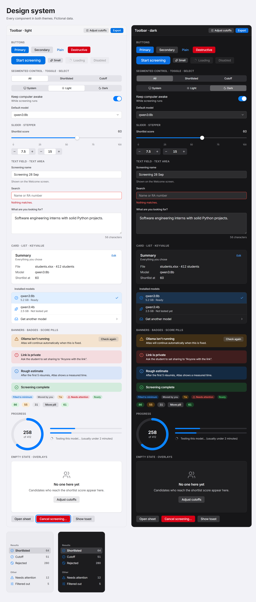
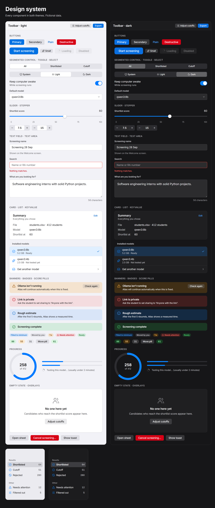

# Step 2.3 — The design system (`app/renderer/design/`)

## What was built
This step builds the visual language of Atlas: colours, type, spacing and motion, plus 24 components that every screen will be made of. It comes before any screen, so the screens can't invent their own look.

The style follows macOS: layered greys instead of stark white, one blue accent, calm banners, spring motion, and a selected state you can see across the room. It works in light and dark and follows the computer's setting by default. Every piece of text passes the WCAG AA contrast rule in both themes, and a test proves it.

A hidden page, `#/design`, shows everything side by side in both themes.

| Light window | Dark window |
|---|---|
|  |  |

*(Each screenshot shows both themes side by side; the difference is the window around them. Captured at 1280 px wide with materials off, so they look the same on any machine.)*

## Files
| File | Purpose | Key functions / classes |
|---|---|---|
| `design/tokens.css` | Colour (light/dark), type scale, 8-pt spacing, radii, shadows, materials, motion timings, fonts per OS | CSS custom properties |
| `design/base.css` | Resets, type utility classes, focus ring, Windows scrollbars, window-drag helpers, reduced motion | `.atl-title`, `.atl-tabular`, `.atl-drag`, … |
| `design/components.css` | Every component's styles (tokens only) | `.atl-*` |
| `design/controls.tsx` | Inputs | `Button`, `SegmentedControl`, `Toggle`, `Slider`, `Stepper`, `TextField`, `TextArea`, `Select` |
| `design/layout.tsx` | Structure | `Card`, `List`, `ListRow`, `Sidebar`, `Toolbar`, `KeyValue` |
| `design/overlays.tsx` | Modals | `Sheet`, `Popover`, `Alert` (+ shared focus handling) |
| `design/feedback.tsx`, `spinner.tsx` | Status | `Banner`, `Badge`, `ScorePill`, `ProgressRing`, `ProgressBar`, `Spinner`, `EmptyState`, `ToastProvider` / `useToast` |
| `design/motion.ts` | Spring presets | `snappy`, `gentle`, `fade` |
| `design/Gallery.tsx`, `gallery.css` | The `#/design` page | `Gallery` |
| `design/index.ts` | One import for screens; loads the Inter font and the CSS | — |
| `renderer/App.tsx`, `app.css` | Sets `data-platform` and `data-material`; reduced-motion config; toasts; `#/design` route; engine gate | `App` |
| `design/contrast.test.ts`, `design/components.test.tsx`, `e2e/design.spec.ts`, `e2e/screens.ts` | Tests and screenshot helper | `capture`, `setTheme` |

## How it works
- **Themes.** Light values sit on `:root` and any `[data-theme='light']` element; dark values on any `[data-theme='dark']` element. The same dark values also apply under `prefers-color-scheme: dark` when no theme has been chosen. Because themes are scoped to *elements*, a light and a dark panel can sit next to each other; the gallery relies on this. A test keeps the two copies of the dark values identical.
- **Platform.** At start the renderer asks main for `app.info()` and sets `<html data-platform="win32|darwin" data-material="true|false">`. CSS then:
  - switches the font: the system font (SF Pro) on macOS, bundled **Inter Variable** on Windows;
  - reserves space for the traffic lights or the Windows caption buttons;
  - makes the sidebar see-through where the window has vibrancy or Mica.
- **Type and space.** The type scale is 34 / 22 / 17 / 15 / 13 / 11 as in PLAN, spacing follows the 8-pt grid plus 4, and radii are 6 / 10 / 14. Scores and counts use tabular figures, so columns of numbers line up.
- **Motion.** Motion uses springs: *snappy* (~200 ms) for controls, *gentle* (~320 ms) for things arriving. `MotionConfig reducedMotion="user"` plus a CSS override turn movement off for people who ask for less motion.
- **Accessibility built in.** Every control is a real, labelled element:
  - buttons are buttons; the segmented control is a `radiogroup` with arrow-key roving focus;
  - the toggle is a `switch`, the stepper a `spinbutton` with arrow keys, and the slider a labelled range with readable value text;
  - fields tie their label, hint and error together; sidebar items mark `aria-current="page"`;
  - progress uses `progressbar`, and ScorePill reads "Score 82, Shortlisted".
- **Modals.** Sheet, Alert and Popover share one behaviour:
  - focus moves in and Tab stays inside;
  - Esc closes, and only the top-most modal answers it, so an Alert over a Sheet closes first;
  - the page behind is `inert`, and focus returns to what opened the modal.
- **ScorePill colours come from the bucket.** They show green-tinted for Shortlisted, amber for Cutoff and grey for Rejected, never a red-to-green score scale. "Rejected" isn't an error, so it isn't red.

## Key decisions and why
- **Apple's colours, adjusted for contrast.** Your brief requires 4.5:1 for text, and several of Apple's own system colours don't meet it as text:

  | Pairing | Contrast |
  |---|---|
  | White on `#007AFF` (button) | 4.0:1 |
  | `#34C759` on white | 2.2:1 |
  | Apple's standard secondary grey on white | 3.5:1 |

  So PLAN's colours stay the accent for *non-text* UI (focus ring, toggles, sliders, progress), where the rule is 3:1. Text uses tuned variants:
  - filled buttons `#0071E3` (light) / `#0A6FE0` (dark);
  - accent text `#0066CC` / `#4AA3FF`;
  - labels in four levels, each measured;
  - darker `-text` colours for success, warning, danger and the bucket pills.

  The fourth label level is for disabled text only, which WCAG exempts. PLAN.md's design section now says this.
- **The contrast test reads `tokens.css` itself.** It checks 42 text pairings and 7 UI pairings per theme, blending translucent colours over the surface they're actually drawn on. A colour change that breaks contrast fails the build.
- **Plain CSS with an `atl-` prefix,** not CSS-in-JS and not a component library (none is allowed). This is the simplest thing that works with a strict CSP and no extra dependencies.
- **Native `<select>`** for Select: the OS draws the menu, which is exactly the native feel we want.
- **Windows gets thin overlay-style scrollbars.** Chromium on Windows otherwise shows thick classic ones; macOS already has overlay scrollbars.

## Failure handling
Not applicable: the design kit has no I/O. The error-facing components (Banner, Alert, EmptyState, the engine-gate error view) are what the screens use to show failures.

## Tests
Added **115 Vitest** (99 contrast + 16 component) and **3 Playwright** tests. Totals: engine 349, Vitest 148, Playwright 10.
- **`contrast.test.ts` (99):**
  - every text pairing ≥ 4.5:1 and every UI pairing ≥ 3:1, in both themes;
  - the "follow the OS" dark values equal the explicit dark theme;
  - both themes define the same tokens;
  - PLAN's accent and status colours are used.
- **`components.test.tsx` (16):**
  - Button variants and loading; the segmented radio group with roving focus, arrows, End and wrap-around;
  - a labelled switch; the Stepper's buttons and arrow keys with bounds, typed `7,35` → 7.3, clamping of 99 → 10.0, rejected junk and exact decimal steps;
  - the slider's value text; field label, error and `aria-describedby`; the character counter;
  - the ScorePill's name; the ring clamped to 100 and the bar at 26%, indeterminate with no value; an error banner is an alert and info is status;
  - toasts auto-dismiss; the sidebar's current page and thousands separators; a choice list is a radio group;
  - a sheet is a modal dialog that makes the page inert, takes focus and closes on Esc; only the top-most modal answers Esc.
- **`e2e/design.spec.ts` (3):**
  - the gallery renders every role in both themes, including the three ScorePill labels;
  - the sheet traps Tab and closes on Esc, and the alert focuses "Keep screening" and closes on Esc;
  - the light and dark screenshots.

## How to try it yourself
```bash
cd app
npm test                  # 148 passed
npm run dev               # then open DevTools and run: location.hash = '#/design'
npm run e2e               # rewrites docs/summaries/phase2/screens/design-*.png
```

## Known limitations
- **Only seen on Windows 11, with materials off.** SF Pro on macOS, real vibrancy, and Mica behind the sidebar need a human look on a Mac and on Windows with materials on.
- **The Slider is single-handle.** The two-handle score band on the Cutoffs screen (step 2.5) builds on it but is its own component.
- **Dark-mode depth.** The selected segment in dark mode (`#636366`) is close to macOS but a little heavy. It's worth a designer's eye.
- **Everything is sized for 13–17 px text.** Very large system font settings aren't handled beyond the browser's zoom.

## Concepts to learn
- **Design tokens:** one named value per decision (`--accent-text`) instead of scattered hex codes, so a theme is just a different set of values.
- **WCAG contrast:** relative luminance, why 4.5:1 applies to text and 3:1 to UI, and blending translucent colours before measuring.
- **Roving tabindex:** one Tab stop per group, arrow keys inside it (radio groups, segmented controls).
- **Modal accessibility:** `aria-modal`, `inert`, focus traps, and returning focus.
- **Spring animation:** motion described by stiffness and damping rather than duration, so interrupted animations stay smooth.
