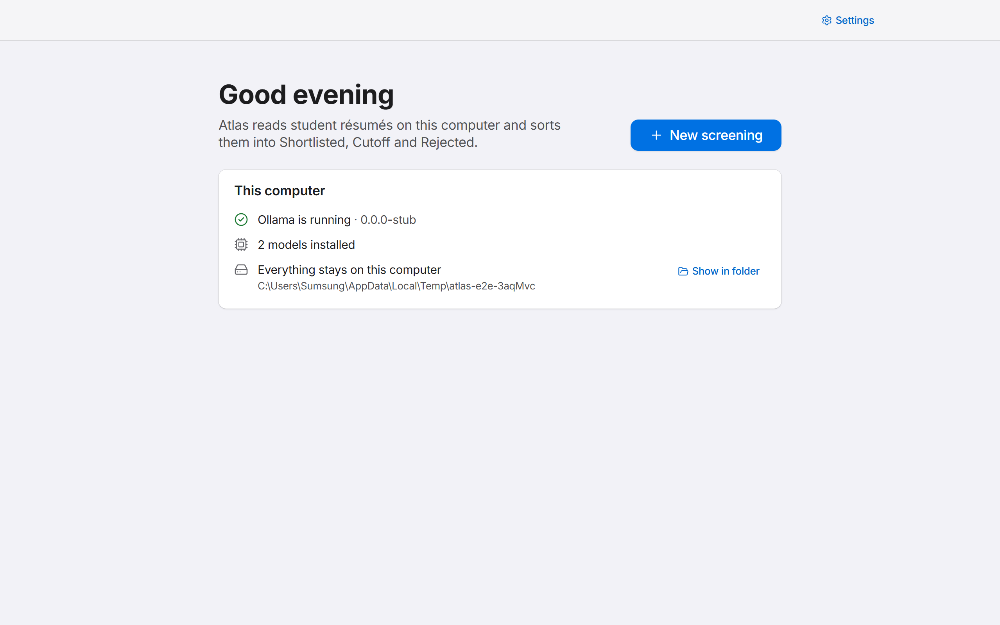
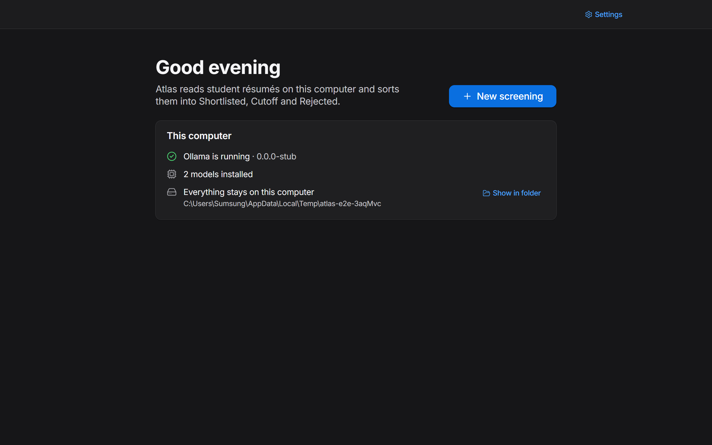
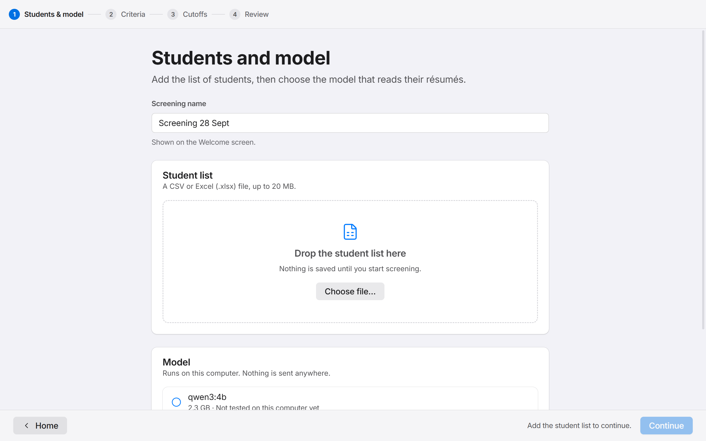
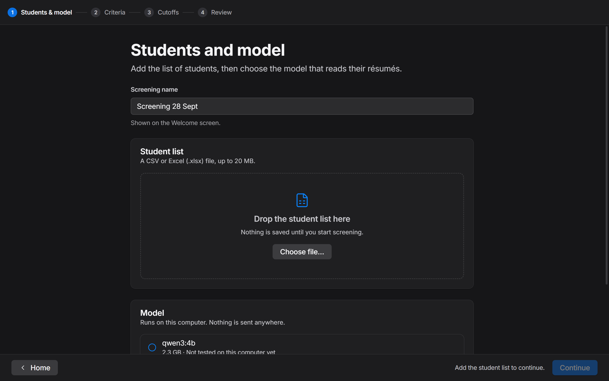
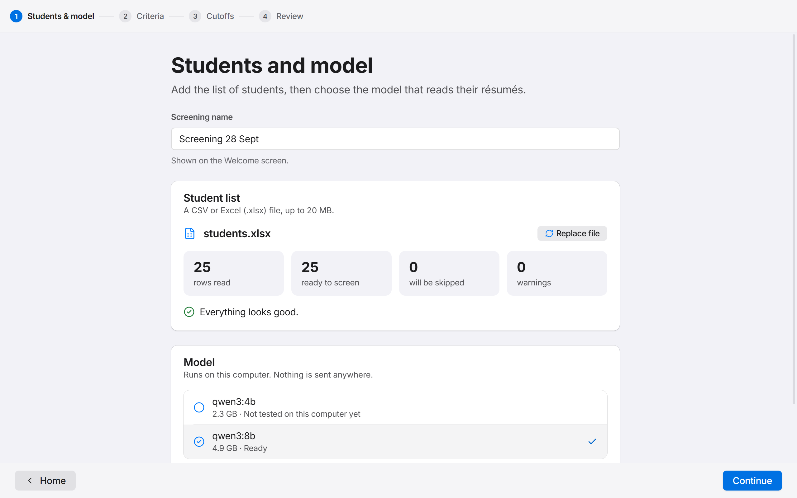
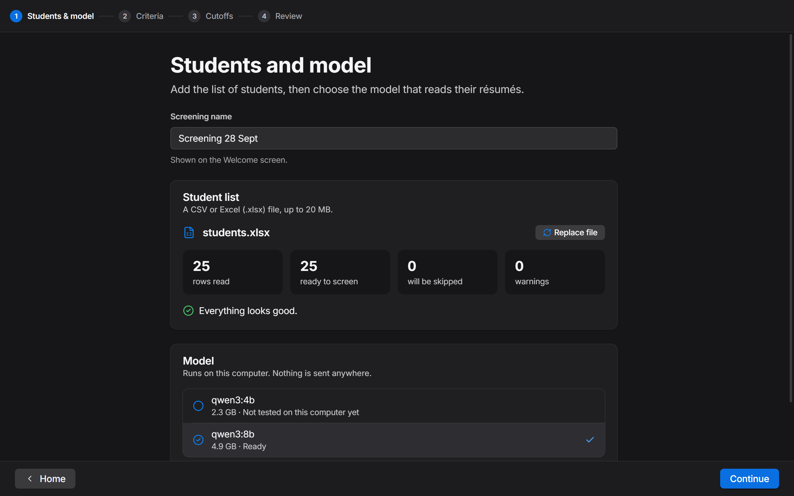
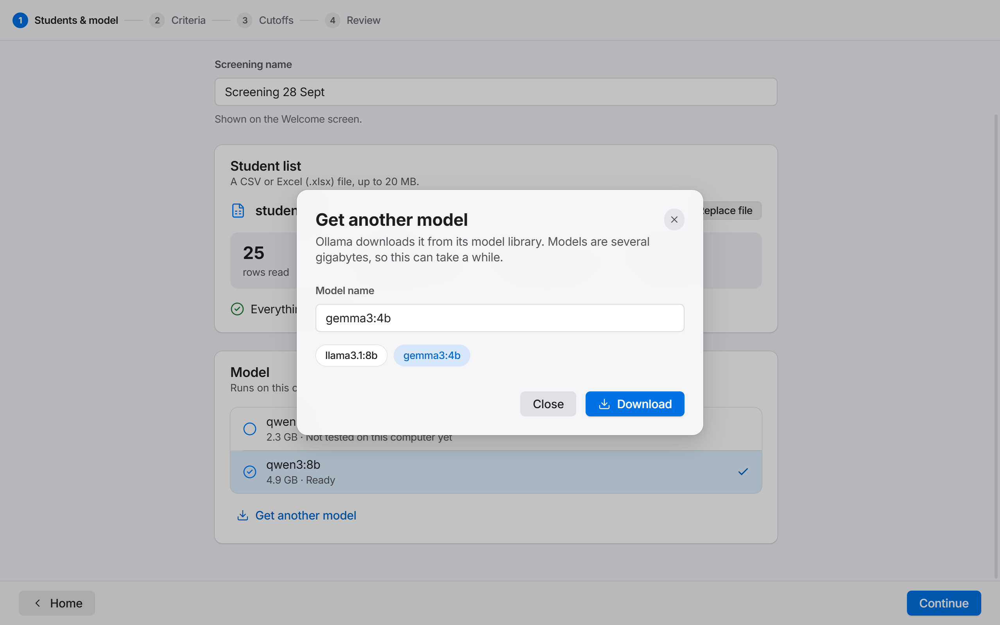
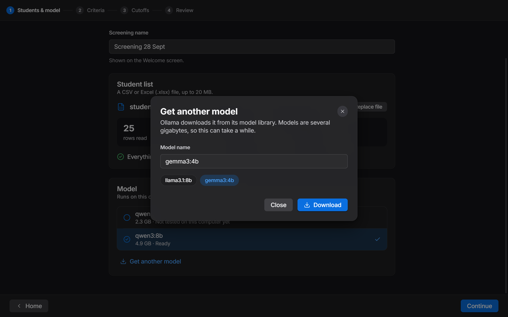

# Step 2.4 — Screens, part 1: Welcome, then Upload and Model

## What was built
This step builds the first two screens a recruiter sees.

**Welcome** greets them, shows whether this computer is ready, and offers **New screening**:
- Ollama running or not, with how to start it;
- how many models are installed;
- where the data lives.

If a screening is unfinished, a prominent card offers to resume it, showing its progress and pause reason. Recent screenings are listed below.

**Students and model** is step 1 of the setup flow. The recruiter:
1. names the screening;
2. adds the student list, as a CSV or Excel file dropped or chosen;
3. sees the engine's pre-flight check as a clear report;
4. picks a model, which Atlas tests on this computer before allowing Continue.

A missing model can be downloaded from a sheet with progress and Cancel.

| | Light | Dark |
|---|---|---|
| Welcome |  |  |
| Setup, before a file |  |  |
| Pre-flight report + model ready |  |  |
| Get another model |  |  |

*(1280×800 logical, captured at 2× by Playwright against the stub Drive and Ollama; fictional data. Windows' caption buttons, top right, aren't part of the page, so they don't appear.)*

## Files
| File | Purpose | Key functions / classes |
|---|---|---|
| `app/renderer/api/client.ts` | Typed engine calls through the bridge; failures carry the engine's words | `api`, `buildPath`, `ApiFailure`, `messageOf` |
| `app/renderer/api/events.ts` | Run and app event subscriptions | `useRunEvents`, `useAppEvents`, `isPullEvent` |
| `app/renderer/state/nav.ts` | Which screen, run and step | `useNav`, `viewForRun`, `SETUP_STEPS` |
| `app/renderer/state/setup.ts` | The pre-flight report and chosen model while setting up | `useSetup` |
| `app/renderer/state/theme.ts` | Apply Appearance to the page and the native chrome | `applyTheme` |
| `app/renderer/format.ts` | Presentation only: greeting, bytes, durations, ranges, plurals | — |
| `app/renderer/App.tsx` | Query client, engine gate, saved theme at start, `⌘,`/`Ctrl+,` → Settings, router | `Screens` |
| `app/renderer/screens/Welcome.tsx` | Welcome | `ResumeCard`, `SystemCard` |
| `app/renderer/screens/setup/SetupFlow.tsx` | Step indicator, bottom bar, Esc = Back | `SetupFlow`, `SetupBar`, `useFlow` |
| `app/renderer/screens/setup/UploadModel.tsx` | Name, file, model, Continue | `UploadModel`, `DropZone` |
| `app/renderer/screens/setup/Preflight.tsx` | The engine's pre-flight report as UI | `Preflight`, `IssueGroup` |
| `app/renderer/screens/setup/ModelPicker.tsx` | Installed models, pre-check, "Get another model" sheet | `ModelPicker`, `PullSheet` |
| `app/renderer/screens/screens.css`, `Placeholder.tsx` | Screen layout; stand-in for screens still to come | — |
| `engine/tests/e2e_stubs.py`, `engine/tests/e2e_engine.py` | The Phase 1 stubs + fixtures for the app's tests; the engine pointed at them | `build`, `control_server`, `options_from_env` |
| `app/e2e/stubs.ts`, `app/e2e/setup-part1.spec.ts` | Start the stubs; launch Atlas against them; native-dialog stand-ins; the screen tests | `startStubs`, `launchWithStubs`, `nextOpenDialogReturns` |

## How it works
```mermaid
sequenceDiagram
    participant R as Recruiter
    participant UI as Renderer
    participant M as Main
    participant E as Engine
    R->>UI: New screening
    UI->>E: POST /runs {"name":"Screening 28 Sept"} (draft)
    R->>UI: Choose file…
    UI->>M: files.openTable()  (native dialog; path stays in main)
    UI->>M: files.uploadTable(run, {handle})
    M->>E: POST /runs/7/table (multipart)
    E-->>UI: pre-flight report (groups, rows, RA numbers, departments)
    R->>UI: picks qwen3:4b (not tested yet)
    UI->>E: POST /models/qwen3%3A4b/precheck
    E-->>UI: ready (cached per model + digest)
    R->>UI: Continue
    UI->>E: PATCH /runs/7 {"model_name":"qwen3:4b"}
```

- **New screening creates a draft run** named "Screening 28 Sept".
  - The name is saved when the field loses focus.
  - Nothing about the students is stored until the recruiter presses **Start screening** on Review (step 2.5): the engine keeps the uploaded file aside until `/table/confirm`.
  - An abandoned draft stays in Recent screenings as "Not started · Setup not finished", and can be continued.
- **The pre-flight report is the engine's, drawn as UI:**
  - four tiles (rows read, ready, will be skipped, warnings);
  - file-level problems in one error banner; a missing résumé-link column blocks Continue with the engine's "No column for Résumé link. Add a column named "Résumé link"";
  - row issues grouped by kind, each opening to show row numbers and RA numbers;
  - an explicit "N rows will be skipped and not screened".

  The renderer counts nothing itself.
- **The model picker.**
  - It lists installed models with their size and cached pre-check status: Ready, Not tested on this computer yet, or Can't be used.
  - Choosing an untested model runs the pre-check straight away ("Testing this model… (usually under 2 minutes)"). **Continue** needs the file to be usable *and* the chosen model Ready, both as the engine reports them.
  - If Ollama isn't running, a calm banner explains what to do, with **Check again**.
- **Get another model** is a sheet with a name field and suggested names, taken from the engine's suggestions minus what's installed.
  - **Download** starts Ollama's pull. Progress arrives on the app event stream: friendly status text, a bar, and "1.2 GB of 4.9 GB".
  - Cancel stops the download.
  - When it finishes, the model is selected and tested automatically. An unknown name gets the engine's "There is no model called "X". Check the name at ollama.com/library."
- **Keyboard.**
  - Esc goes Back. The first Esc inside a field leaves the field; the next goes back. An open sheet takes Esc first.
  - The step indicator marks the current step for screen readers.
  - `⌘,` / `Ctrl+,` opens Settings from anywhere.

## Key decisions and why
- **The setup flow has four numbered steps: Students & model, Criteria, Cutoffs, Review.** Welcome is its entry point rather than "step 1 of 5": a greeting screen with a step number would read oddly. ARCHITECTURE §18 is unchanged otherwise.
- **The draft run is created at New screening, not at upload.** The upload needs a run to attach to, and the name field needs somewhere to save. The cost is that an abandoned setup leaves a draft behind. It's clearly labelled, can be continued, and can be deleted in Settings (step 2.8).
- **The file type and the 20 MB limit are the engine's business:**
  - main rejects a dropped file over 20 MB with the engine's own message before sending it;
  - the engine judges the type ("Choose a CSV or Excel (.xlsx) file.");
  - the renderer never decides.

  A validator test was updated for this.
- **The test harness uses the Phase 1 stubs in their own process** (`engine/tests/e2e_stubs.py`). The app's engine runs `engine.tests.e2e_engine` with Drive rewritten to the stub, through the development-only `ATLAS_ENGINE_MODULE`. Native dialogs are answered by replacing `dialog.showOpenDialog` in main from the test; Playwright can't click OS dialogs. The fixtures are fictional:
  - 25 students, including a Tamil name and a formula-looking name;
  - a phone stored as a number, and link cells that are hyperlinks;
  - 3 failures: a private link, a Google Doc and a 404;
  - grades chosen so the buckets are known in advance.
- **The Ollama stub reports realistic model sizes,** so screenshots say "4.9 GB", not "1 B".

## Failure handling
| Situation | What happens | Candidate failed / run paused / nothing | Message shown |
|---|---|---|---|
| File without a résumé-link column | report shown, Continue disabled | nothing | "This file can't be used yet · No column for Résumé link. Add a column named "Résumé link"." |
| Rows missing an RA number or link, duplicate RA | grouped, rows listed | those rows skipped | "N rows will be skipped and not screened." |
| Dropped file over 20 MB | refused before upload | nothing | "This file is larger than 20 MB. Save just the student sheet as .xlsx or CSV and try again." |
| A PDF dropped instead of a list | refused by the engine | nothing | "Choose a CSV or Excel (.xlsx) file." |
| Ollama not running | banner with Check again | nothing | "Ollama isn't running · Atlas uses Ollama to read résumés on this computer. Open the Ollama app (or run "ollama serve"), then check again." |
| Model fails its pre-check | row marked; banner with Test again | nothing | the engine's pre-check message ("This model can't be used for screening. Choose another.") |
| Another model is being tested | refused | nothing | "Another model is being tested. Try again when it finishes." |
| Unknown model name to download | error in the sheet | nothing | "There is no model called "X". Check the name at ollama.com/library." |

## Tests
Added **9 Vitest** (API client 5, format 4) and **7 Playwright** tests. Totals: engine 349, Vitest 157, Playwright 17.
- **API client:** encodes path parameters (`qwen3:8b` → `qwen3%3A8b`), skips empty query values and repeats arrays, sends method, path and body through the bridge, throws the engine's message and code, and turns a bridge rejection into a calm message.
- **Format:** greeting by time of day, bytes, durations, "About 3–5 hours", plurals.
- **`setup-part1.spec.ts`,** against the real engine and the stubs:
  1. Welcome shows the greeting, "Ollama is running", "2 models installed" and New screening (screenshots).
  2. New screening opens Students and model with a prefilled name (screenshots). The no-link file shows the blocking error, and Continue is disabled.
  3. Replace file with the 25-row `.xlsx`: 25 ready, "Everything looks good."; choosing `qwen3:8b` runs its pre-check to Ready, and Continue enables (screenshots).
  4. Get another model: the suggestion chip fills the name (screenshots); Download → the sheet closes, the new model is selected and tested to Ready.
  5. An unknown model shows the engine's message; Esc closes the sheet.
  6. Continue saves the model and moves to Criteria; Esc comes back with the report still there.
  7. Ollama stopped: the Welcome banner, then Check again once it's back.

## How to try it yourself
```bash
cd app
npm test                                   # 157 passed
npm run e2e -- e2e/setup-part1.spec.ts     # 7 passed; rewrites the screenshots above
npm run dev                                # real engine; needs Ollama for models
```

## Known limitations
- **Criteria, Cutoffs and Review are placeholders** until step 2.5, and Progress, Results and Settings until 2.6–2.8.
- **The report is held in memory.** If the app restarts during setup, the draft remains but the file must be added again: the engine deliberately forgets unconfirmed uploads at start.
- **Drag-and-drop was built but only the dialog path is tested end to end.** Playwright can't drag files from the OS, and the drop path shares the same upload call.
- **A dropped file is read into memory before the 20 MB check.** A very large file (hundreds of MB) is slow to refuse.
- **Ollama's pull progress is per layer,** so the bar restarts for each layer. The status text says which phase it's in.

## Concepts to learn
- **Server state vs UI state:** React Query holds what the engine said (runs, models, settings), while zustand holds only navigation and in-progress choices.
- **Optimistic but honest UI:** Continue is enabled from the engine's facts (report `ok`, pre-check `ready`), never from what the UI hopes.
- **Testing native dialogs:** replacing `dialog.showOpenDialog` in the main process from the test.
- **Deterministic fixtures:** grades chosen so every bucket count is known before the run.
