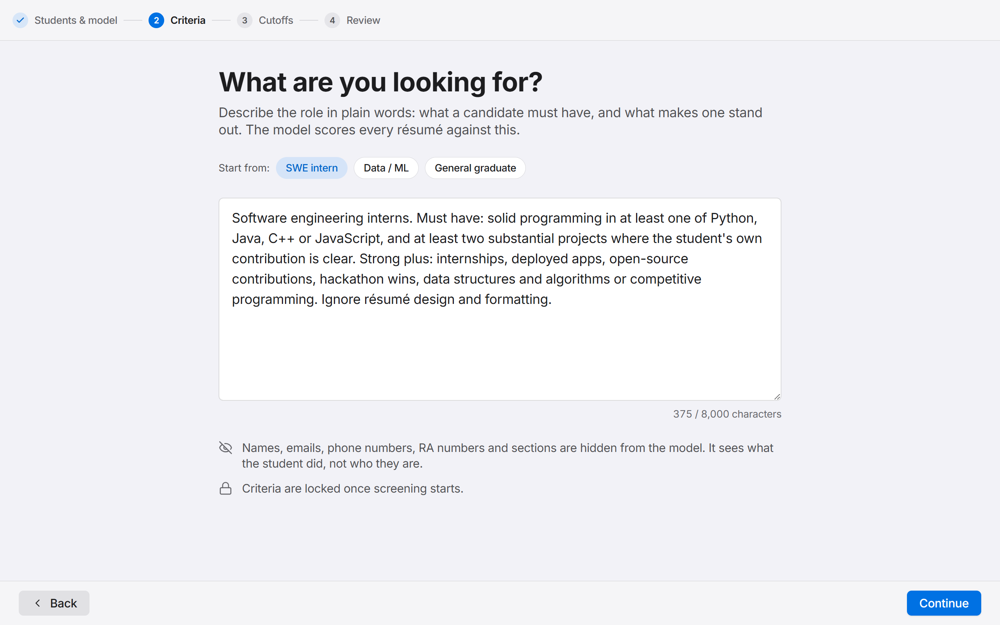
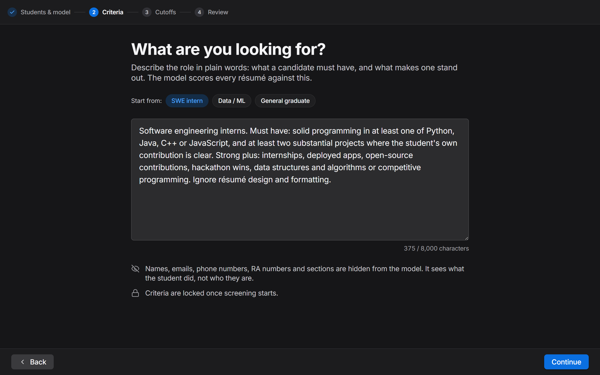
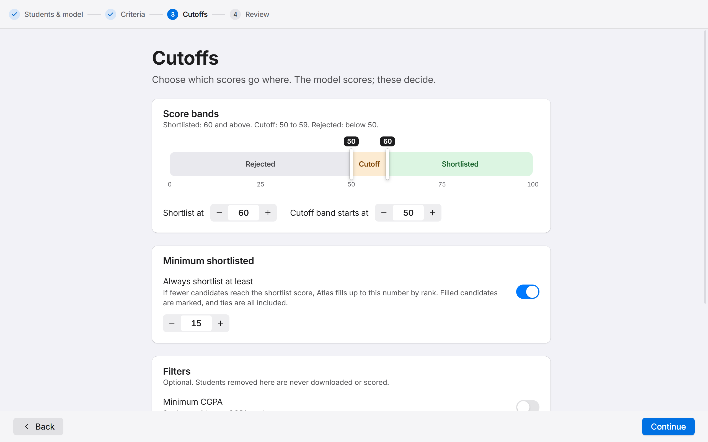
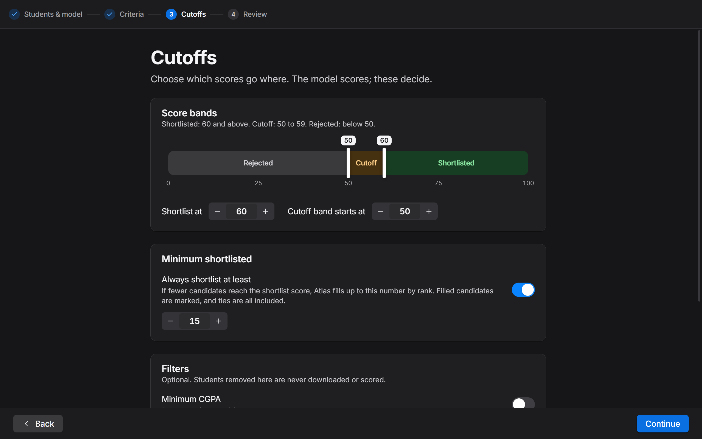
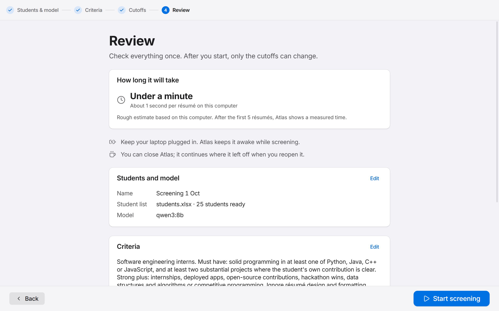
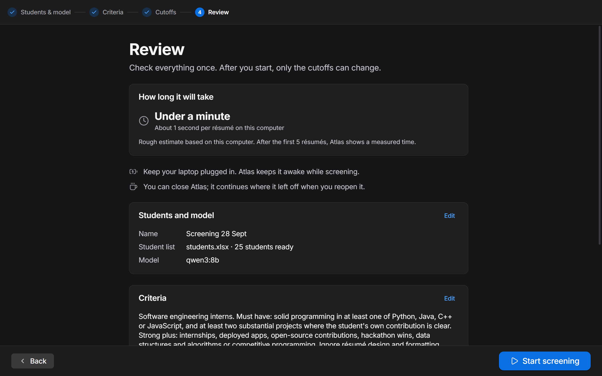

# Step 2.5 — Screens, part 2: Criteria, then Cutoffs, then Review and Timeline

## What was built
The rest of the setup flow is built: the recruiter describes the role, decides how scores become buckets, checks everything once, and starts screening.

- **Criteria** is a large "What are you looking for?" box.
  - Three starter templates (SWE intern, Data / ML, General graduate) fill it in one click.
  - A character count, and a gentle hint when the text is very short.
  - Two reassurances: identity details are hidden from the model, and criteria lock once screening starts.
- **Cutoffs** is a visual 0–100 score band with two draggable handles (Shortlist, and where the Cutoff band starts). The three zones are coloured and labelled like the results they produce.
  - Precise steppers for both values.
  - "Always shortlist at least N", with an explanation of filling and ties.
  - Optional CGPA and department filters, each showing live how many students it would remove, all counted by the engine.
- **Review** leads with how long the screening will take, as a range with its basis and the disclaimer, then practical tips, then every choice with an Edit link.
  - **Start screening** saves the configuration, adds the students, and starts, in that order.
  - If another screening is running, Review says so before the recruiter presses Start.

| | Light | Dark |
|---|---|---|
| Criteria |  |  |
| Cutoffs |  |  |
| Review |  |  |

*(Captured against the stubs, so the model is instant and the estimate reads "Under a minute". With smoke test 1's 57.6-second pre-check, 400 students would read "About 4–10 hours", and the real time on that laptop would be nearer 16 hours; see Known limitations.)*

## Files
| File | Purpose | Key functions / classes |
|---|---|---|
| `app/renderer/design/band.tsx` (+ CSS) | Two new kit components | `ScoreBand` (two `role="slider"` handles, zones by bucket colour), `Chip` (toggle button) |
| `app/renderer/screens/setup/Criteria.tsx` | Criteria | `TEMPLATES` |
| `app/renderer/screens/setup/Cutoffs.tsx` | Score band, minimum, filters with live counts | `Cutoffs` |
| `app/renderer/screens/setup/Review.tsx` | Estimate, tips, summary, Start | `Review`, `cutoffItems` |
| `app/renderer/format.ts` | `formatPerResume` ("about 2 minutes per résumé") | — |
| `app/renderer/design/band.test.tsx`, `app/e2e/setup-part2.spec.ts` | Tests | — |

## How it works
- **Each step saves on Continue** (`PATCH /runs/{id}`) to the draft run in the engine. Going Back and forward shows what was saved, and Edit on Review jumps to a step.
- **The score band is only an input.** The handles can't cross, but the engine is still the judge: `configure_run` rejects a band above the shortlist, and the Results screen computes the buckets.
- **The filter counts come from the engine.** Every change asks `GET /runs/{id}/filters/preview`, debounced by 150 ms, and the engine applies the same `filter_reason` the worker will use at start (step 2.1). "Removes 12 students" can't disagree with what actually happens. Department chips come from the pre-flight report's department counts, with spellings merged ("CSE", "C.S.E.").
- **The estimate is the engine's** (`GET /runs/{id}/estimate`): the students left after filters × the model's pre-check time, as a ×0.7–1.5 range. The renderer only formats it ("About 3–5 hours").
- **Start screening** runs `PATCH` (the full config) → `POST /table/confirm` → `POST /start`, then opens Progress. Any refusal shows the engine's message, for example "Another screening is running. Pause it before starting this one."

## Key decisions and why
- **Review leads with the time.** The first capture showed the estimate below the fold at 1280×800. It's the one number this screen exists for, so it now comes first, followed by the tips, then the choices.
- **One screening at a time is said before Start, not only after.** When another screening is running, Review shows "“X” is screening right now. Atlas screens one list at a time…". This is how the UI explains step 2.0's one-run-per-engine rule.
- **Filters are an allow-list of departments.** Chips select the departments to *keep*; none selected means all. This is how the engine's `departments_allowed` already works, and it's clearer than "exclude" chips.
- **Minimum shortlisted is a toggle plus a stepper.** Zero ("off") and "fill to N" are different ideas, and a stepper alone would hide that.
- **The first Esc leaves a field; the second goes Back** (from step 2.4). Criteria focuses its text box, so the step 2.4 test now presses Esc twice, and says so.

## Failure handling
| Situation | What happens | Candidate failed / run paused / nothing | Message shown |
|---|---|---|---|
| Criteria empty | Continue disabled | nothing | "Describe what you are looking for to continue." |
| Criteria very short | hint under the box | nothing | "A little more detail helps: what must a candidate have, and what is a strong plus?" |
| Another screening running | warning on Review; Start refused by the engine | nothing | "“X” is screening right now · Atlas screens one list at a time. Pause it, or wait until it finishes, then start this one." |
| App restarted during setup (upload forgotten) | warning with Go to step 1; Start disabled | nothing | "Add the student list again · Atlas was restarted during setup, so the file needs to be added once more." |
| Engine refuses a value | error banner | nothing | the engine's message, e.g. "The cutoff band must start at or below the shortlist score." |

## Tests
Added **5 Vitest** (ScoreBand 3, Chip 1, `formatPerResume` 1) and **3 Playwright** tests. Totals: engine 349, Vitest 162, Playwright 20.
- **`band.test.tsx`:** two labelled sliders with values and zone labels; arrows, PageUp, Home and End, with the handles never crossing (0–100 limits held); narrow zones hide their label; Chip is an `aria-pressed` toggle.
- **`setup-part2.spec.ts`,** against the real engine and the stubs:
  1. **Criteria:** Continue is disabled when empty; the short-text hint; the SWE intern template fills and shows as pressed; the counter; the lock note (screenshots).
  2. **Cutoffs:**
     - the handles by keyboard, with the band handle unable to pass the shortlist, and the steppers moving the same value;
     - the minimum set to 15;
     - "25 of 25 students will be screened"; the CGPA filter shows "Removes N students…" and the total drops; four department chips from the file, and CSE shows "Removes N students from other departments" (screenshots).
  3. **Review:**
     - the file, model, cutoffs and minimum; "About N seconds per résumé on this computer", and the disclaimer (screenshots);
     - Edit on Criteria and back;
     - **Start screening** leads to the run `running`, with 25 students and a minimum of 15.

## How to try it yourself
```bash
cd app
npm run e2e -- e2e/setup-part2.spec.ts   # 3 passed; refreshes the screenshots
npm run dev                              # New screening → the four steps → Start screening
```

## Known limitations
- **Start opens a placeholder Progress screen** until step 2.6.
- **Filters are CGPA and department only,** as in the engine.
- **The estimate before a run is the pre-check-based "Rough estimate",** which smoke test 1 showed is about 2.5× optimistic on a CPU laptop. It becomes measured after 5 résumés (Progress, step 2.6), and PLAN's Deferred list tracks the real fix (Phase 3 calibration).
- **Dragging a handle with the mouse is covered by the component's code but not by a test:** Playwright tests use the keyboard and steppers.

## Concepts to learn
- **Inputs vs decisions:** the score band constrains input (handles can't cross), but the engine decides what is valid and computes the buckets.
- **Debounced live queries:** asking the engine for counts as the recruiter types, without flooding it.
- **Allow-lists:** selecting what to keep is safer and easier to explain than selecting what to drop.
- **Ordered commits:** configure → confirm → start, each checked by the engine, so a half-started screening can't exist.
