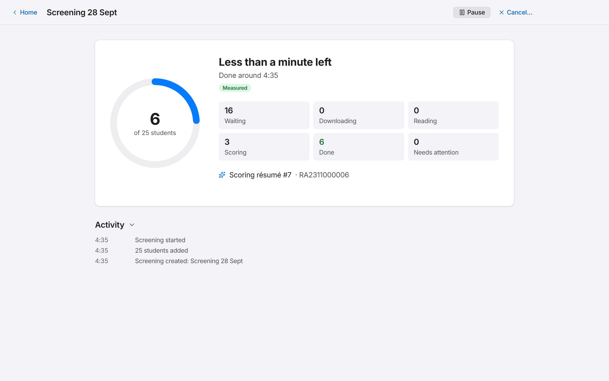
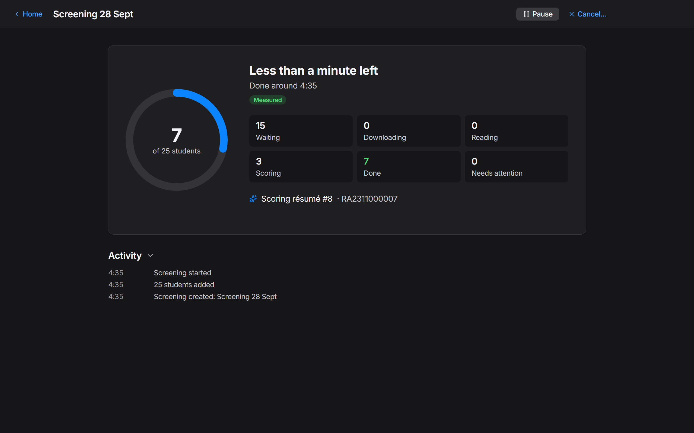
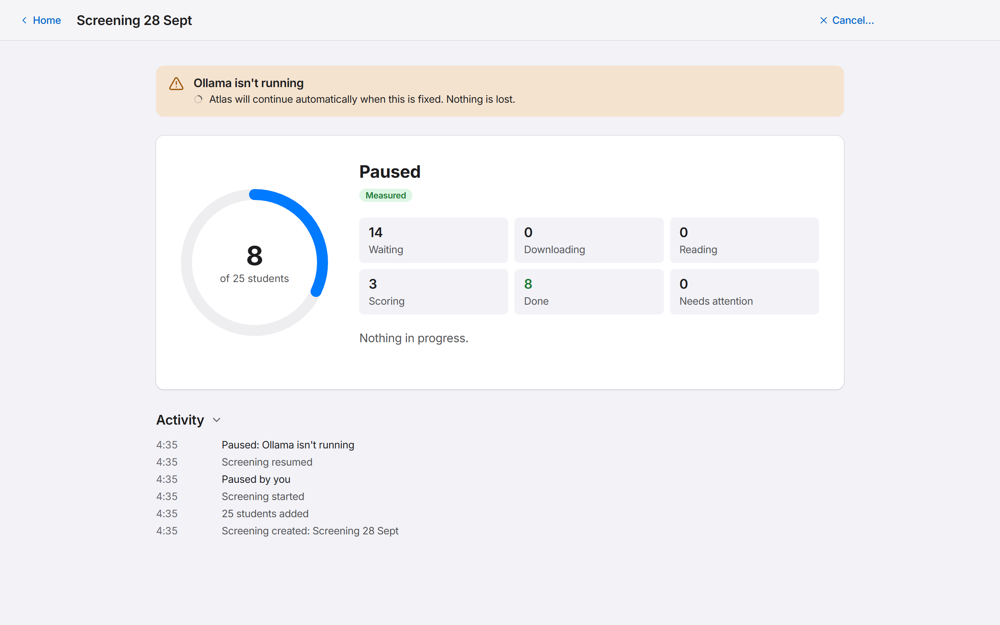
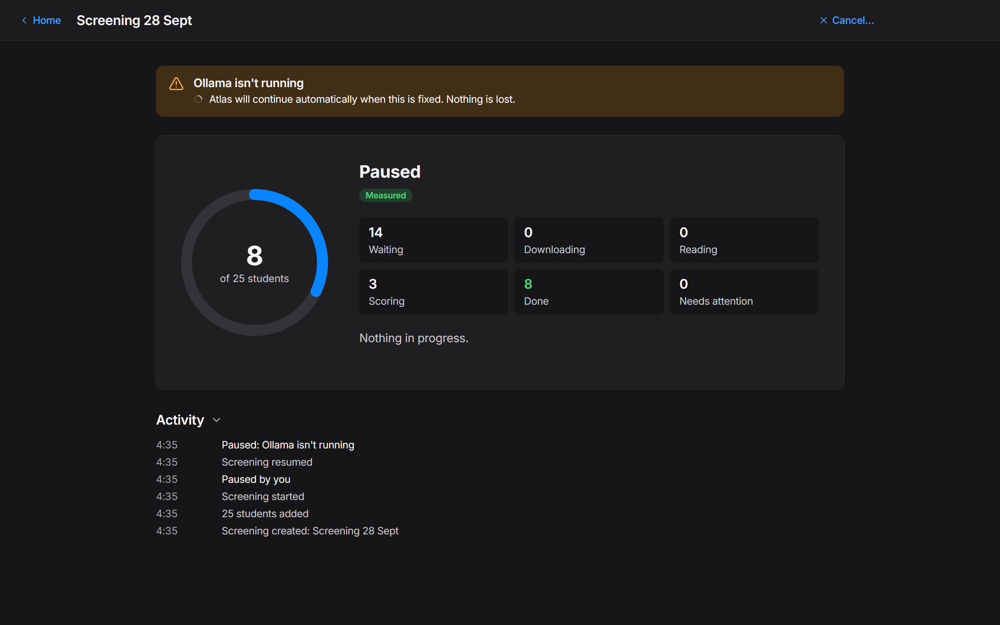
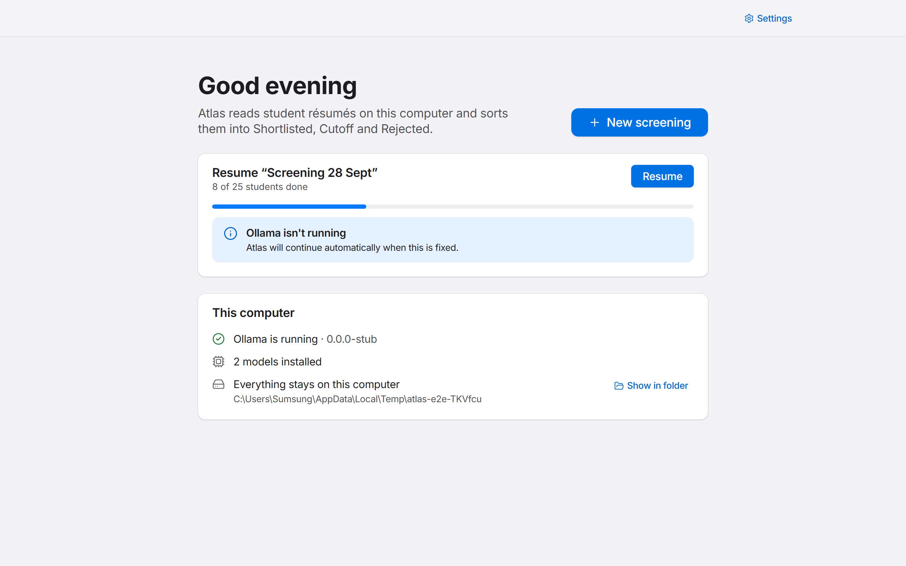
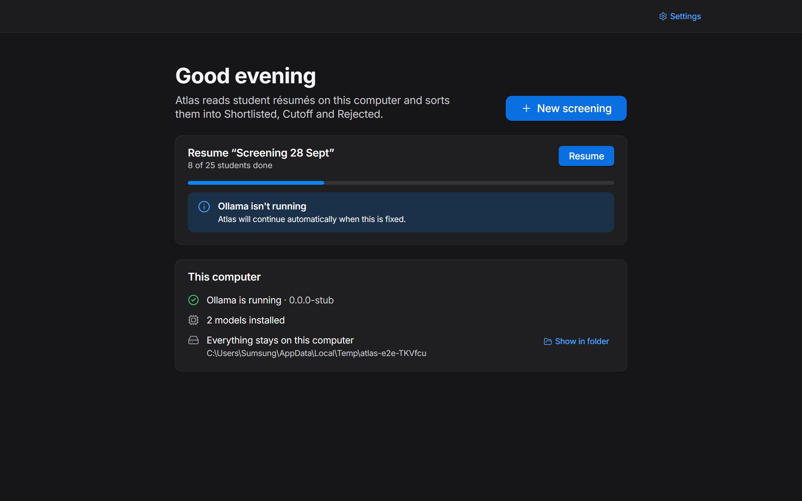
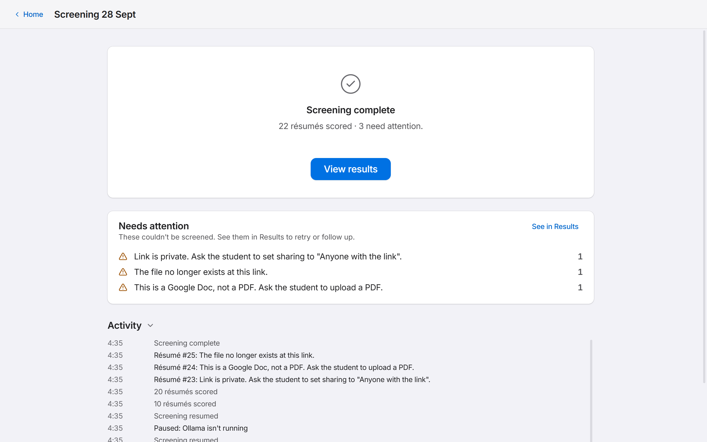
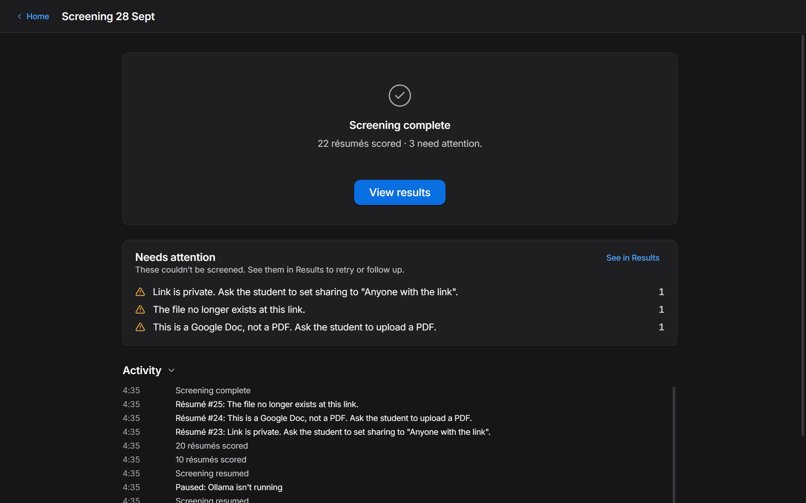

# Step 2.6 — Screen: Progress

## What was built
A screening can take hours on a laptop, so the Progress screen is built to be glanced at, left alone, and trusted.

- **The overview.** A large ring shows how many students are done. Beside it:
  - counts per stage: Waiting, Downloading, Reading, Scoring, Done, Needs attention;
  - the time left and the finish time ("About 2 h 10 min left · Done around 11:40 PM"), marked **Rough** until five résumés are scored, then **Measured**;
  - what Atlas is doing right now, by candidate number and RA number only. Names never appear on this screen, which may be visible over a shoulder.
- **Pauses.** A pause shows its exact reason. If it will fix itself (no internet, Ollama stopped), the banner says Atlas will continue automatically and shows a live check. Otherwise there's a **Resume** button.
- **Controls.** Pause, Resume and Cancel. Cancel asks first, in destructive style.
- **The rest of the screen.**
  - A quiet, collapsible activity feed lists milestones and failures, not every score.
  - "Needs attention" groups failures by reason.
  - When the run completes, a success state leads to **View results**.
  - A system notification goes out if the window isn't in front (main does this; step 2.2).

The Welcome screen's Resume card now leads here too.

| | Light | Dark |
|---|---|---|
| Running (measured estimate) |  |  |
| Paused: Ollama stopped (resumes by itself) |  |  |
| Welcome with an unfinished run |  |  |
| Complete |  |  |

## Files
| File | Purpose | Key functions / classes |
|---|---|---|
| `app/renderer/screens/Progress.tsx`, `progress.css` | The screen | `Progress`, `Live`, `PauseBanner`, `Finished`, `NeedsAttention`, `Feed`, `feedLines` |
| `engine/db.py` | Event wording the recruiter reads in the feed | `_status_event` |
| `engine/worker.py` | Same, for filtering | — |
| `app/e2e/flow.ts`, `app/e2e/progress.spec.ts` | Drive setup to Start; Progress tests | `startScreening`, `waitForStatus` |

## How it works
- **Everything on screen is the engine's.** `GET /runs/{id}/progress` returns status, pause reason and whether it's automatic, counts, display stages, what's in flight (id + RA), failures grouped by reason, and the estimate.
  - The screen refetches it after every run event (debounced by 250 ms) and every 5 s as a fallback.
  - The run's event stream (`useRunEvents`) replays the backlog on open, so the feed shows history.
- **The estimate becomes measured by itself.** After 5 scored résumés the engine switches the basis to *measured* (EWMA of this run's times), and the badge turns green. The screen shows the middle of the range as "About X left" plus the clock time. Paused time never counts.
- **Pause, Resume and Cancel** call the engine and then refresh. Cancel confirms first: "Cancel this screening? Résumés already scored are kept, and you can still see and export them. The rest won't be screened, and this screening can't be started again."
- **The feed shows milestones, not noise:**
  - run-level events (started, paused with reason, resumed, complete);
  - each failure with its reason;
  - a milestone every tenth of the list (at least every 10).

  A 400-student run shows about ten "N résumés scored" lines, not 400.

## Key decisions and why
- **The engine's event wording was rewritten for recruiters.** The feed shows the engine's `events` rows verbatim, so the wording is fixed at the source rather than translated in the UI:

  | Before | Now |
  |---|---|
  | "Run running" | "Screening started" / "Screening resumed" |
  | "Run paused: Paused by you" | "Paused by you" |
  | "Run completed" | "Screening complete" |
  | "25 candidates added" | "25 students added" |
  | "Recovered after unexpected shutdown" | "Atlas closed unexpectedly; screening paused" |
  | "filtered candidates…", "Retrying N failed candidates" | "filtered-out students…", "Retrying N students who couldn't be screened" |

  Nothing parses these strings (the CLI only reads candidate "Scored"/"Failed" events), and one server test was updated.
- **The screen names nobody.** Activity lines read "Scoring résumé #7 · RA2311000006", and a test checks that none of the fixture names appear anywhere on the screen.
- **"Needs attention" links to Results only when the run is finished,** because retrying happens there (step 2.7). While running, it says retrying is possible once screening finishes.
- **Stage colour only when it means something.** "Needs attention 0" is plain, not orange.

## Failure handling
| Situation | What happens | Candidate failed / run paused / nothing | Message shown |
|---|---|---|---|
| Ollama stops mid-run | engine pauses; the screen shows it; auto-resumes | run paused, **0 failed** | "Ollama isn't running · Atlas will continue automatically when this is fixed. Nothing is lost." |
| No internet mid-run | same | run paused | "No internet connection · Atlas will continue automatically…" |
| Recruiter pauses | Resume button | run paused | "Paused by you · Nothing is lost. Press Resume to continue where it stopped." |
| App closed during a run | on reopen: Welcome's Resume card, then Progress with Resume | run paused | "Atlas was closed" |
| Disk full, repeated errors, model removed | Resume button (these need a person) | run paused | the engine's reason (e.g. "Disk is full") |
| Pause/Resume/Cancel refused | error banner | nothing | the engine's message |

## Tests
Added **4 Playwright** tests. Totals: engine 349, Vitest 162, Playwright 24.

`progress.spec.ts` uses the real engine and the stubs with a 0.6-second model, a minimum of 15, and the 25-student fixture:
1. The ring, the stage grid and live activity ("résumé #N · RA…"). The basis turns **Measured**, with "About … left" and "Done around …". None of six fixture names appears anywhere (screenshots).
2. **Pause** shows "Paused by you" with Resume. **Resume** returns the run to `running`; the banner goes and the feed keeps the history.
3. **Ollama stopped:**
   - the banner shows "Ollama isn't running … continue automatically" with no Resume button (screenshots);
   - Welcome shows the Resume card with the reason (screenshots);
   - once Ollama is back, the run resumes by itself.
4. **Completion:**
   - "Screening complete · 22 résumés scored · 3 need attention";
   - Needs attention lists the private link, the Google Doc and the 404, in the engine's words (screenshots);
   - View results leaves Progress.

## How to try it yourself
```bash
cd app
npm run e2e -- e2e/progress.spec.ts     # 4 passed; refreshes 8 screenshots
```

## Known limitations
- **The "Scoring" stage counts résumés waiting for the model as well as the one being scored.** On a CPU laptop it usually shows 2–3, with one actually in progress. The activity line says which.
- **The ETA shows the middle of the engine's range.** The low and high bounds exist in the API but aren't on screen.
- **Cancel can't stop a model call that has already started.** The screen says "Screening cancelled" immediately; that last résumé's score still arrives (step 2.0).
- **The Welcome Resume card shows one unfinished run.** If two exist (one paused, one running), the other appears under Recent screenings.

## Concepts to learn
- **Event-driven refresh with a fallback poll:** react to the stream, and poll slowly in case a message is lost.
- **Debouncing bursts:** many events in a second cause one refetch.
- **Privacy by screen:** decide per screen who might be looking (here: ids and RA numbers only).
- **Idempotent feeds:** events carry ids, so a replayed backlog never shows duplicates.
