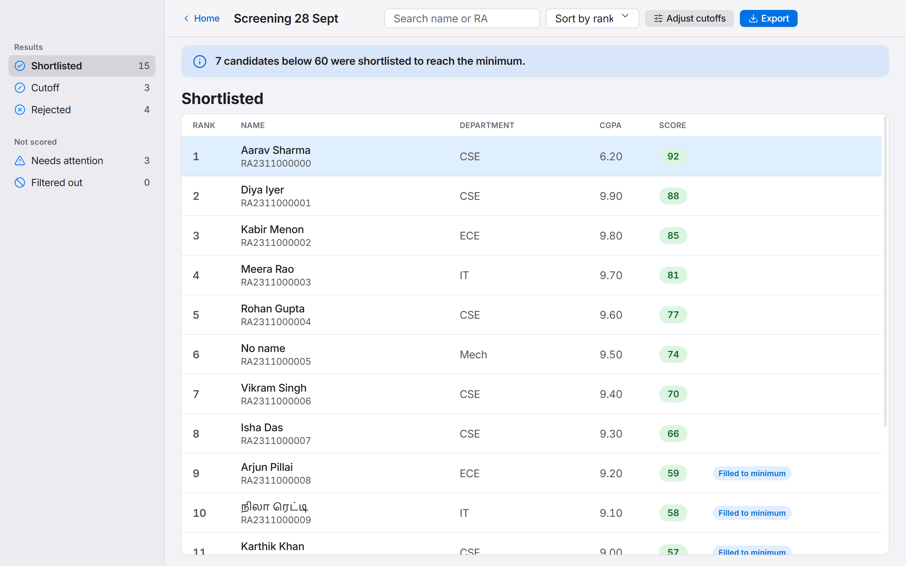
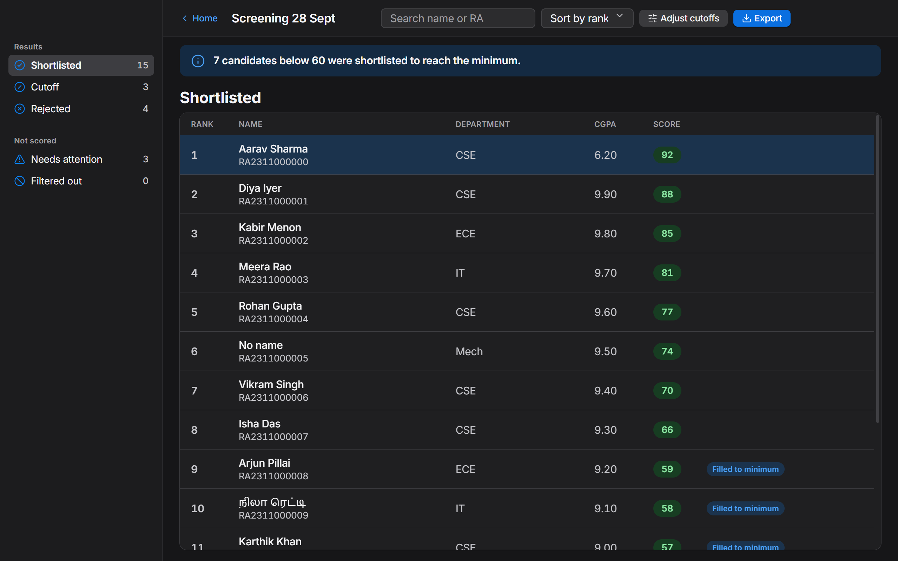
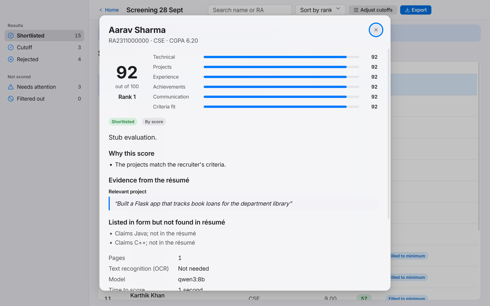
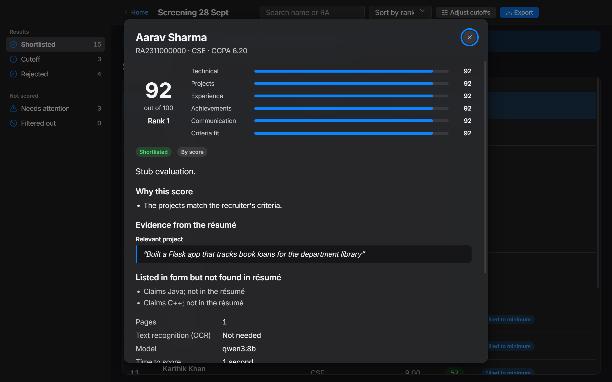
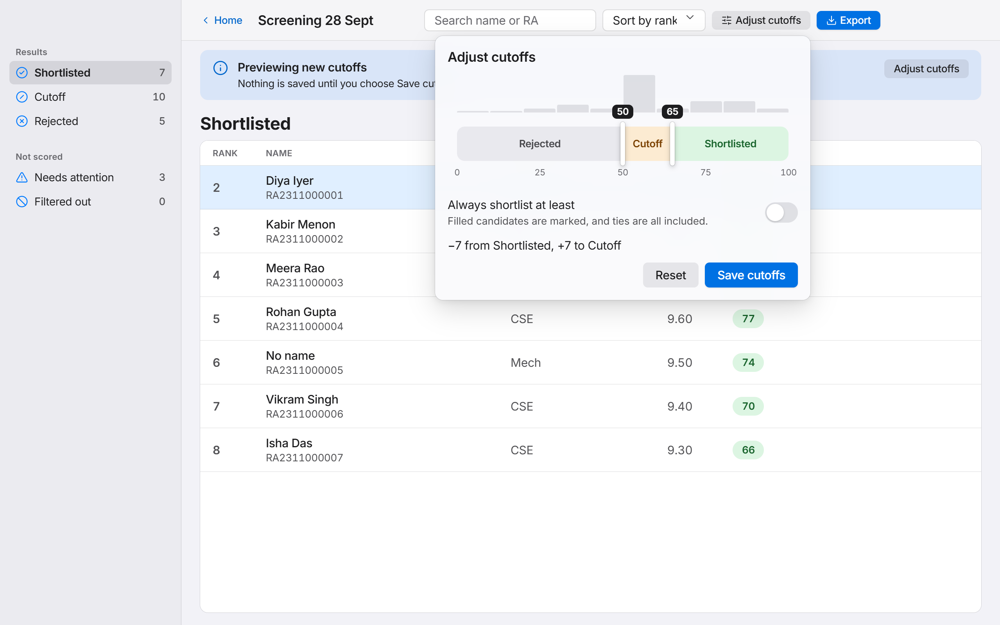
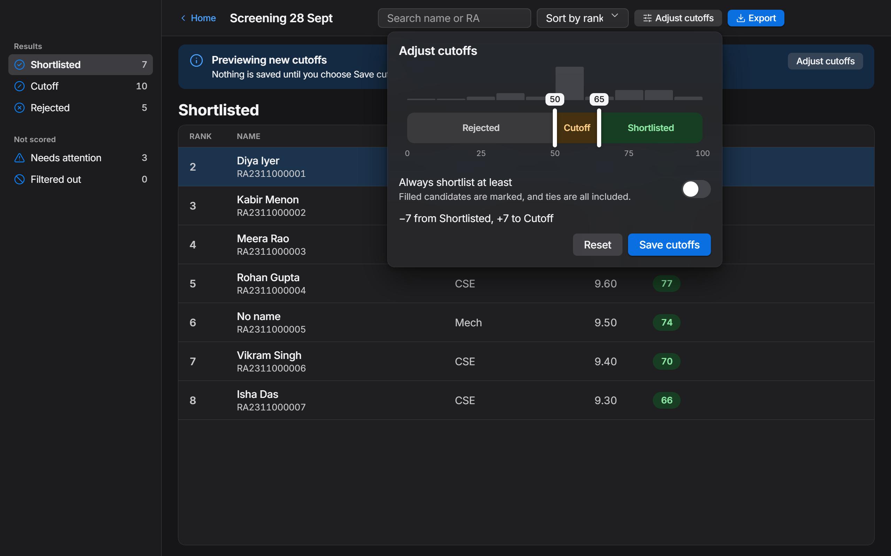
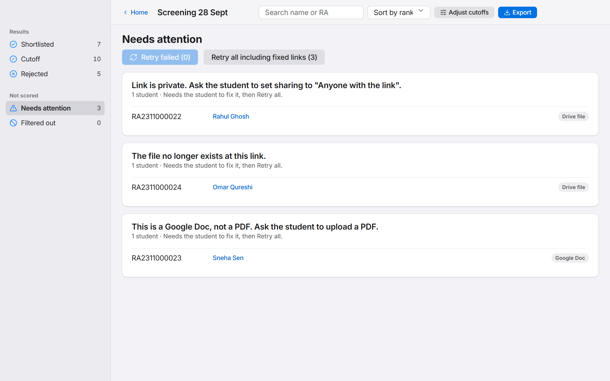
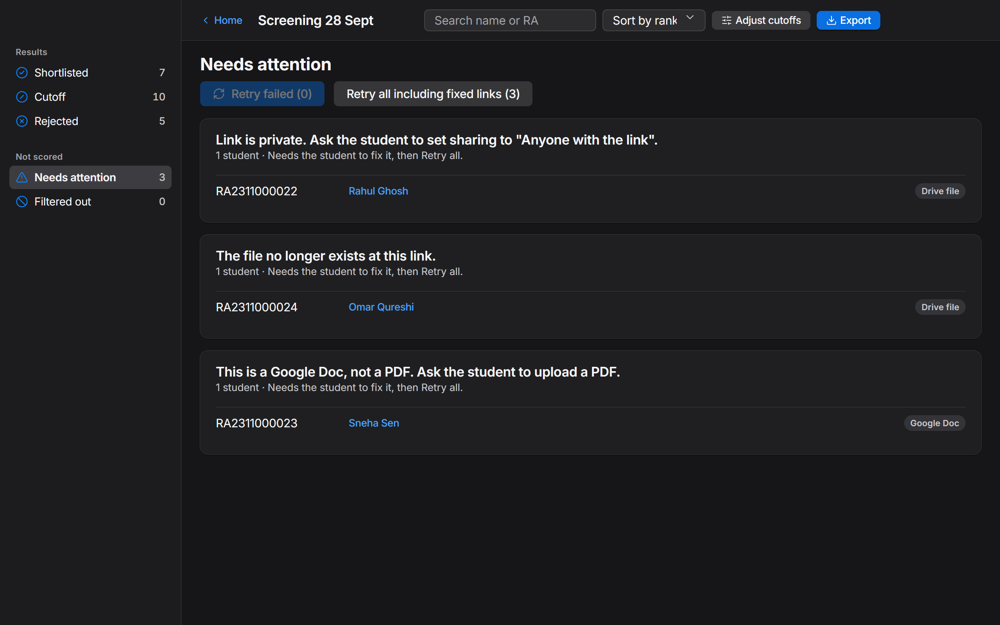
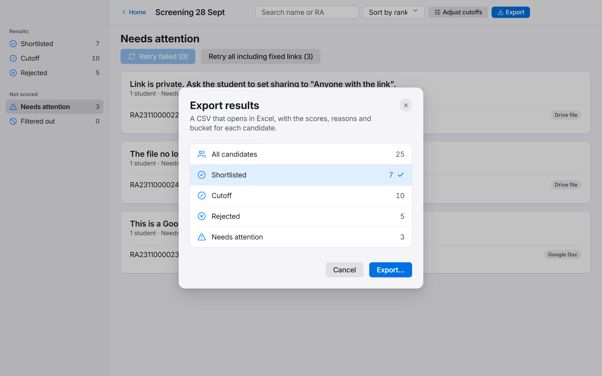
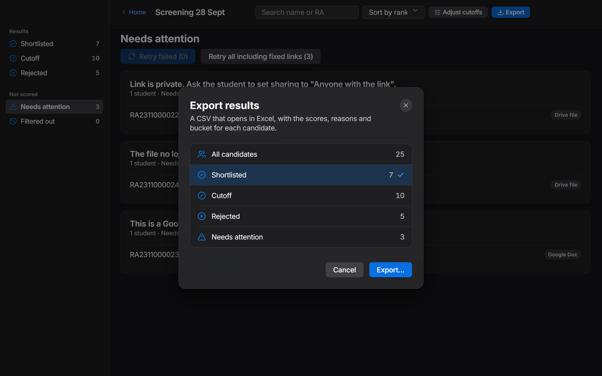

# Step 2.7 — Screen: Results

## What was built
Results is where the recruiter spends most of their time after a screening, so it is built around three questions: *who made it*, *why*, and *what happens if I move the line*.

- **Buckets in a sidebar.** Shortlisted, Cutoff and Rejected under *Results*; Needs attention and Filtered out under *Not scored*. Each shows the engine's count, which animates when it changes.
- **A fast, keyboard-friendly list.** Rank, name + RA number, department, CGPA and a score pill.
  - Badges show **Filled to minimum**, **Tie** and **Moved by you**.
  - The list is virtualised (TanStack Virtual), so 2,000 rows scroll as smoothly as 20.
  - It is a real listbox: ↑/↓, Page Up/Down, Home/End move the selection; Enter or a click opens the candidate.
- **Search and sort.** Search by name or RA number (debounced 200 ms). Sort by rank, score or name; students without a name sort last.
- **Candidate detail** (a sheet):
  - the overall score, rank and six sub-score bars;
  - why this score, evidence quoted from the résumé, and "listed in form but not found in résumé";
  - flags, résumé facts (pages, OCR, model, time to score), link type and attempts;
  - history, and **Move to…** with an optional note. A move is logged, shows "Moved by you", and always wins.
- **Adjust cutoffs** (a popover from the toolbar):
  - a score histogram above the same two-handle `ScoreBand` used in setup, plus the minimum toggle and stepper;
  - a live preview: the sidebar counts and the list change as the handles move, and the popover says what moves ("−7 from Shortlisted, +7 to Cutoff");
  - **nothing is saved** until *Save cutoffs*. Closing or *Reset* throws the preview away, and a banner says a preview is showing.
- **Export** (a sheet): pick All / Shortlisted / Cutoff / Rejected / Needs attention (with counts), then the native save dialog. A toast confirms "Exported N candidates" with **Show in folder**.
- **Needs attention:**
  - failures are grouped by the engine's reason, each saying whether it's temporary or needs the student;
  - each row shows the RA number, the name (opens the detail) and the link type;
  - **Retry failed** retries only the temporary failures;
  - **Retry all including fixed links** asks first, then retries everything and returns to Progress.
- **Empty states per bucket**, e.g. "No one reached the shortlist · Lower the shortlist score, or set a minimum, in Adjust cutoffs."

| | Light | Dark |
|---|---|---|
| Results (15 shortlisted, 7 filled to the minimum) |  |  |
| Candidate detail |  |  |
| Adjust cutoffs (live preview) |  |  |
| Needs attention |  |  |
| Export |  |  |

## Files
| File | Purpose | Key functions / classes |
|---|---|---|
| `app/renderer/screens/results/Results.tsx` | The screen: sidebar, toolbar, notes, queries, preview state | `Results`, `useDebounced` |
| `…/results/ResultList.tsx` | Virtualised listbox of rows | `ResultList`, `ScoredCells`, `FilteredCells`, `linkLabel` |
| `…/results/CandidateSheet.tsx` | Detail + override | `CandidateSheet`, `Detail`, `OverrideForm`, `History` |
| `…/results/CutoffPopover.tsx` | Live cutoffs | `CutoffPopover`, `describeDelta` |
| `…/results/ExportSheet.tsx` | Choose a view, save, toast | `ExportSheet` |
| `…/results/NeedsAttention.tsx` | Failures by reason, retry | `NeedsAttention` |
| `…/results/results.css` | Layout for all of the above | — |
| `app/renderer/design/number.tsx` | Counts that animate (sidebar) | `AnimatedNumber` |
| `app/renderer/design/overlays.tsx` | `Popover` gained a `width` prop | `Popover` |
| `engine/server.py` | Name sort puts rows without a name last | `Engine.results` |
| `app/e2e/results.spec.ts`, `…/results/results.test.tsx` | Tests | — |

## How it works
- **The renderer never decides a bucket (rule 16).** Everything comes from `GET /runs/{id}/results`: buckets, ranks, ties, fills, overrides, notes, the histogram, failure groups, the delta against the saved cutoffs, and the total. The engine computes it with `buckets.py`, exactly as the export does.
- **Two queries, so the handles feel instant:**
  - a *summary* query (`limit: 1`) for counts, notes, the histogram and the delta;
  - a *list* query (`limit: 5000`) for the rows of the selected bucket.

  Both carry the preview cutoffs as `?shortlist&band&min`. The engine treats those as "what if" and saves nothing. The preview is debounced by 150 ms, and `keepPreviousData` keeps the old rows on screen while the new ones load, so nothing flickers.
- **Saving** is `PATCH /runs/{id}/cutoffs`. The engine allows this on a completed run (only the cutoffs; model, criteria and filters stay locked, rule 11). Then both queries refresh.
- **Overrides** are `POST /runs/{id}/candidates/{cid}/override {to_bucket, note}`. The engine records the override and an event ("Moved by recruiter: shortlisted → rejected (note)"). The sheet shows the new placement, and the list and counts refresh. If a move leaves the shortlist below the minimum, the engine adds a note ("Recruiter changes leave 14 shortlisted, below the minimum of 15.") and the screen shows it.
- **Export** goes through main (`files.saveExport`): main shows the save dialog, then asks the engine to write the CSV to that path (UTF-8 with BOM, formula-escaped; rule 14). The renderer only ever sees the returned path and count.
- **Retry** is `POST /runs/{id}/retry-failed {include_permanent}`. If anything was requeued, the screen goes to Progress.

## Key decisions and why
- **Preview is the default, saving is explicit.** Moving a line is how a recruiter explores. Making every drag permanent would make exploring risky, so nothing is written until *Save cutoffs*, and a banner makes the preview state obvious.
- **"Move to…" with a note, inside the detail.** Recruiters move someone after reading why they scored as they did, so the control sits under the evidence rather than in a row menu.
- **Students without a name sort last.** An engine fix: sorting by name used to put them first, above "Aarav", where they look like a mistake.
- **"All candidates" in Export is the engine's total,** not the sidebar counts added up here. Small, but it keeps even arithmetic on buckets out of the renderer.
- **Group IDs in Needs attention are generated.** Reasons contain spaces, and an `aria-labelledby` value is a *list* of IDs, so using the reason as an ID silently gave each group no accessible name. A test caught it.

## Failure handling
| Situation | What happens | Candidate failed / run paused / nothing | Message shown |
|---|---|---|---|
| Save cutoffs refused (e.g. band above shortlist) | error in the popover; the preview stays | nothing | the engine's message ("The cutoff band must start at or below the shortlist score.") |
| Override refused (a candidate that wasn't scored) | error under the form | nothing | "Only screened candidates can be moved between buckets." |
| Export: the target file is open in Excel | sheet stays open with an error | nothing | "<file> is open in another program. Close it and export again." (engine wording) |
| Export: dialog cancelled | nothing happens | nothing | — |
| Retry while running | buttons disabled | nothing | "Retrying is possible once screening has finished." |
| Search finds nothing | empty state | nothing | "Nothing matches “…” · Search looks at names and RA numbers." |

## Tests
Added **8 Playwright**, **4 Vitest** and **1 engine** test. Totals: engine 350, Vitest 166, Playwright 32.

`results.spec.ts` runs one real screening with the stubs (25 students, shortlist 60, band 50, minimum 15). The tests run in order and share it:
1. **Counts and badges from the engine:**
   - 15 / 3 / 4, with 3 needing attention;
   - the note "7 candidates below 60 were shortlisted to reach the minimum";
   - seven "Filled to minimum" badges (screenshots).
2. **Search and sort:**
   - an RA search gives 1 row, and a nonsense search shows the empty state;
   - sort by name reorders the list, and sort by rank restores it.
3. **Keyboard and override:**
   - Home, then Enter, opens the detail with sub-score bars and a quoted evidence line (screenshots);
   - Move to Rejected with a note shows "Moved by you" and the history line;
   - the counts go 14/5, the engine's shortfall note appears, and the row is badged in Rejected.
4. **Adjust cutoffs:**
   - the arrow keys take the shortlist handle to 65, and turning the minimum off shows the delta;
   - the counts change live while the saved run still says 60 (screenshots);
   - Save cutoffs stores 65 and minimum 0.
5. **Needs attention:** three reason groups, each with its accessible name, the "Google Doc" link badge, and Retry failed (0) disabled (screenshots).
6. **Export:**
   - Shortlisted is written through the stubbed save dialog;
   - the toast and Show in folder appear;
   - the file starts with a UTF-8 BOM and has 7 rows plus the header (screenshots).
7. **Empty bucket:** "No one was filtered out".
8. **Retry all:** after confirmation, Atlas returns to Progress and the run completes again.

Vitest: `describeDelta` wording (both directions, nothing moves), plus the list rendering the engine's badges and its keyboard model (arrows, Home, Enter). Engine: `test_sort_by_name_puts_rows_without_a_name_last` (fails before the fix).

## How to try it yourself
```bash
cd app
npm run e2e -- e2e/results.spec.ts     # 8 passed; refreshes 10 screenshots
npx vitest run renderer/screens/results
```

## Known limitations
- **The list loads up to 5,000 rows per bucket in one request.** That's fine for the expected 200–2,000 students; beyond that it would need paging (the API supports `offset`).
- **Retry all cannot know which links were actually fixed.** It retries every failure, and ones still broken fail again with the same reason.
- **Show in folder in the toast lasts 8 s.** After that, the export is only findable via the path in the file dialog.
- **No multi-select.** Moving ten candidates means opening ten sheets.

## Concepts to learn
- **Preview vs commit:** a "what if" query that shares the real computation but writes nothing.
- **Virtualised lists:** only the rows on screen exist in the DOM, which is why 2,000 rows stay fast.
- **`aria-activedescendant`:** focus stays on the list while the "current" row moves, which is how native list views behave for screen readers.
- **ID references are space-separated lists:** `aria-labelledby="a b"` means two elements, so IDs must never contain spaces.
