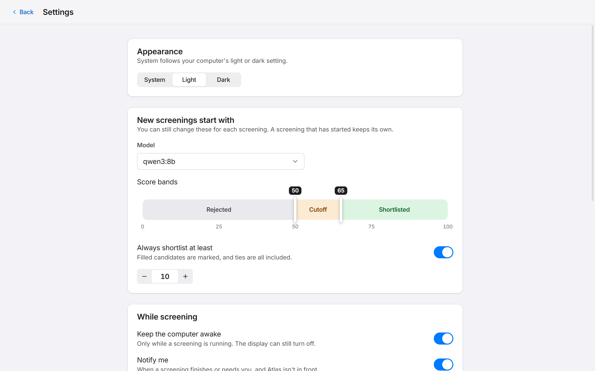
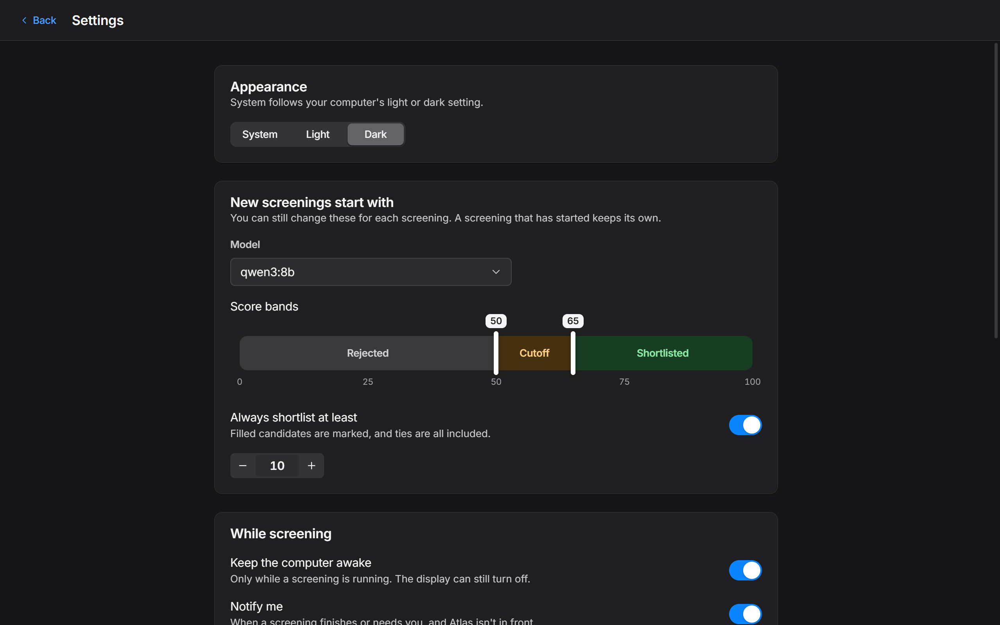
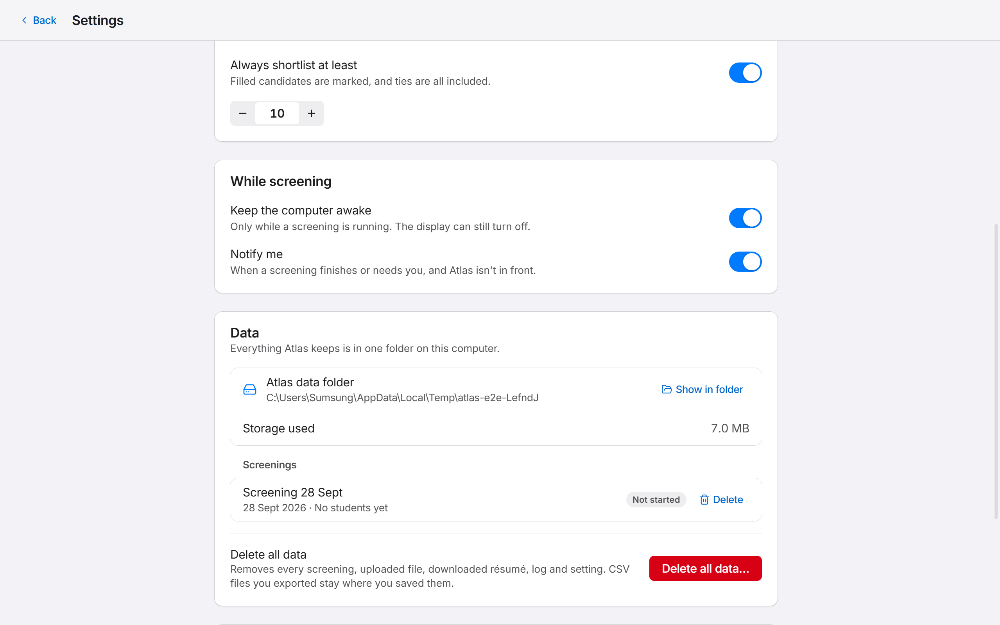
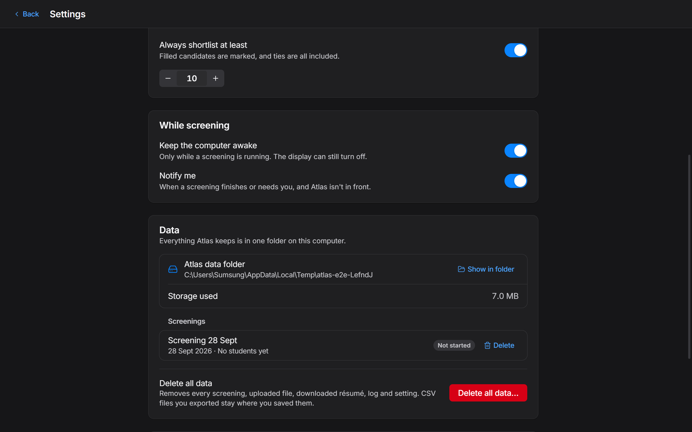

# Step 2.8 — Screen: Settings

## What was built
Settings works like System Settings on a Mac: one column of grouped cards, and every change applies the moment it's made. There's no Save button.

- **Appearance:** System / Light / Dark. The page and the native window chrome switch instantly, and the choice survives a restart.
- **New screenings start with:**
  - a default **model** ("Choose for each screening", or one of the installed models);
  - the default **score bands** (the same two-handle band as setup);
  - an optional **minimum shortlisted**.

  These defaults only prefill new screenings. A screening that has started keeps its own settings (rule 11).
- **While screening:**
  - **Keep the computer awake** (only while something is running; the display can still turn off);
  - **Notify me** (when a screening finishes or needs the recruiter and Atlas isn't in front).
- **Data:**
  - the data folder's path with **Show in folder**, and the storage used;
  - every screening with its status and a **Delete** button, which asks first. A running screening can't be deleted; its row says "Pause it to delete it".
  - **Delete all data…** opens a sheet that stays locked until the recruiter types DELETE.
- **About Atlas:**
  - the app and engine versions, whether Ollama is running (and its version), and the platform and cores;
  - **Open logs folder**, with a note that logs never contain résumé text or student details.

Settings opens from Welcome's toolbar, from the menu, and with ⌘, / Ctrl+,. **Back** returns to wherever the recruiter was, or **Home** if they came from Welcome or that screening was just deleted.

| | Light | Dark |
|---|---|---|
| Settings (top) |  |  |
| Settings (data) |  |  |

## Files
| File | Purpose | Key functions / classes |
|---|---|---|
| `app/renderer/screens/Settings.tsx`, `settings.css` | The screen | `Settings`, `Appearance`, `Defaults`, `WhileScreening`, `Data`, `WipeSheet`, `About` |
| `app/renderer/state/nav.ts` | Back never returns to a deleted screening | `forget` |
| `app/renderer/screens/setup/SetupFlow.tsx` | A started run opened in setup goes to its own screen | — |
| `app/main/runs.ts`, `main/ipc.ts`, `main/validate.ts`, `main/index.ts` | Keep awake / notify changes reach main at once | `RunWatcher.preferencesChanged`, `settingsWrite`, `IpcContext.onSettingsChanged` |
| `engine/server.py` | A new screening starts with the default model | `Engine.create_run` |
| `app/e2e/settings.spec.ts`, `app/e2e/stubs.ts` | Tests; a stand-in for "Show in folder" | `recordShellOpens`, `shellOpened` |
| `app/renderer/screens/Placeholder.tsx` | Removed: every screen now exists | — |

## How it works
- **One source of truth.** The screen reads `GET /settings` and writes `PUT /settings` with just the field that changed. The write is optimistic: React Query updates its copy first, so the switch moves and the theme changes before the engine answers. If the engine refuses, the old value comes back and a toast says why.
- **The theme follows the settings.** `App` already applies `settings.appearance` whenever it changes (page `data-theme` plus the native chrome via `app.setTheme`), so Settings only has to save it.
- **Main hears about it immediately.** Main keeps its own copy of *keep awake* and *notify* (it decides about `powerSaveBlocker` and notifications), and it used to re-read them at most every 5 s. Now, after a successful `PUT /settings` or `DELETE /data`, the IPC layer calls `RunWatcher.preferencesChanged()`: turning keep-awake off releases the blocker straight away.
- **The band saves once it settles.** Dragging a handle updates the screen at once but writes 400 ms after the last move, not on every step.
- **Defaults reach new screenings in the engine.** `POST /runs` already applied the default cutoffs and minimum. It now also sets the default model, so the Students & model step opens with it selected. It is only a preselection: the recruiter can pick another, and a model that has since been removed simply shows as not selected.
- **Deleting:**
  - `DELETE /runs/{id}` removes the run, its candidates and leftover files, then runs VACUUM so the space comes back;
  - `DELETE /data` removes everything and resets settings. The screen then resets every query, goes to Welcome and shows "All Atlas data was deleted from this computer." The theme falls back to System because the settings did.

## Key decisions and why
- **No Save button.** Recruiters expect settings to stick as they change them (macOS and Windows 11 both work this way), and a forgotten Save loses work silently.
- **Typing DELETE, not just a second button.** Deleting everything is the one action in Atlas that can't be undone and destroys hours of scoring, so it gets a deliberate, typed confirmation. Deleting one screening only needs the usual destructive Alert.
- **Exports survive.** Both delete messages say so, because the recruiter's CSVs live wherever they saved them, outside the data folder.
- **The default model is set by the engine at creation,** not chosen by the renderer. Defaults are data (rule 16), and a screening created any other way gets the same defaults.
- **The Placeholder screen is gone.** Its last use was setup opened on a run that had already started. That now goes to the run's real screen (Progress or Results), which is what the recruiter wanted anyway.

## Failure handling
| Situation | What happens | Candidate failed / run paused / nothing | Message shown |
|---|---|---|---|
| Engine refuses a setting (e.g. band above shortlist) | the value snaps back | nothing | toast with the engine's message |
| Delete a running screening | Delete is disabled; the engine would refuse anyway | nothing | "Pause it to delete it" (row); engine: "Pause or cancel this screening before deleting it." |
| Delete all while one is running | button disabled; engine refuses too | nothing | "Pause or cancel the running screening to delete data." |
| Delete all fails partway | sheet stays open | nothing | the engine's message in the sheet |
| Default model later uninstalled | Settings lists it as "(not installed)"; setup shows nothing selected | nothing | — |
| Ollama not running | About shows it; defaults still editable | nothing | "Not running" |

## Tests
Added **1 engine**, **5 Vitest** and **8 Playwright** tests. Totals: engine 351, Vitest 171, Playwright 40.

`settings.spec.ts` uses the real engine and the stubs:
1. Settings opens from Welcome and with Ctrl/⌘+comma, and Home goes back.
2. **Appearance:** Dark, then Light, then System change `<html data-theme>` at once, and the engine stores the choice.
3. **Keep awake and notify:** main's `RunWatcher` sees the new values immediately (read through the E2E hook), and they are stored.
4. **Defaults:**
   - set the model, minimum 10 and shortlist 65;
   - **New screening** creates a draft with exactly those values;
   - Students & model opens with qwen3:8b selected.
5. Screenshots, top and data section, light and dark.
6. **Delete a screening:**
   - the Alert says exports stay;
   - the run is gone from the list and from the engine, with a toast;
   - Back now says Home (the screening it came from no longer exists).
7. **About:** the Ollama and engine versions show; Open logs folder and Show in folder open the logs and data folders (recorded, not opened).
8. **Delete all data:**
   - "delet" keeps the button disabled, and "delete" enables it;
   - after deleting: Welcome, the toast, no runs, settings back to defaults, and the theme back to System.

Vitest: `nav` (Back target, `forget`, `viewForRun`), `settingsWrite`, and `RunWatcher.preferencesChanged` releasing keep-awake at once. Engine: `test_a_new_screening_starts_with_the_default_model`.

## How to try it yourself
```bash
cd app
npm run e2e -- e2e/settings.spec.ts     # 8 passed; refreshes 4 screenshots
npx vitest run renderer/state main/runs.test.ts main/validate.test.ts
```

## Known limitations
- **Storage used is the whole data folder.** There's no per-screening size, so there's no way to see which screening is big before deleting.
- **The default model isn't checked when chosen.** It's pre-checked in setup like any other model.
- **Delete all can't be undone, and there's no backup or export-everything step before it.** The typed confirmation is the only safeguard.
- **Notifications are sent by the OS.** If they're turned off for Atlas in system settings, "Notify me" can't override that, and Settings doesn't detect it.

## Concepts to learn
- **Optimistic updates:** show the change first, confirm with the server, roll back on refusal.
- **Debounced writes:** separate what the screen shows (every step) from what gets stored (once it settles).
- **Cache invalidation across processes:** main and the renderer each keep a copy of the settings, so a write must tell the other copy.
- **Proportional friction:** the harder an action is to undo, the more deliberate its confirmation.
