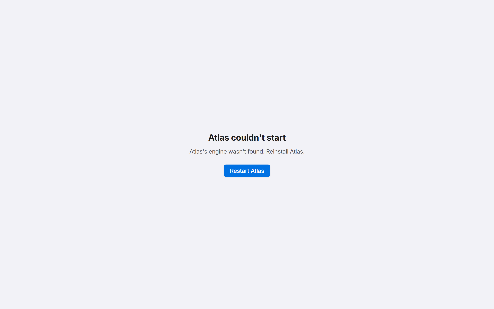
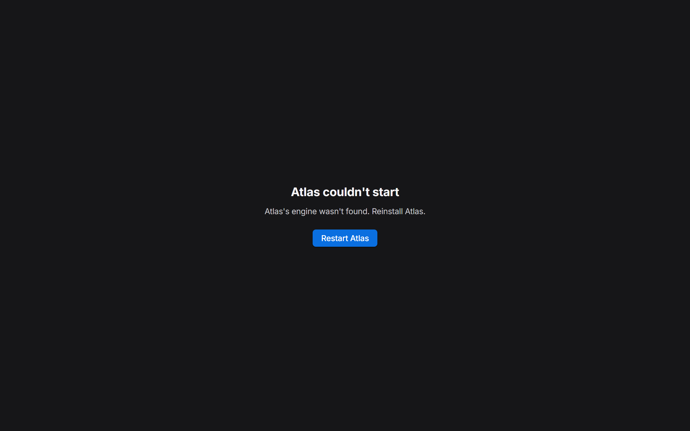
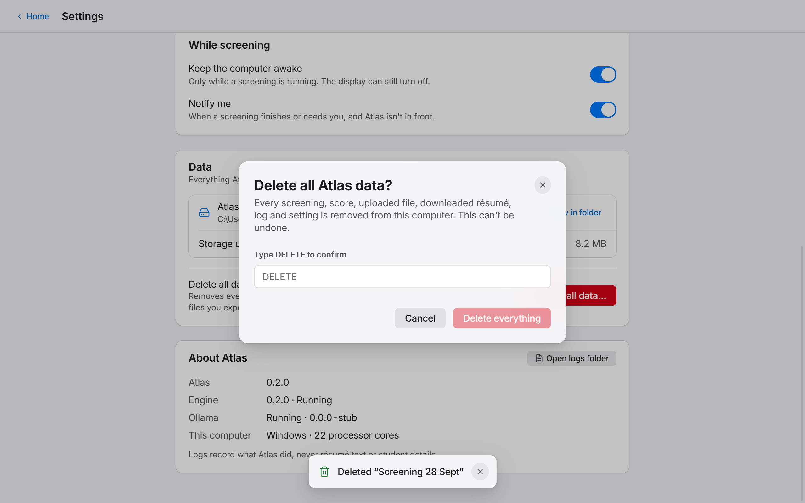
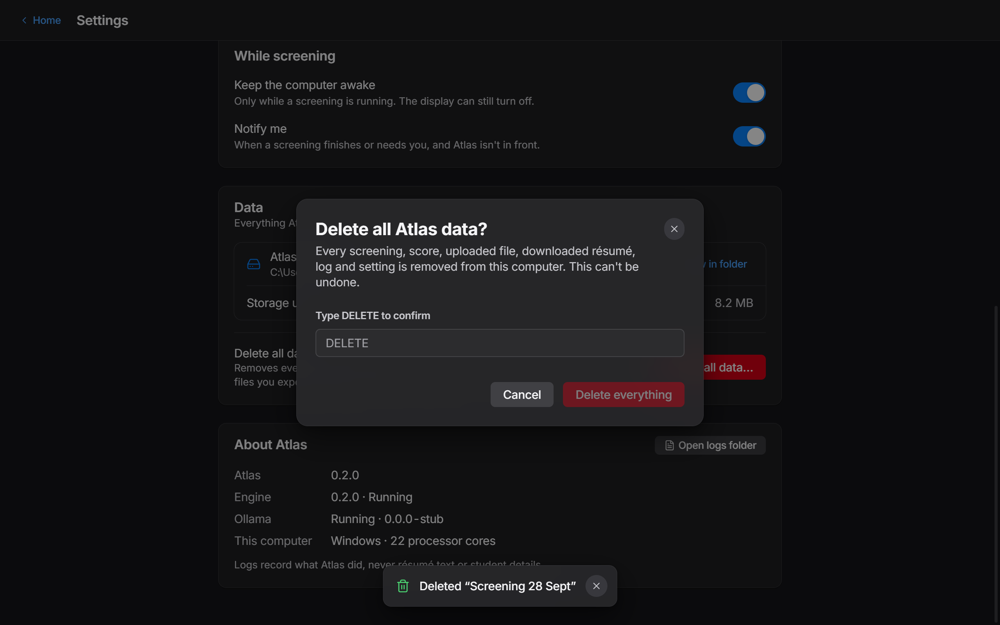
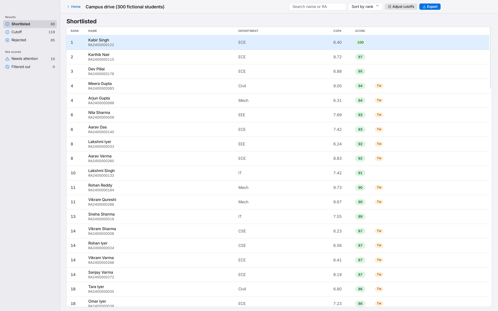
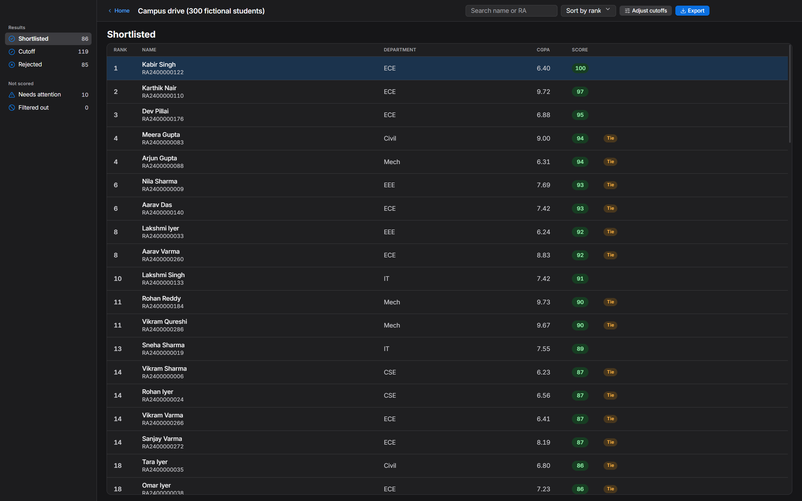

# Step 2.9 — End-to-end flows, keyboard, performance

## What was built
This step builds no new screen. It proves the app does what Phase 2 promised, as one recruiter would use it, and fixes what that proof uncovered.

- **The five end-to-end flows** (`e2e/flows.spec.ts`). Each runs in a fresh Atlas against the real engine and the stub Drive and Ollama, with fictional students only:
  1. **Happy path from an .xlsx:**
     - minimum 15, so seven "Filled to minimum" badges;
     - live cutoffs: turning the minimum off shows "−7 from Shortlisted" before anything is saved, then Save;
     - an override with a note;
     - Export All, then the file is read back: BOM, 25 rows, one "Moved by recruiter", 7 Shortlisted, and no cell starting with a formula character.
  2. **Ollama stops mid-run.** The run pauses with "Ollama isn't running", and the screen says it will continue automatically. When Ollama is back it resumes by itself and finishes 22 scored + 3 needing attention. None of the failures mentions Ollama.
  3. **Atlas is closed mid-run and reopened:**
     - the window is closed and "Close Atlas" confirmed; the run is paused "Atlas was closed";
     - on reopening, Welcome's Resume card leads to Progress, and Resume finishes the run;
     - then every candidate is checked: **25 of 25, 25 unique RA numbers, and exactly one "Scored" event per scored candidate.**
  4. **A file without a résumé link column** is refused in the pre-flight report. Continue stays disabled and nothing is added.
  5. **The theme survives a restart:** Dark in Settings, quit, reopen. The page is dark and so is the native chrome (`nativeTheme.themeSource`).
- **Keyboard only** (`e2e/keyboard.spec.ts`):
  - Welcome → Students & model → Criteria → Cutoffs → Review → Start screening with Tab, Space, Enter, the arrows, typing and Esc;
  - every stop on the way is checked to show a focus ring (`:focus-visible`);
  - the started run is checked to hold exactly what was chosen.
- **Performance** (`e2e/perf.spec.ts`, with `engine/tests/e2e_seed.py`):
  - a finished screening of **2,000 fictional students**, seeded through the engine's own state machine;
  - opening, scrolling end to end and switching buckets are measured, with long tasks counted in the page;
  - so is the time from a key press on the shortlist handle to the engine's new count appearing.
- **Full screen and a large display** (`e2e/fullscreen.spec.ts`), for PLAN's Phase 2 exit criterion ("every screen works … at 1280×800 and full screen"):
  - the test visits Welcome, Students & model, Results, the candidate sheet, Adjust cutoffs and Settings three times: at 1280×800, in real full screen (`setFullScreen`), and at 1920×1200 CSS pixels (zoomed out, since this laptop's screen is itself 1280×800 in CSS pixels);
  - each time it checks that nothing scrolls sideways, that the content column is centred and stays readable (≤ 900 px), and that the popover stays inside the window.
- **The error screen** (`e2e/errors.spec.ts`): when the engine can't start, a plain sentence and **Restart Atlas**, with screenshots.
- **Rule 16 as a test** (`tests/contracts.test.ts`): no renderer source compares a candidate score with anything, or computes buckets, ranks or sorts by score.

| | Light | Dark |
|---|---|---|
| Atlas couldn't start |  |  |
| Delete all data (typed confirmation) |  |  |
| Results on a large display (1920×1200) |  |  |

## Files
| File | Purpose | Key functions / classes |
|---|---|---|
| `app/e2e/flows.spec.ts` | The five DoD flows | `parseCsv`, `request`, `open` |
| `app/e2e/keyboard.spec.ts` | Keyboard-only setup with focus-ring checks | `tabTo` |
| `app/e2e/perf.spec.ts` | 2,000-row performance | long-task observer, in-page response timer |
| `app/e2e/errors.spec.ts` | Engine-can't-start screen | — |
| `app/e2e/fullscreen.spec.ts` | Every screen at 1280×800, full screen and 1920×1200 | `layout`, `check`, `everyScreen` |
| `app/renderer/screens/screens.css` | **Fix:** `scrollbar-gutter: stable both-edges`, so a scrolling column stays centred | — |
| `engine/tests/e2e_seed.py` | Seeds a finished fictional run through `Database` methods only | `seed`, `main` |
| `app/tests/contracts.test.ts` | Rule 16 checks | — |
| `app/renderer/design/controls.tsx` | **Bug fix:** `Stepper` no longer writes a stale value back | `Stepper` |
| `app/renderer/screens/setup/*.tsx` | **Bug fix:** each step stores the engine's reply before moving on | — |
| `app/renderer/screens/results/Results.tsx` | Preview debounce 150 → 80 ms | — |
| `app/electron.vite.config.ts`, `main/env.d.ts`, `main/index.ts` | **Bug fix:** About shows Atlas's version, not Electron's | `__ATLAS_VERSION__` |

## How it works
- **Flows share the stubs and nothing else.** Each test starts its own Atlas with its own data folder, and cleans up even when it fails. Cleanup pre-answers the "Close Atlas?" dialog, because a still-running screening would otherwise wait for a click forever. That is what made the first attempt take 7 minutes instead of 1.
- **"Lost or duplicated" is checked three ways:**
  - the results total equals the students added (25);
  - the RA numbers are unique;
  - each candidate's own event history has exactly one "Scored" event (zero for the three with broken links).

  `evaluations` is keyed by candidate, so a double score couldn't create two rows anyway. The event check catches a candidate scored twice, which would mean work done after it was already saved.
- **Performance is measured inside the page,** so Playwright's own round trips don't count:
  - a `PerformanceObserver` collects long tasks (main-thread work over 50 ms);
  - a `MutationObserver` waits for the Shortlisted count's `aria-label` to change after a key press on the handle.
- **The seeder uses the state machine.** Every one of the 2,000 goes queued → downloading → downloaded → extracted → scoring → scored (or failed), through `Database` methods only (rule 2). It takes about 4 s.

## Key decisions and why
- **The keyboard test found a real bug, and it's fixed.**
  - *What happened:* in Cutoffs, pressing → twice on the shortlist handle showed **62**. Tabbing on through the page passed the "Shortlist score" number box, whose own copy of the value still said **61**, and leaving the box wrote 61 back. The screening then started at 61. It happened in 2 of 3 runs.
  - *The cause:* `Stepper` kept a copy of its value in state, synced by an effect, so fast changes from elsewhere could leave the copy one step behind.
  - *The fix:* the box shows the real value unless the recruiter is typing, and leaving it without typing writes nothing.
  - *Related:* each setup step now stores the engine's reply (`setQueryData`) before moving on, so Review's "configure → confirm → start" can never re-save an older copy.
  - *Result:* after the fix, 3 of 3 runs pass. A recruiter could otherwise have started a screening at a cutoff one point off what they saw.
- **Live cutoff debounce 150 → 80 ms.** At 150 ms the median response was 159 ms, almost all of it waiting, and the first presses took about 250 ms. At 80 ms the median is 85–93 ms and the worst 199–222 ms across runs. The engine answers a 2,000-row results query in about 40 ms, so there was room.
- **The scrollbar pushed the column off-centre.** On a screen that scrolls (Settings), the Windows scrollbar took 10 px on the right only, so the column sat 5 px left of centre, and content jumped sideways whenever a scrollbar appeared. `scrollbar-gutter: stable both-edges` reserves the same room on both sides. The full-screen test caught it.
- **About showed "Atlas 44.4.5",** which is Electron's version: unpackaged, `app.getVersion()` falls back to Electron. The version now comes from `package.json` at build time, and a test checks it.
- **Rule 16 is enforced by a test, not by review.** The check relies on Prettier's spacing to tell `score >= 60` from JSX like `score</h3>`. A throwaway file containing `row.score >= 60 ? 'shortlisted' : 'rejected'` was shown to fail it.

## Failure handling
| Situation | What happens | Candidate failed / run paused / nothing | Message shown |
|---|---|---|---|
| Ollama stops mid-run (flow 2) | pause; auto-resume when back | run paused, **0 failed** | "Ollama isn't running · Atlas will continue automatically…" |
| Window closed mid-run (flow 3) | confirm, then pause | run paused | "Screening is running. Close Atlas?"; then "Atlas was closed" with Resume |
| File without a link column (flow 4) | refused before anything is added | nothing | "This file can't be used yet" + "No column for Résumé link…" |
| Engine can't start | error screen | nothing | "Atlas couldn't start · Atlas's engine wasn't found. Reinstall Atlas." + Restart Atlas |

## Tests
Added **12 Playwright** tests (5 flows, 1 keyboard, 2 performance, 3 full screen / large display, 1 error screen), **3 Vitest** tests (2 rule-16 contracts, 1 `Stepper`) and 1 seeding script. Totals: engine 351, Vitest 174, Playwright 52.

Measured on this Windows 11 laptop (22 cores, no GPU needed; unpackaged build):

| Measure (2,000 fictional students, 575 shortlisted) | Result |
|---|---|
| Open Results from Welcome (click → first row visible) | 236–289 ms |
| Rows in the DOM at once (virtualised) | < 60 |
| Long tasks while opening | 0 |
| Long tasks while scrolling end to end, paging, switching buckets | 0 |
| Live cutoff response, median of 8 | **85–93 ms** across runs (budget 200 ms) |
| Live cutoff response, worst of 8 (the first press also shows the preview banner) | 199–222 ms across runs (limit 300 ms) |
| Long tasks while moving cutoffs | 0 |
| Engine results query, in-process | ~40 ms |

Flow 3's own evidence line from the final full run: "scored before close: 4; after reopen: 5; final: 22 scored + 3 need attention of 25; unique RA numbers: 25; one "Scored" event per scored candidate". One more résumé finished between the test's last count and the pause (the model call in flight when Close was pressed is allowed to finish during the graceful stop). The one-"Scored"-event check shows it was not scored again after Resume.

## How to try it yourself
```bash
cd app
npm run e2e -- e2e/flows.spec.ts e2e/keyboard.spec.ts e2e/perf.spec.ts --reporter=list   # prints [perf] and [flow 3] lines
python -m engine.tests.e2e_seed some-empty-folder --count 2000                              # (repo root) a seeded data folder
```

## Known limitations
- **Performance was measured on one fast Windows machine, unpackaged.** A low-end laptop, or macOS, may be slower. The test budgets (200 ms median, 300 ms worst) will say so, but they haven't been run there.
- **The flows use stubs.** A real 8B model on a CPU takes ~141 s per résumé (smoke test 1), so the real flow 3 is "close after an hour, resume tomorrow". The logic is the same; the timing isn't exercised.
- **Flow 3 closes Atlas gracefully.** A hard kill of the whole app mid-run is covered at the engine level (`test_worker_kill`, 20 kills) but not through Electron.
- **The keyboard test covers setup.** Results and Settings are keyboard-tested only in parts (the list, the detail sheet, the cutoff handle, the switches).

## Concepts to learn
- **Tests that measure inside the page:** observers in the renderer, so the number is the user's experience, not the test tool's.
- **Derived state bugs:** a copy of a prop kept in sync by an effect can lag behind, so show the prop and hold only what the user is typing.
- **Cache coherence across steps:** store the server's answer before navigating, instead of invalidating and hoping the refetch wins.
- **Invariants as tests:** turning an architecture rule (rule 16) into a check that fails the build.
